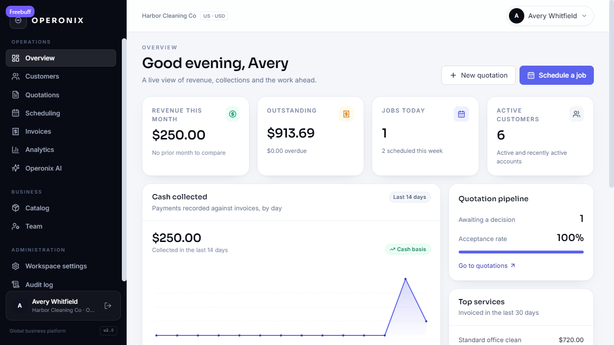
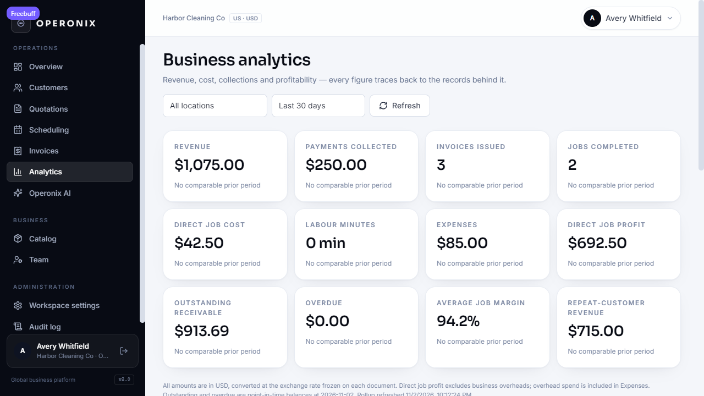
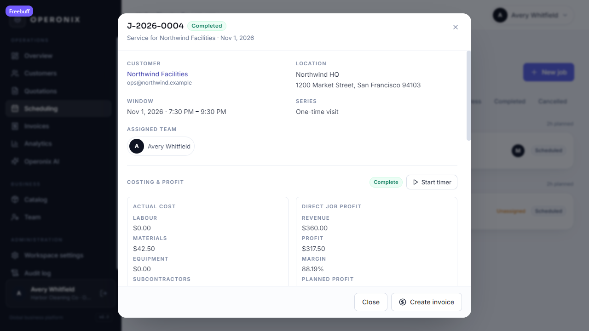
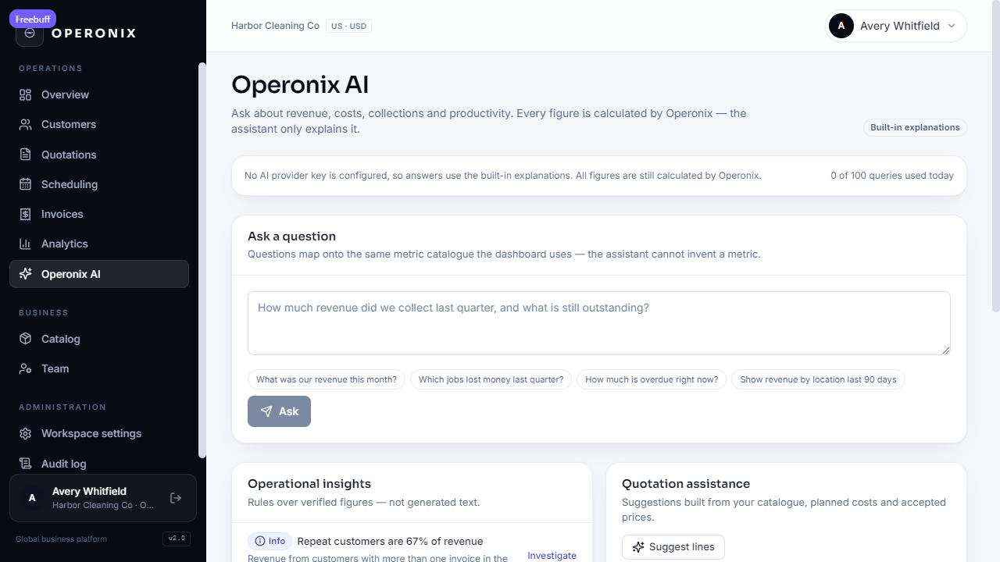
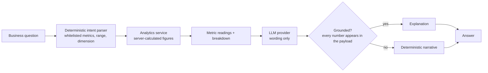
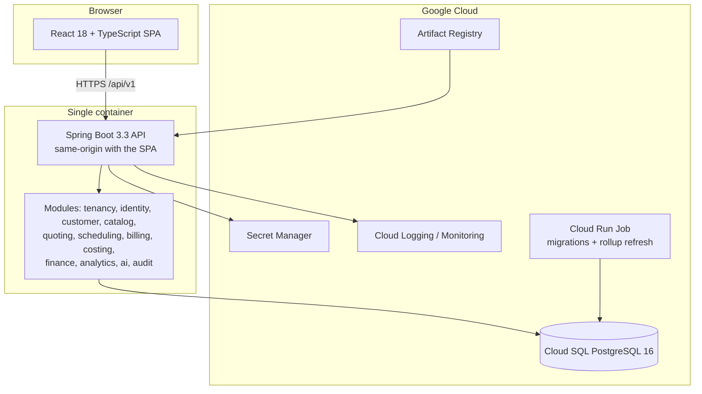

<p align="center">
  
</p>

<h1 align="center">Operonix</h1>

<p align="center"><strong>The operating platform for growing service businesses.</strong></p>

<p align="center">
  
  
  
  
  
  
</p>

---

Operonix is a multi-tenant business platform for the small service companies that keep local economies
running — cleaning and pest-control crews, rental desks, workshops, plumbers and electricians,
property maintenance teams, contractors, local logistics operators and training centres.

Most of these businesses run on a notebook for jobs, a spreadsheet for quotes, an invoicing app and a
mental model of what is profitable. Operonix puts the whole loop in one workspace:
**customer → quotation → scheduled job → invoice → payment → insight**, with the cost data underneath
that turns *“did we get paid?”* into *“did we actually make money?”*.

Industry, country, currency and tax are configuration, not code paths. The same workflow serves a
two-person cleaning company in Ohio and a multi-location contractor in Singapore.

## The problems it removes

| Today | With Operonix |
| --- | --- |
| Quotes are hand-written, inconsistently priced and slow to send | Catalogue-driven quotations with server-computed tax, discounts and totals |
| The schedule lives in someone’s head or on a whiteboard | A week board with crew assignment, conflict detection and recurring visits |
| Profitability is a guess made from a bank balance | Per-job costing from labour, materials, vendors and expenses — or an honest “cost not recorded” |
| Nobody can answer “what did we earn, and from whom?” | A metric catalogue that reconciles to the ledger, with drill-down to the source documents |
| Business software is enterprise-priced or locked to one country | One configurable platform with global money, tax and time-zone handling |

## Capabilities

| Area | What the workspace gets |
| --- | --- |
| **Customers** | Contacts, billing details, multiple service locations with access notes and an optional address time zone; archive instead of delete |
| **Catalogue** | Services with unit, duration, planned cost and tax treatment; catalogue-driven or ad-hoc pricing |
| **Quotations** | Discounts, inclusive or exclusive tax, send / accept / decline / convert, expiry, immutable issued snapshots |
| **Scheduling** | Week board, recurring series, conflict checks, status transitions; wall-clock times resolved in the **location’s** time zone, across DST boundaries |
| **Jobs & costing** | Live time logs, labour rates, vendors, material and equipment expenses, planned vs actual profitability |
| **Invoicing & payments** | Invoices from delivered work, partial payments, reversals with an audit trail, balances and ageing |
| **Analytics** | Revenue **net of collected tax**, collections, margin, productivity, repeat customers, receivables ageing, per-location comparison, drill-down |
| **Operonix AI** | Questions answered from server-calculated figures, quotation assistance and operational insights |
| **Administration** | Roles (owner / admin / manager / technician), team, financial settings, append-only audit log |

### What makes it different

1. **Industry-neutral by construction.** Vocabulary and defaults come from an industry template and a
   country profile; no trade is hardcoded into a service or a screen.
2. **Financial history is immutable.** Issued quotations and invoices keep the currency, FX rate, tax
   components and totals they were issued with. Changing a setting never rewrites the past.
3. **Profitability that refuses to lie.** Missing labour rates or costs produce “cost not recorded”
   rather than a flattering 100% margin.
4. **AI that cannot invent numbers.** The assistant maps the question to whitelisted metrics, lets the
   server calculate, and only then explains the result; a reply containing an unverified number is
   discarded.
5. **Revenue is revenue.** Collected tax is excluded from revenue and margin — it belongs to a tax
   authority, not the business.

## Screens

| Dashboard | Analytics |
| --- | --- |
|  |  |

| Job costing | Operonix AI |
| --- | --- |
|  |  |

## Business intelligence

Every figure in the product comes from a **metric catalogue** — one place that defines the formula and
the inputs each metric needs. The same catalogue feeds the API, the dashboard and the assistant, so a
number shown in the UI can always be traced to the documents behind it.

- **Revenue & collections** — revenue net of tax, payments collected, invoices issued, period comparison.
- **Profitability** — direct job cost, direct job profit, average margin.
- **Productivity** — labour minutes, jobs completed, breakdown by team member.
- **Customers & services** — repeat-customer revenue, revenue by customer and by service.
- **Receivables** — outstanding, overdue and ageing buckets, with drill-down.
- **Locations** — per-location revenue, cost and margin.

Daily rollups are rebuilt (never incremented) and refreshed when source rows change, so a retried
request cannot double-count and an invoice issued a minute ago is not invisible.

## Operonix AI



- **No text-to-SQL.** A question is mapped to metrics, dimensions and dates from the catalogue;
  anything outside it is refused with the supported subjects listed.
- **The model never computes.** It receives calculated values and is only asked to explain them.
- **Quotas before spend.** Availability and per-workspace limits are enforced before any provider call.
- **Optional by design.** With no provider key the assistant still returns the same figures with
  built-in explanations; nothing else in the product depends on it.

## Architecture

One deployable modular monolith: a Spring Boot API that also serves the React bundle, with PostgreSQL
as the only stateful dependency.



- **Requests are tenant-scoped from the authentication context**, never from a client parameter.
- **Money** flows through one deterministic calculator (currency minor units, inclusive or exclusive
  tax, per-component allocation) and is stored with the rates used at issue time.
- **Rollups** (`job_cost`, `metric_daily`) are materialised and rebuilt, so retries are safe.
- **Scheduling** stores UTC instants but interprets wall-clock input in the location’s zone, which is
  what a crew means by “nine o’clock”.

Design detail lives in [HLD](docs/HLD.md), [LLD](docs/LLD.md) and [ERD](docs/ERD.md).

## Technology stack

| Layer | Choice |
| --- | --- |
| Backend | Java 21, Spring Boot 3.3, Spring Security 6, Spring Data JPA, Bean Validation |
| Database | PostgreSQL 16, Flyway migrations (V1 → V8, additive) |
| Frontend | React 18, TypeScript 5, Vite 5, React Router 6, TanStack Query 5, Tailwind CSS |
| Auth | Short-lived JWT access tokens, rotating hashed refresh tokens with reuse detection, role-based access |
| AI | Provider-agnostic `LlmProvider` port with a Gemini adapter |
| Hosting | Cloud Run + Cloud SQL + Artifact Registry + Cloud Build + Secret Manager |
| Operations | JSON structured logs, Actuator health/readiness, Cloud Logging & Monitoring |
| Tooling | Maven (backend), npm with a committed lockfile (frontend) |

## Security and multi-tenancy

| Control | Implementation |
| --- | --- |
| Tenant isolation | Every tenant-owned row carries `tenant_id`; queries go through tenant-scoped accessors and foreign ids return `404`, never another workspace’s data |
| Authentication | Access tokens held in memory; refresh tokens rotated, hashed at rest and grouped into families with reuse detection |
| Authorization | Server-side role checks on every mutating endpoint, mirrored by route guards in the UI |
| Credentials | Secret Manager in production; the app refuses to start with a missing or development signing key under `prod` |
| Abuse protection | Shared rate limiter on authentication, per-workspace quotas on AI |
| Auditability | Append-only audit log for business changes; a separate AI query log |
| Payment safety | A retried “record payment” returns the original payment instead of taking the money twice |
| Historical integrity | Issued documents keep their currency, FX rate, tax components and totals as snapshots |

## Quick start

Prerequisites: JDK 21, Maven 3.9, Node 20+, PostgreSQL 16 (Docker is convenient).

```bash
# 1. Database
docker compose up -d db

# 2. API on http://localhost:8080 — Flyway creates and migrates the schema at startup
cd backend
mvn spring-boot:run -Dspring-boot.run.profiles=dev

# 3. Web app on http://localhost:5173 — proxies /api to :8080
cd frontend
npm install
npm run dev
```

Register the first workspace in the browser; that user becomes its `OWNER`. Onboarding asks for the
business name, country, industry, currency, time zone and language — the country seeds currency,
locale and number formatting, and legal/tax identifiers stay optional until they are needed.

### Configuration

| Variable | Default (dev) | Purpose |
| --- | --- | --- |
| `OPERONIX_DB_URL` | `jdbc:postgresql://localhost:5432/operonix` | JDBC URL |
| `OPERONIX_DB_USER` / `OPERONIX_DB_PASSWORD` | `operonix` | Database credentials |
| `OPERONIX_JWT_SECRET` | dev-only constant | HS256 key, ≥ 32 bytes; required in production |
| `OPERONIX_CORS_ORIGINS` | `http://localhost:5173` | Allowed web origins |
| `OPERONIX_AI_API_KEY` | empty | Provider key; empty means built-in explanations |
| `OPERONIX_AI_MODEL` | `gemini-2.0-flash` | Model id |
| `OPERONIX_AI_ENABLED` | `true` | Kill switch for the provider call path |
| `OPERONIX_ANALYTICS_RUN_ON_STARTUP` | `false` | Run a rollup refresh on boot (Cloud Run Job) |
| `OPERONIX_API_DOCS` | `true` (dev) | Swagger UI at `/swagger-ui.html` |

Production reads credentials from Secret Manager and reaches Cloud SQL through its socket; no secret is
ever committed, logged or shipped to the browser. Full matrix:
[docs/GOOGLE_CLOUD_DEPLOYMENT.md](docs/GOOGLE_CLOUD_DEPLOYMENT.md).

## Tests and builds

```bash
# Backend: unit + integration tests on embedded PostgreSQL 16 with the real Flyway migrations
cd backend && mvn test          # 81 tests, 0 failures

# Frontend: type-check and production build
cd frontend && npm run typecheck && npm run build

# End-to-end lifecycle against a running API
cd frontend && node scripts/smoke.mjs
```

The regression suites cover inclusive/exclusive tax, zero-decimal currencies, FX snapshots, immutable
documents, payment idempotency, location time zones across DST, costing idempotency, metric
reconciliation, tenant isolation and AI quota/degradation behaviour.

## Deployment

Operonix packages as **one container** serving the SPA and API from the same origin, designed for
**Cloud Run** with **Cloud SQL**, **Artifact Registry**, **Cloud Build**, **Secret Manager** and Cloud
Logging/Monitoring.

```bash
cp deploy/gcp/.env.example deploy/gcp/.env   # PROJECT_ID, REGION, ENV
./deploy/gcp/deploy.sh bootstrap --yes       # Windows: .\deploy\gcp\deploy.ps1 bootstrap -Yes
./deploy/gcp/deploy.sh build                 # Cloud Build → Artifact Registry
./deploy/gcp/deploy.sh job --yes             # migrate-only Cloud Run job
./deploy/gcp/deploy.sh migrate               # Flyway before traffic moves
./deploy/gcp/deploy.sh deploy --yes          # new Cloud Run revision
./deploy/gcp/deploy.sh smoke                 # post-deploy checks
```

- Walkthrough: [deploy/gcp/README.md](deploy/gcp/README.md) · Go-live gates:
  [docs/PRODUCTION_CHECKLIST.md](docs/PRODUCTION_CHECKLIST.md)
- Operations and rollback: [docs/OPERATIONS_RUNBOOK.md](docs/OPERATIONS_RUNBOOK.md) · Backups and
  restore: [docs/DISASTER_RECOVERY.md](docs/DISASTER_RECOVERY.md)
- Infrastructure as code (not applied): [infra/terraform](infra/terraform/README.md)

**Nothing has been deployed.** No Google Cloud resource exists and no image has been pushed from this
project yet.

## Roadmap and status

| Phase | Scope | Status |
| --- | --- | --- |
| Core platform | Customers, catalogue, quotations, scheduling, invoicing, payments, team, audit, dashboard | ✅ implemented and tested |
| Global foundation | Industry-neutral onboarding, multi-workspace identity, refresh-token families, shared rate limiting, design system | ✅ implemented and tested |
| Financial foundation | Currency-aware precision (incl. JPY), legal entities, business locations, tax profiles and components, document numbering, FX snapshots | ✅ implemented and tested |
| Costing | Work logs, labour rates, vendors, expenses, job cost rollup, planned vs actual profit | ✅ implemented and tested |
| Analytics | Metric catalogue, daily rollups, revenue/margin/productivity/receivables, location comparison, drill-down | ✅ implemented and tested |
| Operonix AI | Grounded natural-language reporting, quotation assistance, insights, quotas and audit | ✅ implemented and tested |
| Reliability hardening | Payment reversal trail, concurrency-safe rollups, **location time-zone scheduling**, **payment idempotency**, **tax-exclusive revenue** | ✅ implemented and tested |
| Deployment | Container, Cloud Run/Cloud SQL packaging, Terraform, CI with Workload Identity Federation | 🟡 prepared and locally verified; not deployed |
| Next | Payment capture, email/SMS delivery, customer portal, attachments, automated browser suite | ⬜ planned |

Known gaps are tracked in [memory.md](memory.md): no card capture, no email/SMS delivery, no
attachments, one language catalogued (formatting is locale-aware), no automated browser suite yet, and
no invitation flow.

## Project layout

```
backend/         Spring Boot API (modular monolith: tenancy, identity, customer, catalog, quoting,
                 scheduling, billing, costing, finance, analytics, ai, reporting, audit)
frontend/        React SPA (api/, auth/, components/, pages/, lib/, i18n/)
docs/            HLD, LLD, ERD, design system, deployment, operations, decision records
deploy/gcp/      deploy.sh / deploy.ps1 / .env.example / README
infra/terraform/ Cloud Run, Cloud SQL, Artifact Registry, Secret Manager, IAM
.github/         CI and Workload-Identity-Federation deployment workflows
memory.md        single source of truth for progress and handover
compose.yaml     local PostgreSQL
```

## Contributing

1. Read [memory.md](memory.md) and the relevant design document before changing behaviour.
2. Keep migrations additive and never rewrite an issued financial document.
3. Run `cd backend && mvn test` and `cd frontend && npm run build` before opening a pull request.
4. Describe the user-visible behaviour and the tests that prove it.

## License

No license has been chosen yet, so all rights are reserved by default. Add a `LICENSE` file before
redistributing or accepting external contributions.

---

**Documentation:** [HLD](docs/HLD.md) · [LLD](docs/LLD.md) · [ERD](docs/ERD.md) ·
[Design system](docs/DESIGN_SYSTEM.md) · [Globalization](docs/FRONTEND_GLOBALIZATION.md) ·
[Industry neutrality](docs/INDUSTRY_NEUTRALITY.md) · [Product evolution](docs/product-evolution/README.md)
