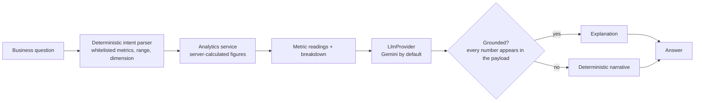
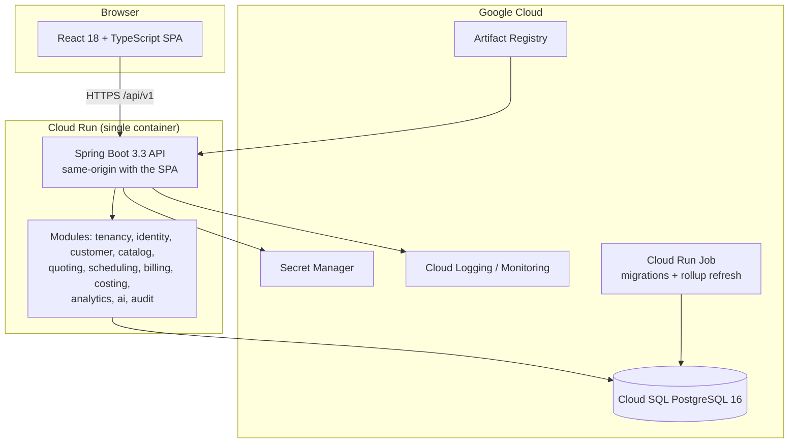
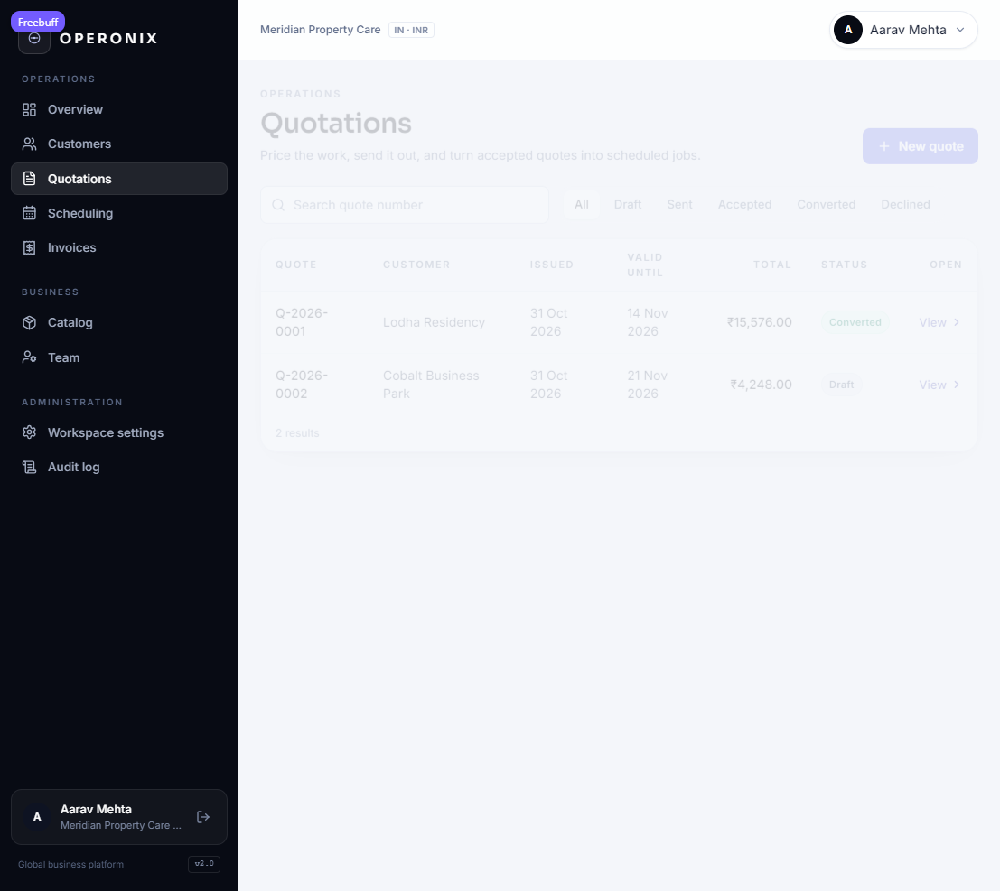
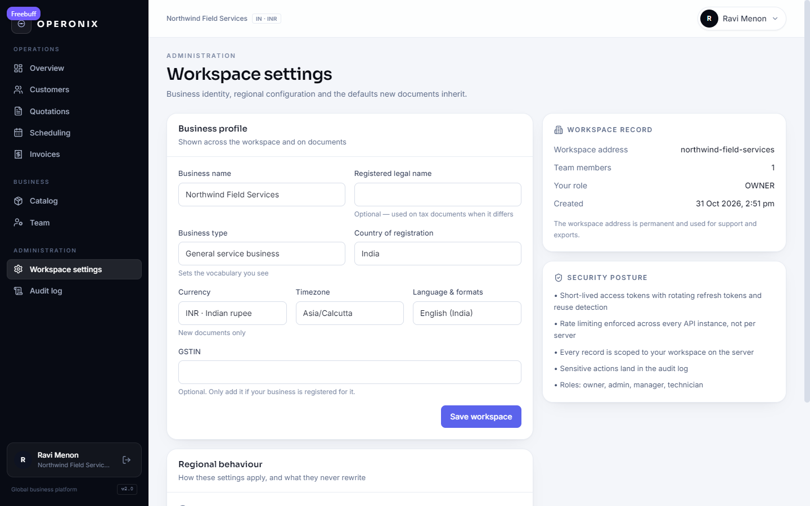
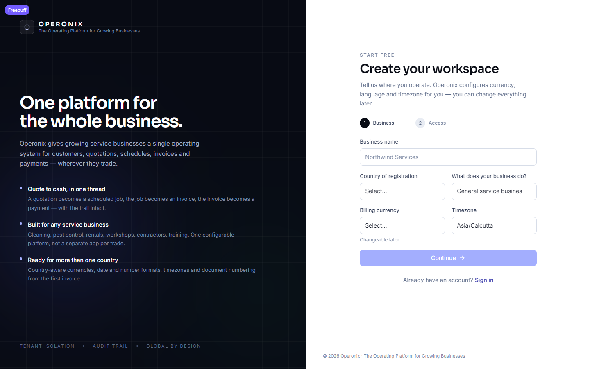
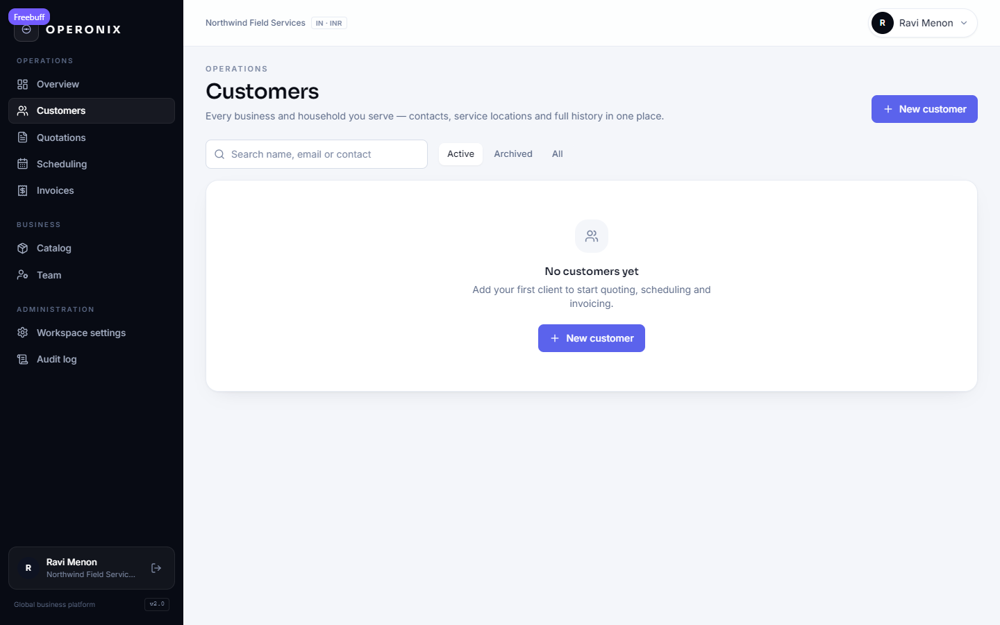

<p align="center">
  
</p>

<h1 align="center">Operonix</h1>

<p align="center"><strong>The Operating Platform for Growing Businesses.</strong></p>

<p align="center">
  <a href="#quick-start"></a>
  <a href="#quick-start"></a>
  <a href="#quick-start"></a>
  <a href="#quick-start"></a>
  <a href="#status"></a>
  <a href="docs/GOOGLE_CLOUD_DEPLOYMENT.md"></a>
</p>

---

Operonix is a multi-tenant business operating platform for the small service businesses that run the
world's local economy and are still served by spreadsheets, WhatsApp threads and paper invoices:
cleaning and pest-control crews, equipment rental desks, auto repair shops, plumbers and
electricians, property maintenance teams, contractors, local logistics operators and training
centres.

One workspace covers the whole lead-to-cash loop — **customer → quotation → scheduled job →
invoice → payment → insight** — with the costing data underneath it that turns "did we get paid?" into
"did we actually make money?".

Industry is configuration, not a code path. A workspace picks an industry template, country,
currency, locale and tax profile; the workflow, pricing engine and tenant isolation are identical for
every business on the platform.

## Contents

- [The problem](#the-problem)
- [What Operonix does](#what-operonix-does)
- [Who it is for](#who-it-is-for)
- [Business Intelligence](#business-intelligence)
- [Operonix AI](#operonix-ai)
- [Architecture](#architecture)
- [Technology stack](#technology-stack)
- [Screens](#screens)
- [Quick start](#quick-start)
- [Tests and builds](#tests-and-builds)
- [Deployment](#deployment)
- [Security and multi-tenancy](#security-and-multi-tenancy)
- [Roadmap and status](#roadmap-and-status)
- [Project layout](#project-layout)
- [Contributing](#contributing)
- [License](#license)

## The problem

A five-person service business typically runs on four disconnected tools: a notebook for jobs, a
spreadsheet for quotes, an invoicing app and a mental model of which jobs are profitable. The
software that could replace all of it is either enterprise-priced, built for a single vertical, or
locked to one country's tax and currency rules.

The result is the same everywhere: quotes take hours, the schedule lives in someone's head, and
nobody can say which services or customers actually make money.

## What Operonix does

| Capability | What the workspace gets |
| --- | --- |
| **Customers and locations** | Contacts, billing details, multiple service locations with access notes; archive instead of delete |
| **Catalog and pricing** | Services or items with unit, duration, planned cost and tax treatment; catalogue-driven quoting |
| **Quotations** | Catalogue or ad-hoc lines, discounts, server-computed tax in inclusive or exclusive mode, send/accept/decline/convert, expiry |
| **Scheduling** | Week board, workforce assignment with conflict detection, recurring series, status transitions, actual duration |
| **Jobs and costing** | Live time logs, vendor and subcontractor costs, material and equipment costs, expenses, planned vs actual profitability |
| **Invoicing and payments** | Invoices from completed jobs, partial payments, reversals, balances, ageing, void with reason |
| **Business Intelligence** | Revenue and collections trends, job margin, employee productivity, recurring customers, outstanding and overdue, location comparison |
| **Operonix AI** | Natural-language questions answered from server-calculated figures, quotation assistance, operational insights |
| **Administration** | Roles (owner/admin/manager/technician), team management, workspace and financial settings, append-only audit log |
| **Global money model** | Legal entities, business locations, tax profiles with components, inclusive/exclusive pricing, FX snapshots, configurable document numbering |

### Differentiators

1. **Industry-neutral by construction.** Terminology, defaults and onboarding come from a template
   and a country profile; no business type is hardcoded into a service or a screen.
2. **Financial history is immutable.** Issued quotations and invoices keep the currency, FX rate, tax
   components and totals they were issued with. Changing a workspace setting never rewrites a
   historical document.
3. **Profitability that refuses to lie.** If labour rates or material costs are missing, Operonix
   reports "cost not recorded" instead of a flattering 100% margin.
4. **AI that cannot invent numbers.** The assistant converts a question into a whitelisted metric
   request, lets the server calculate, and only then explains the result.

## Who it is for

- **Field-service operators** — cleaning, pest control, plumbing, electrical, HVAC, property
  maintenance, landscaping.
- **Asset and equipment businesses** — rental desks, workshops, auto repair, machine servicing.
- **Project and contract businesses** — construction contractors, renovation crews, local logistics,
  independent training centres.
- **Multi-location and multi-entity operators** who need one place to see several branches, currencies
  and tax profiles.

## Business Intelligence

The analytics module is built on a **metric catalogue**: every figure has a documented formula and a
declared set of required inputs, and the same catalogue feeds the API, the UI and the assistant.

| Metric family | Examples |
| --- | --- |
| Revenue and collections | Revenue, payments collected, invoices issued, previous-period comparison |
| Profitability | Direct job cost, direct job profit, average job margin |
| Productivity | Labour minutes, jobs completed, breakdown by team member |
| Customers | Repeat-customer revenue, revenue by customer and by service |
| Receivables | Outstanding receivable, overdue amount, ageing buckets (0–30/31–60/61–90/90+) |
| Locations | Per-location revenue, cost and margin |

Daily rollups (`metric_daily`) are maintained incrementally and idempotently by a refresh job that can
run in-process or as a **Cloud Run Job**; point-in-time metrics read live source rows so they can never
drift from the ledger. Every dashboard number is drilled down to the invoices, jobs or customers behind
it, in the reporting currency, with the currency conversion stated explicitly.

## Operonix AI



- **No text-to-SQL.** The question is mapped to metrics, dimensions and dates from the catalogue;
  anything outside it is rejected with the supported subjects listed.
- **The model never computes.** It receives already-calculated values and is only asked to explain
  them; a reply that contains a number not present in the payload is discarded.
- **Quotas before spend.** Availability and daily limits are enforced per tenant before any provider
  call; usage and every question are audited.
- **Optional by design.** With no provider key the assistant still returns the same figures with
  template explanations. No other feature depends on it.

## Architecture

One deployable modular monolith — a Spring Boot API that also serves the React bundle — with
PostgreSQL as the only stateful dependency.



- **Requests** are tenant-scoped from the authentication context, never from a client parameter.
- **Money** is calculated with a single deterministic calculator (currency minor units, inclusive or
  exclusive tax, per-component allocation) and stored with snapshots of the rates used.
- **Rollups** (`job_cost`, `metric_daily`) are materialised, rebuilt rather than incremented, so a
  retried request cannot double-count.
- Design detail: [HLD](docs/HLD.md) · [LLD](docs/LLD.md) · [ERD](docs/ERD.md) · design system
  [docs/DESIGN_SYSTEM.md](docs/DESIGN_SYSTEM.md)

## Technology stack

| Layer | Choice |
| --- | --- |
| Language / runtime | Java 21 |
| Backend | Spring Boot 3.3, Spring Security 6, Spring Data JPA, Bean Validation |
| Database | PostgreSQL 16, Flyway migrations (V1 → V6, additive) |
| Frontend | React 18, TypeScript 5, Vite 5, React Router 6, TanStack Query 5 |
| Styling | Tailwind CSS with a documented token set and component primitives |
| Auth | JWT access tokens in memory, rotating hashed refresh tokens, role-based access |
| AI | Provider-agnostic `LlmProvider` port with a Gemini adapter |
| Hosting | Cloud Run + Cloud SQL + Artifact Registry + Cloud Build + Secret Manager |
| Ops | JSON structured logs, Actuator health/readiness, Cloud Monitoring |
| Tooling | Maven (backend), npm with a committed lockfile (frontend) |

## Screens

| Dashboard | Quotations | Workspace settings |
| --- | --- | --- |
|  |  |  |

| Onboarding | Empty customers |
| --- | --- |
|  |  |

## Quick start

Prerequisites: JDK 21 and Maven 3.9 (or the bundled `scripts/windows/setup-toolchain.ps1`),
Node 20+, PostgreSQL 16 (Docker is convenient).

```bash
# 1. Database
docker compose up -d db

# 2. API on http://localhost:8080 (Flyway creates and migrates the schema at startup)
cd backend
mvn spring-boot:run -Dspring-boot.run.profiles=dev

# 3. Web app on http://localhost:5173 (proxies /api to :8080)
cd frontend
npm install
npm run dev
```

Register the first workspace in the browser; that user becomes its `OWNER`. Onboarding asks for the
business name, country, industry, currency, timezone and language — country selection seeds the rest,
and legal/tax identifiers stay optional until the workspace needs them.

### Configuration

| Variable | Default (dev) | Purpose |
| --- | --- | --- |
| `OPERONIX_DB_URL` | `jdbc:postgresql://localhost:5432/operonix` | JDBC URL |
| `OPERONIX_DB_USER` / `OPERONIX_DB_PASSWORD` | `operonix` | Database credentials |
| `OPERONIX_JWT_SECRET` | dev-only constant | HS256 key, ≥ 32 bytes; the app refuses to start without one and rejects the dev value under `prod` |
| `OPERONIX_CORS_ORIGINS` | `http://localhost:5173` | Allowed web origins |
| `OPERONIX_AI_API_KEY` | empty | Provider key for Operonix AI; empty means built-in explanations |
| `OPERONIX_AI_MODEL` | `gemini-2.0-flash` | Model id for new conversations |
| `OPERONIX_AI_ENABLED` | `true` | Global kill switch for the provider call path |
| `OPERONIX_ANALYTICS_RUN_ON_STARTUP` | `false` | Run a rollup refresh when the process starts (Cloud Run Job) |
| `OPERONIX_API_DOCS` | `true` (dev) | Swagger UI at `/swagger-ui.html` |

In production the database is reached through the Cloud SQL socket and `OPERONIX_DB_PASSWORD` and
`OPERONIX_JWT_SECRET` come from **Secret Manager**; the AI key follows the same path. No credential is
ever committed, logged or shipped to the browser. Full matrix:
[docs/GOOGLE_CLOUD_DEPLOYMENT.md](docs/GOOGLE_CLOUD_DEPLOYMENT.md).

## Tests and builds

```bash
# Backend: unit + integration tests on embedded PostgreSQL 16 with real Flyway migrations
cd backend && mvn verify          # last run: 66 tests, 0 failures

# Frontend: type-check and production build
cd frontend && npm run build      # tsc -b && vite build

# Optional: manual API walkthrough / reviewable demo workspace
cd frontend && node scripts/smoke.mjs
cd frontend && node scripts/demo-seed.mjs
```

The financial regression suites (`FinancialFoundationIT`, `CostingFlowIT`, `AnalyticsFlowIT`,
`AiFlowIT`) cover inclusive/exclusive tax, zero-decimal currencies, FX snapshots, immutable historical
documents, cost roll-up idempotency, metric reconciliation and AI quota/degradation behaviour.

## Deployment

The application is packaged as **one container** serving the SPA and API from the same origin, deployed
to **Cloud Run** with **Cloud SQL PostgreSQL 16**, **Artifact Registry**, **Cloud Build**, **Secret
Manager** and Cloud Logging/Monitoring.

```bash
cp deploy/gcp/.env.example deploy/gcp/.env   # PROJECT_ID, REGION (default asia-south1), ENV
./deploy/gcp/deploy.sh bootstrap --yes       # Windows: .\deploy\gcp\deploy.ps1 bootstrap -Yes

./deploy/gcp/deploy.sh build                 # Cloud Build → Artifact Registry
./deploy/gcp/deploy.sh job --yes             # migrate-only Cloud Run job
./deploy/gcp/deploy.sh migrate               # Flyway before traffic moves
./deploy/gcp/deploy.sh deploy --yes          # new Cloud Run revision
./deploy/gcp/deploy.sh smoke                 # post-deploy checks
```

- Walkthrough: [deploy/gcp/README.md](deploy/gcp/README.md) · Go-live gates:
  [docs/PRODUCTION_CHECKLIST.md](docs/PRODUCTION_CHECKLIST.md)
- Operations and rollback: [docs/OPERATIONS_RUNBOOK.md](docs/OPERATIONS_RUNBOOK.md) · Backups and
  restore: [docs/DISASTER_RECOVERY.md](docs/DISASTER_RECOVERY.md)
- Terraform (infrastructure only, nothing applied): [infra/terraform](infra/terraform/README.md)
- Google AI Studio working notes: [docs/AI_STUDIO_HANDOVER.md](docs/AI_STUDIO_HANDOVER.md)

**Nothing has been deployed.** No Google Cloud resource exists, no image has been pushed from this
machine and no paid service is enabled.

## Security and multi-tenancy

| Control | Implementation |
| --- | --- |
| Tenant isolation | Every entity carries `tenant_id`; repositories are queried through tenant-scoped accessors and cross-tenant ids return `404` |
| Authentication | Short-lived JWT access tokens held in memory; refresh tokens rotated, hashed at rest, grouped into families with reuse detection |
| Authorization | Role checks (`OWNER`/`ADMIN`/`MANAGER`/`TECHNICIAN`) on the server for every mutating endpoint, mirrored by route guards in the UI |
| Credentials | `Secret Manager` in production; the app refuses to boot with a missing or development signing key under `prod` |
| Rate limiting | Shared limiter on authentication and AI endpoints; per-tenant AI quotas enforced before provider calls |
| Auditability | Append-only audit log for business changes; a separate AI query log for assistant usage |
| AI data handling | Only metric labels, values, dates and currency reach the provider — no names, contacts or invoice numbers |
| Historical integrity | Issued documents keep their currency, FX rate, tax components and totals as snapshots |

## Roadmap and status

| Phase | Scope | Status |
| --- | --- | --- |
| MVP | Customers, catalogue, quotes, scheduling, invoices, payments, team, audit, dashboard | ✅ implemented and tested |
| P0 | Industry-neutral foundation, multi-workspace identity, refresh-token hardening, shared rate limiting, global onboarding, UI design system | ✅ implemented and tested |
| P1a | Currency-aware precision (incl. JPY), legal entities, locations, tax profiles and components, inclusive/exclusive pricing, document numbering, FX snapshots | ✅ implemented and tested |
| P1b | Work logs, labour costing, vendors and subcontractors, expenses, material/equipment cost, job cost rollup, planned vs actual profit | ✅ implemented and tested |
| P2a | Metric catalogue, daily rollups, revenue/margin/productivity/receivables analytics, location filters, drill-down | ✅ implemented and tested |
| P2b | Natural-language reporting, quotation assistance, operational insights, quotas and audit | ✅ implemented and tested |
| Deployment | Cloud Run + Cloud SQL + Secret Manager packaging, Terraform, CI with Workload Identity Federation | 🟡 prepared and locally verified; **not deployed** |
| P3 (planned) | Payment capture, email/SMS delivery, customer portal, attachments, route optimisation, deeper regional compliance | ⬜ not started |

Known gaps are tracked honestly in [memory.md](memory.md): no card capture, no email/SMS delivery, no
attachments (so Cloud Storage is unused), one language catalogued (formatting is locale-aware), no
automated browser test suite, and a shared-credential invitation flow is still missing.

## Project layout

```
backend/         Spring Boot API (modular monolith: tenancy, identity, customer, catalog, quoting,
                 scheduling, billing, costing, analytics, ai, reporting, audit, finance)
frontend/        React SPA (api/, auth/, components/, pages/, lib/, i18n/)
docs/            HLD, LLD, ERD, design system, deployment, operations, product evolution
Dockerfile       multi-stage: SPA → jar with the bundle → non-root JRE runtime
cloudbuild.yaml  Cloud Build: build, push, optional migrate + deploy
deploy/gcp/      deploy.sh / deploy.ps1 / .env.example / README
infra/terraform/ Cloud Run, Cloud SQL, Artifact Registry, Secret Manager, IAM, optional bucket
.github/         CI and Workload-Identity-Federation deployment workflows
memory.md        single source of truth for progress and handover
compose.yaml     local PostgreSQL
```

## Contributing

The repository is being prepared for external contribution. Until a contribution guide lands, please:

1. Read [memory.md](memory.md) and the relevant design document before changing behaviour.
2. Keep migrations additive and never rewrite an issued financial document.
3. Run `cd backend && mvn verify` and `cd frontend && npm run build` before opening a pull request.
4. Describe the user-visible behaviour and the tests that prove it.

## License

No license has been chosen yet, so all rights are reserved by default. Add a `LICENSE` file before
redistributing or accepting external contributions.

---

**Repository docs:** [HLD](docs/HLD.md) · [LLD](docs/LLD.md) · [ERD](docs/ERD.md) ·
[Design system](docs/DESIGN_SYSTEM.md) · [Globalization](docs/FRONTEND_GLOBALIZATION.md) ·
[Industry neutrality](docs/INDUSTRY_NEUTRALITY.md) · [Product evolution](docs/product-evolution/README.md)
