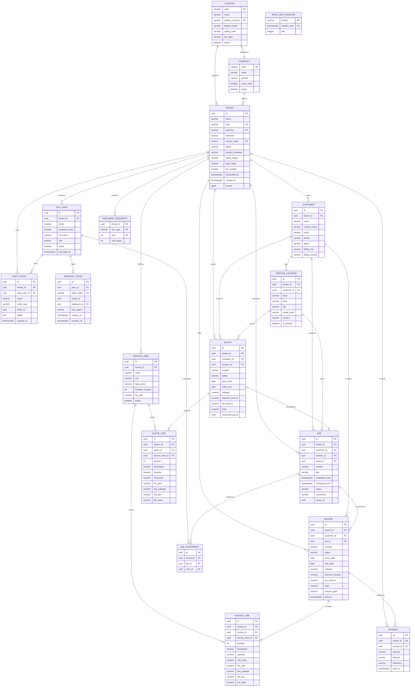
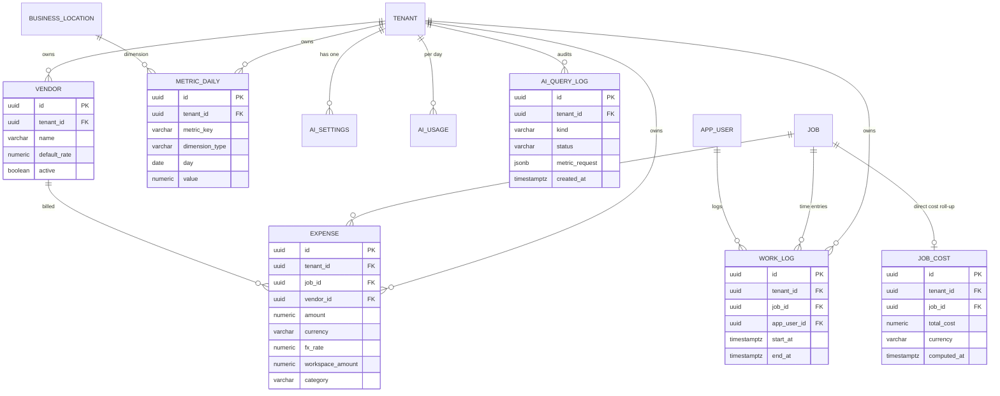

# Operonix — Entity Relationship Design (ERD)

| Field | Value |
| --- | --- |
| Version | 1.0 |
| Last updated | 2026-10-30 |
| Database | PostgreSQL 16 |
| Schema | `public` (single schema, shared tables, `tenant_id` discriminator) |
| Migration tool | Flyway, forward-only (`backend/src/main/resources/db/migration`) |
| ORM mapping | Hibernate 6, `ddl-auto=validate` |

Companion: [HLD.md](HLD.md) §6 (tenancy), [LLD.md](LLD.md) §5 (rules) and §8 (isolation).
Column names here are the physical names used by JPA entities and SQL migrations.

---

## 1. ER diagram

---

## 2. Global schema conventions

| Convention | Rule |
| --- | --- |
| Primary keys | `uuid` generated in the application (`UUID.randomUUID()`), no DB extension required |
| Tenant key | `tenant_id uuid NOT NULL REFERENCES tenant(id) ON DELETE RESTRICT` on every tenant-owned table |
| Timestamps | `timestamptz NOT NULL`, written in UTC by the application; `created_at` immutable |
| Money | `numeric(12,2) NOT NULL DEFAULT 0`; quantities `numeric(10,3)`; tax rates `numeric(5,4)` |
| Enums | `varchar` + `CHECK` constraint, mapped with `@Enumerated(EnumType.STRING)` |
| Optimistic locking | `version bigint NOT NULL DEFAULT 0` on mutable aggregates (`tenant`, `app_user`, `customer`, `service_item`, `quote`, `job`, `invoice`) |
| Cascades | JPA cascades only within an aggregate (quote→lines, invoice→lines); cross-aggregate references use `ON DELETE RESTRICT` and explicit service logic |
| Deletion | Tenant data is archived/voided, never hard-deleted except draft quotes, locations and draft line rows |
| Naming | snake_case, singular table names, index names `ix_<table>_<cols>`, constraints `ck_`, `uq_`, `fk_` |
| Character set | UTF-8 database; case-insensitive comparison handled in the application (emails/names normalised) |

---

## 3. Table definitions

### 3.1 `tenant`

| Column | Type | Constraints |
| --- | --- | --- |
| `id` | uuid | PK |
| `name` | varchar(120) | NOT NULL, `ck_tenant_name_len` length between 2 and 120 |
| `slug` | varchar(63) | NOT NULL, UNIQUE `uq_tenant_slug`, `ck_tenant_slug` matches `^[a-z0-9][a-z0-9-]{1,62}$` |
| `currency` | varchar(3) | NOT NULL, FK `fk_tenant_currency` → `currency(code)` (V2 replaced `ck_tenant_currency`) |
| `timezone` | varchar(64) | NOT NULL DEFAULT `UTC` |
| `country_code` | varchar(2) | NOT NULL, FK → `country(code)` (V2) |
| `locale` | varchar(16) | NOT NULL DEFAULT `en`, `ck_tenant_locale` matches `^[a-z]{2}(-[A-Z]{2})?$` |
| `industry_template` | varchar(40) | NOT NULL DEFAULT `GENERAL_SERVICE`, `ck_tenant_industry` restricted to the template catalogue |
| `home_region` | varchar(32) | NOT NULL DEFAULT `asia-south1` — data-residency region |
| `legal_name` | varchar(160) | NULL — optional, never requested during onboarding |
| `tax_number` | varchar(32) | NULL — optional; many countries have no equivalent identifier |
| `onboarded_at` | timestamptz | NULL — set when regional setup is confirmed |
| `created_at` / `updated_at` | timestamptz | NOT NULL |
| `version` | bigint | NOT NULL DEFAULT 0 |

Indexes: `uq_tenant_slug` (unique), `ix_tenant_country (country_code)`.
Deletion: restricted while dependent rows exist.

### 3.2 `app_user`

| Column | Type | Constraints |
| --- | --- | --- |
| `id` | uuid | PK |
| `tenant_id` | uuid | NOT NULL FK → `tenant(id)` |
| `email` | varchar(254) | NOT NULL, stored lowercase; unique **per workspace** via `uq_app_user_tenant_email (tenant_id, lower(email))` (V2 replaced the global `uq_app_user_email`) |
| `password_hash` | varchar(100) | NOT NULL (BCrypt, strength 12) |
| `full_name` | varchar(120) | NOT NULL |
| `role` | varchar(20) | NOT NULL, `ck_app_user_role` in (`OWNER`,`ADMIN`,`MANAGER`,`TECHNICIAN`) |
| `active` | boolean | NOT NULL DEFAULT true |
| `last_login_at` | timestamptz | NULL |
| `created_at` / `updated_at` | timestamptz | NOT NULL |
| `version` | bigint | NOT NULL DEFAULT 0 |

Indexes: `uq_app_user_tenant_email` (unique), `ix_app_user_email_lower (lower(email))` for sign-in
resolution across workspaces, `ix_app_user_tenant_role (tenant_id, role)`.
v1 rule: exactly one tenant per user. Since V2 the same email may exist in several workspaces (one row
per membership); `POST /auth/login` requires the `workspace` slug when several match. A dedicated
`membership` table remains the P1 target — see `docs/product-evolution/DATA_MODEL_IMPACT_ANALYSIS.md`.

### 3.3 `refresh_token`

| Column | Type | Constraints |
| --- | --- | --- |
| `id` | uuid | PK |
| `user_id` | uuid | NOT NULL FK → `app_user(id)` ON DELETE CASCADE |
| `token_hash` | varchar(64) | NOT NULL UNIQUE (SHA-256 hex of the opaque token) |
| `family_id` | uuid | NOT NULL (V2) — every rotation of one login shares it |
| `replaced_by` | uuid | NULL, FK → `refresh_token(id)` — next token in the chain |
| `user_agent` | varchar(200) | NULL — session labelling in the client |
| `expires_at` | timestamptz | NOT NULL |
| `revoked_at` | timestamptz | NULL |
| `created_at` | timestamptz | NOT NULL |

Indexes: `uq_refresh_token_hash`; `ix_refresh_token_user_expiry (user_id, expires_at)`;
`ix_refresh_token_family (family_id)`; `ix_refresh_token_expiry (expires_at)`.
Raw tokens are never stored. Reusing a rotated token revokes the whole family (reuse detection) and is
audited as `REFRESH_TOKEN_REUSE`. Expired rows are pruned by a maintenance job (manual in v1).

### 3.4 `customer`

| Column | Type | Constraints |
| --- | --- | --- |
| `id` | uuid | PK |
| `tenant_id` | uuid | NOT NULL FK → `tenant(id)` |
| `name` | varchar(160) | NOT NULL, `ck_customer_name_len` length ≥ 1 |
| `contact_name` | varchar(120) | NULL |
| `email` | varchar(254) | NULL (lowercase) |
| `phone` | varchar(32) | NULL |
| `notes` | varchar(2000) | NULL |
| `status` | varchar(16) | NOT NULL DEFAULT `ACTIVE`, `ck_customer_status` in (`ACTIVE`,`ARCHIVED`) |
| `billing_line1` | varchar(160) | NULL |
| `billing_line2` | varchar(160) | NULL |
| `billing_city` | varchar(80) | NULL |
| `billing_region` | varchar(80) | NULL |
| `billing_postal_code` | varchar(16) | NULL |
| `billing_country` | varchar(2) | NULL |
| `created_at` / `updated_at` | timestamptz | NOT NULL |
| `version` | bigint | NOT NULL DEFAULT 0 |

Indexes: `ix_customer_tenant_name (tenant_id, name)`; `ix_customer_tenant_status (tenant_id, status)`;
`ix_customer_tenant_email (tenant_id, email)`.
Deletion: restricted by locations, quotes, jobs, invoices (archive instead).

### 3.5 `service_location`

| Column | Type | Constraints |
| --- | --- | --- |
| `id` | uuid | PK |
| `tenant_id` | uuid | NOT NULL FK → `tenant(id)` |
| `customer_id` | uuid | NOT NULL FK → `customer(id)` ON DELETE CASCADE |
| `label` | varchar(80) | NOT NULL |
| `line1` / `line2` | varchar(160) | `line1` NOT NULL |
| `city` | varchar(80) | NOT NULL |
| `region` | varchar(80) | NULL |
| `postal_code` | varchar(16) | NOT NULL |
| `country` | varchar(2) | NOT NULL |
| `access_notes` | varchar(1000) | NULL |
| `is_primary` | boolean | NOT NULL DEFAULT false |
| `created_at` / `updated_at` | timestamptz | NOT NULL |

Indexes: `ix_service_location_tenant_customer (tenant_id, customer_id)`; partial unique
`uq_service_location_primary ON (customer_id) WHERE is_primary` (at most one primary location).

### 3.6 `service_item`

| Column | Type | Constraints |
| --- | --- | --- |
| `id` | uuid | PK |
| `tenant_id` | uuid | NOT NULL FK → `tenant(id)` |
| `name` | varchar(120) | NOT NULL |
| `description` | varchar(500) | NULL |
| `unit` | varchar(16) | NOT NULL, `ck_service_item_unit` in (`HOUR`,`VISIT`,`SQUARE_FOOT`,`ROOM`,`FLAT`) |
| `base_price` | numeric(12,2) | NOT NULL, `ck_service_item_price` ≥ 0 |
| `duration_minutes` | int | NOT NULL, `ck_service_item_duration` 15–1440 |
| `tax_rate` | numeric(5,4) | NOT NULL DEFAULT 0, `ck_service_item_tax` 0–1 |
| `active` | boolean | NOT NULL DEFAULT true |
| `created_at` / `updated_at` | timestamptz | NOT NULL |
| `version` | bigint | NOT NULL DEFAULT 0 |

Indexes: `ix_service_item_tenant_active (tenant_id, active)`; unique `uq_service_item_name (tenant_id, name)`.

### 3.7 `quote`

| Column | Type | Constraints |
| --- | --- | --- |
| `id` | uuid | PK |
| `tenant_id` | uuid | NOT NULL FK → `tenant(id)` |
| `customer_id` | uuid | NOT NULL FK → `customer(id)` |
| `location_id` | uuid | NULL FK → `service_location(id)` |
| `number` | varchar(20) | NOT NULL, UNIQUE `uq_quote_number (tenant_id, number)` |
| `status` | varchar(16) | NOT NULL DEFAULT `DRAFT`, `ck_quote_status` in (`DRAFT`,`SENT`,`ACCEPTED`,`DECLINED`,`EXPIRED`,`CONVERTED`) |
| `issue_date` | date | NOT NULL |
| `valid_until` | date | NOT NULL, `ck_quote_validity` ≥ `issue_date` |
| `currency` | varchar(3) | NOT NULL (snapshot of tenant currency) |
| `notes` | varchar(2000) | NULL |
| `subtotal` | numeric(12,2) | NOT NULL DEFAULT 0 |
| `discount_amount` | numeric(12,2) | NOT NULL DEFAULT 0, `ck_quote_discount` 0 ≤ discount ≤ subtotal |
| `tax_amount` | numeric(12,2) | NOT NULL DEFAULT 0 |
| `total` | numeric(12,2) | NOT NULL DEFAULT 0 |
| `converted_job_id` | uuid | NULL (no FK to avoid a cycle; validated by service + `uq_job_quote`) |
| `created_by` | uuid | NOT NULL FK → `app_user(id)` |
| `created_at` / `updated_at` | timestamptz | NOT NULL |
| `version` | bigint | NOT NULL DEFAULT 0 |

Indexes: `uq_quote_number`; `ix_quote_tenant_status_date (tenant_id, status, issue_date DESC)`;
`ix_quote_tenant_customer (tenant_id, customer_id)`.

### 3.8 `quote_line`

| Column | Type | Constraints |
| --- | --- | --- |
| `id` | uuid | PK |
| `tenant_id` | uuid | NOT NULL FK → `tenant(id)` |
| `quote_id` | uuid | NOT NULL FK → `quote(id)` ON DELETE CASCADE |
| `service_item_id` | uuid | NULL FK → `service_item(id)` ON DELETE SET NULL |
| `position` | int | NOT NULL, `ck_quote_line_position` ≥ 0 |
| `description` | varchar(300) | NOT NULL |
| `quantity` | numeric(10,3) | NOT NULL, `ck_quote_line_qty` > 0 |
| `unit_price` | numeric(12,2) | NOT NULL, ≥ 0 |
| `tax_rate` | numeric(5,4) | NOT NULL, 0–1 |
| `line_subtotal` | numeric(12,2) | NOT NULL |
| `line_tax` | numeric(12,2) | NOT NULL |
| `line_total` | numeric(12,2) | NOT NULL |

Index: `ix_quote_line_quote (quote_id, position)`; unique `uq_quote_line_position (quote_id, position)`.

### 3.9 `job`

| Column | Type | Constraints |
| --- | --- | --- |
| `id` | uuid | PK |
| `tenant_id` | uuid | NOT NULL FK → `tenant(id)` |
| `customer_id` | uuid | NOT NULL FK → `customer(id)` |
| `location_id` | uuid | NOT NULL FK → `service_location(id)` |
| `quote_id` | uuid | NULL FK → `quote(id)` |
| `number` | varchar(20) | NOT NULL, UNIQUE `uq_job_number (tenant_id, number)` |
| `title` | varchar(160) | NOT NULL |
| `scheduled_start` / `scheduled_end` | timestamptz | NOT NULL, `ck_job_window` `scheduled_end > scheduled_start` |
| `status` | varchar(16) | NOT NULL DEFAULT `SCHEDULED`, `ck_job_status` in (`SCHEDULED`,`IN_PROGRESS`,`COMPLETED`,`CANCELLED`) |
| `recurrence` | varchar(16) | NOT NULL DEFAULT `NONE`, `ck_job_recurrence` in (`NONE`,`WEEKLY`,`BIWEEKLY`,`MONTHLY`) |
| `series_id` | uuid | NULL (first job of a series) |
| `notes` | varchar(2000) | NULL |
| `created_by` | uuid | NOT NULL FK → `app_user(id)` |
| `completed_at` | timestamptz | NULL, `ck_job_completed` set iff `status = 'COMPLETED'` |
| `created_at` / `updated_at` | timestamptz | NOT NULL |
| `version` | bigint | NOT NULL DEFAULT 0 |

Indexes: `uq_job_number`; `ix_job_tenant_start (tenant_id, scheduled_start)`;
`ix_job_tenant_customer (tenant_id, customer_id)`; `ix_job_tenant_status (tenant_id, status)`;
`uq_job_quote ON (quote_id) WHERE quote_id IS NOT NULL` (one job per converted quote);
`ix_job_series (tenant_id, series_id)`.

### 3.10 `job_assignment`

| Column | Type | Constraints |
| --- | --- | --- |
| `id` | uuid | PK |
| `tenant_id` | uuid | NOT NULL FK → `tenant(id)` |
| `job_id` | uuid | NOT NULL FK → `job(id)` ON DELETE CASCADE |
| `user_id` | uuid | NOT NULL FK → `app_user(id)` |
| `created_at` | timestamptz | NOT NULL |

Indexes: UNIQUE `uq_job_assignment (job_id, user_id)`;
`ix_job_assignment_tenant_user (tenant_id, user_id)` (drives conflict detection and "my jobs").

### 3.11 `invoice`

| Column | Type | Constraints |
| --- | --- | --- |
| `id` | uuid | PK |
| `tenant_id` | uuid | NOT NULL FK → `tenant(id)` |
| `customer_id` | uuid | NOT NULL FK → `customer(id)` |
| `job_id` | uuid | NULL FK → `job(id)` |
| `number` | varchar(20) | NOT NULL, UNIQUE `uq_invoice_number (tenant_id, number)` |
| `status` | varchar(16) | NOT NULL DEFAULT `DRAFT`, `ck_invoice_status` in (`DRAFT`,`SENT`,`PARTIALLY_PAID`,`PAID`,`VOID`) |
| `issue_date` | date | NOT NULL |
| `due_date` | date | NOT NULL, `ck_invoice_due` ≥ `issue_date` |
| `currency` | varchar(3) | NOT NULL |
| `notes` | varchar(2000) | NULL |
| `subtotal` | numeric(12,2) | NOT NULL DEFAULT 0 |
| `discount_amount` | numeric(12,2) | NOT NULL DEFAULT 0, 0 ≤ discount ≤ subtotal |
| `tax_amount` | numeric(12,2) | NOT NULL DEFAULT 0 |
| `total` | numeric(12,2) | NOT NULL DEFAULT 0 |
| `amount_paid` | numeric(12,2) | NOT NULL DEFAULT 0, `ck_invoice_paid` 0 ≤ amount_paid |
| `paid_at` | timestamptz | NULL (set when fully paid) |
| `void_reason` | varchar(500) | NULL, required when `status = 'VOID'` |
| `created_by` | uuid | NOT NULL FK → `app_user(id)` |
| `created_at` / `updated_at` | timestamptz | NOT NULL |
| `version` | bigint | NOT NULL DEFAULT 0 |

Indexes: `uq_invoice_number`; `ix_invoice_tenant_status_due (tenant_id, status, due_date)`;
`ix_invoice_tenant_customer (tenant_id, customer_id)`;
partial unique `uq_invoice_job_active ON (job_id) WHERE job_id IS NOT NULL AND status <> 'VOID'`
(one live invoice per job).

### 3.12 `invoice_line`

Identical shape to `quote_line` with `invoice_id` instead of `quote_id`:
`id`, `tenant_id`, `invoice_id` (FK → invoice, ON DELETE CASCADE), `service_item_id` (nullable),
`position`, `description` varchar(300), `quantity` numeric(10,3), `unit_price` numeric(12,2),
`tax_rate` numeric(5,4), `line_subtotal`, `line_tax`, `line_total` numeric(12,2).
Index: `ix_invoice_line_invoice (invoice_id, position)`, unique `uq_invoice_line_position (invoice_id, position)`.

### 3.13 `payment`

| Column | Type | Constraints |
| --- | --- | --- |
| `id` | uuid | PK |
| `tenant_id` | uuid | NOT NULL FK → `tenant(id)` |
| `invoice_id` | uuid | NOT NULL FK → `invoice(id)` |
| `amount` | numeric(12,2) | NOT NULL, `ck_payment_amount` > 0 |
| `method` | varchar(16) | NOT NULL, `ck_payment_method` in (`CASH`,`CARD`,`BANK_TRANSFER`,`CHECK`,`OTHER`) |
| `reference` | varchar(120) | NULL |
| `paid_at` | timestamptz | NOT NULL |
| `recorded_by` | uuid | NOT NULL FK → `app_user(id)` |
| `reversed_at` | timestamptz | NULL — set when the payment is reversed (V7) |
| `reversed_by` | uuid | NULL FK → `app_user(id)` ON DELETE SET NULL (V7) |
| `reversal_reason` | varchar(280) | NULL, reserved for a stated reason (V7) |
| `created_at` | timestamptz | NOT NULL |

Index: `ix_payment_tenant_invoice (tenant_id, invoice_id)`; `ix_payment_tenant_paid_at (tenant_id, paid_at)`
for revenue reporting; `ix_payment_active (tenant_id, invoice_id) WHERE reversed_at IS NULL` for the
live-payments path (V7).

**Reversal is a mark, never a delete.** A payment row is immutable once written: reversing sets
`reversed_at`/`reversed_by`, the invoice recomputes `amount_paid` from the rows still active, and every
money aggregate filters `reversed_at IS NULL`. The row therefore stays on the invoice timeline, so a
reconciliation of the invoice against the audit trail and a bank statement both account for the same
cash, including money that was refunded.

### 3.14 `audit_event`

| Column | Type | Constraints |
| --- | --- | --- |
| `id` | uuid | PK |
| `tenant_id` | uuid | NOT NULL FK → `tenant(id)` |
| `actor_user_id` | uuid | NULL FK → `app_user(id)` (null for anonymous failures) |
| `action` | varchar(40) | NOT NULL (see LLD §9.5) |
| `entity_type` | varchar(40) | NOT NULL |
| `entity_id` | uuid | NULL |
| `detail` | text | NULL (small JSON) |
| `ip_address` | varchar(45) | NULL |
| `request_id` | varchar(64) | NULL |
| `created_at` | timestamptz | NOT NULL |

Index: `ix_audit_event_tenant_created (tenant_id, created_at DESC)`; append-only (no UPDATE/DELETE
in application code).

### 3.15 `document_sequence`

| Column | Type | Constraints |
| --- | --- | --- |
| `tenant_id` | uuid | PK part, FK → `tenant(id)` |
| `doc_type` | varchar(10) | PK part, `ck_document_sequence_type` in (`QUOTE`,`JOB`,`INVOICE`) |
| `year` | int | PK part |
| `next_value` | int | NOT NULL DEFAULT 1, `ck_document_sequence_value` ≥ 1 |

Accessed with `SELECT … FOR UPDATE` inside the inserting transaction (LLD §5.2).

### 3.16 `country`

| Column | Type | Constraints |
| --- | --- | --- |
| `code` | varchar(2) | PK, `ck_country_code` matches `^[A-Z]{2}$` |
| `name` | varchar(80) | NOT NULL |
| `default_currency` | varchar(3) | NOT NULL (logical FK to `currency`) |
| `default_locale` | varchar(16) | NOT NULL, BCP-47 |
| `calling_code` | varchar(8) | NOT NULL, e.g. `+91` |
| `postal_code_regex` | varchar(160) | NULL — `NULL` means "do not validate locally yet" |
| `tax_label` | varchar(40) | NULL — `GSTIN`, `EIN`, `VAT number`, `Invoice registration number`, … |
| `active` | boolean | NOT NULL DEFAULT true |

Seeded with 20 markets in `V2__global_foundation.sql`; India, US, UK and Japan are the deeper P0
markets (currency, locale, tax label and postal pattern all present). Platform data, not tenant data:
no `tenant_id`, readable by unauthenticated onboarding through `GET /api/v1/reference`.

### 3.17 `currency`

| Column | Type | Constraints |
| --- | --- | --- |
| `code` | varchar(3) | PK, `ck_currency_code` matches `^[A-Z]{3}$` |
| `name` | varchar(64) | NOT NULL |
| `symbol` | varchar(8) | NOT NULL |
| `minor_units` | smallint | NOT NULL, `ck_currency_minor_units` between 0 and 4 |
| `active` | boolean | NOT NULL DEFAULT true |

`minor_units` is the authority for money display: `JPY` is 0, `KWD` would be 3. The client receives it
through `/api/v1/reference` and formats from it rather than from a hardcoded table.

### 3.18 `rate_limit_counter`

| Column | Type | Constraints |
| --- | --- | --- |
| `bucket` | varchar(200) | PK part — already namespaced (`login:<ip>:<email>`, `refresh:<ip>`, `register:<ip>`) |
| `window_start` | timestamptz | PK part — start of the fixed window |
| `hits` | integer | NOT NULL, `ck_rate_limit_hits` > 0 |

Index: `ix_rate_limit_window (window_start)` for pruning old windows. Shared by every Cloud Run
instance, so the limit no longer multiplies with replica count. Contains no tenant data and no PII
beyond a hashed/derived caller key.

---

## 4. Relationships and delete behaviour

| Parent → Child | Cardinality | Delete rule | Application rule |
| --- | --- | --- | --- |
| tenant → app_user, customer, service_item, quote, job, invoice, payment, audit_event | 1:N | RESTRICT | Tenants are never deleted via API in v1 |
| app_user → refresh_token | 1:N | CASCADE | Revoke on logout/deactivate/password change |
| customer → service_location | 1:N | CASCADE | Location delete blocked if used by non-cancelled jobs |
| customer → quote/job/invoice | 1:N | RESTRICT | Archive customer instead of deleting |
| quote → quote_line | 1:N | CASCADE | Lines replaced wholesale while DRAFT |
| quote → job | 1:0..1 | SET NULL on job delete (not exposed) | Unique partial index on `job.quote_id` |
| job → job_assignment | 1:N | CASCADE | Unassign endpoint |
| job → invoice | 1:N | RESTRICT | At most one non-void invoice per job (partial unique) |
| invoice → invoice_line | 1:N | CASCADE | Lines replaced while DRAFT |
| invoice → payment | 1:N | RESTRICT | Payments are never removed: a reversal marks the row (V7) and the audit trail records it |
| service_item → quote_line/invoice_line | 1:N | SET NULL | Historical lines snapshot description/price |

**Cross-tenant safety:** every FK that points at a tenant-owned row is paired with an application
check that the referenced row has the same `tenant_id`. Composite FKs and RLS are planned hardening
(LLD §8). Integration tests cover each module.

---

## 5. Index rationale

| Query pattern | Index |
| --- | --- |
| Sign-in resolution by email | `ix_app_user_email_lower` |
| Membership uniqueness per workspace | `uq_app_user_tenant_email` |
| Refresh validation + revoke-all | `uq_refresh_token_hash`, `ix_refresh_token_user_expiry` |
| Customer list/search by tenant | `ix_customer_tenant_name`, `ix_customer_tenant_status` |
| Today/range schedule, calendar | `ix_job_tenant_start` |
| Technician workload, conflict check | `ix_job_assignment_tenant_user` |
| Quote pipeline list | `ix_quote_tenant_status_date` |
| Receivables / overdue | `ix_invoice_tenant_status_due` |
| Revenue reporting by period | `ix_payment_tenant_paid_at` |
| Audit browsing | `ix_audit_event_tenant_created` |

Reporting aggregates scan `payment`/`invoice`/`job` within one tenant and a date range; the tenant
prefix keeps scans bounded. If a tenant grows beyond ~1M rows, add monthly partial indexes.

---

## 6. Data integrity rules expressed in SQL

- `CHECK (scheduled_end > scheduled_start)` on `job`.
- `CHECK (valid_until >= issue_date)` on `quote`; `CHECK (due_date >= issue_date)` on `invoice`.
- `CHECK (discount_amount >= 0 AND discount_amount <= subtotal)` on `quote` and `invoice`.
- `CHECK (amount_paid >= 0 AND amount_paid <= total)` on `invoice`.
- `CHECK (status <> 'VOID' OR void_reason IS NOT NULL)` on `invoice`.
- `CHECK (status <> 'COMPLETED' OR completed_at IS NOT NULL)` on `job`.
- Unique `(tenant_id, number)` on quotes, jobs, invoices; unique `(tenant_id, name)` on services.
- Partial unique indexes: one primary location per customer, one live invoice per job, one job per quote.

---

## 7. Migration policy

V1 as implemented (15 tables): `tenant`, `app_user`, `refresh_token`, `customer`, `service_location`,
`service_item`, `quote`, `quote_line`, `job`, `job_assignment`, `invoice`, `invoice_line`, `payment`,
`audit_event`, `document_sequence`.

V2 as implemented (3 new tables → 18 total): `country`, `currency`, `rate_limit_counter`
(`V2__global_foundation.sql`). Purely additive apart from three justified replacements: the global
`uq_app_user_email` unique constraint becomes the per-workspace `uq_app_user_tenant_email`, the
`ck_tenant_currency` list becomes the `currency` FK, and `refresh_token` gains rotation columns that
are backfilled (`family_id = id`) before being made `NOT NULL`. Existing rows keep their currency, and
`tenant.country_code` is backfilled from it.

- `V1__schema.sql` creates extensions-free schema (no `pgcrypto` dependency), all tables,
  constraints and indexes, plus the `document_sequence` table.
- No seed migration ships: every row in v1 is tenant-owned, and a new workspace starts empty.
- Migrations are forward-only; destructive changes require a new migration with a data-copy step.
- Hibernate runs with `ddl-auto=validate` in every profile so entity/schema drift fails the build.
- Integration tests run Flyway against an embedded PostgreSQL 16 instance, exercising the real
  migration path.

---

## 8. Production topology note (no schema change)

The Google Cloud deployment runs the same `V1__schema.sql` against **Cloud SQL for PostgreSQL 16**.
No table, constraint, index or type changes were required by the deployment work:

- `ddl-auto=validate` is on in every profile, so an entity/schema mismatch fails the container at
  startup instead of drifting silently.
- Flyway runs at startup and, in the migrate-only Cloud Run job, before a revision serves traffic
  (see [LLD.md](LLD.md) §16.2). Migrations remain forward-only per §7.
- Automated daily backups, 14-day retention and point-in-time recovery are enabled on the instance;
  recovery procedures are in [DISASTER_RECOVERY.md](DISASTER_RECOVERY.md).
- Connection capacity is a deployment concern, not a schema one: each Cloud Run instance holds
  `OPERONIX_DB_POOL` (default 5) connections, and `max_instances × pool + 1 ≤ max_connections`.
  `/cloudsql` socket access needs no schema or network grants beyond `roles/cloudsql.client`.

---

## 9. P1a — global financial foundation (V3)

All of V3 is **additive**: new tables, new nullable/defaulted columns, and backfills that reproduce the
previous values exactly. No V1/V2 row is rewritten destructively and no historical document is
recalculated.

### 9.1 Platform-owned tax catalogue

| Table | Columns | Notes |
| --- | --- | --- |
| `tax_definition` | `id`, `country_code` (nullable = global), `code` UNIQUE, `name`, `mode`, `rounding`, `effective_from`, `effective_to`, `active` | The jurisdictional container: `IN-GST-18`, `GB-VAT-20`, `JP-CT-10`, `US-CA-SALES-825`, `GLOBAL-EXEMPT`, … 12 seeded rows. `mode` is `EXCLUSIVE`/`INCLUSIVE`. |
| `tax_component` | `id`, `tax_definition_id` FK CASCADE, `code`, `name`, `rate numeric(7,5)`, `compound`, `position`; UNIQUE `(tax_definition_id, code)` | Lets `CGST 9% + SGST 9%` print as two rows without new columns. |

`tax_definition` is data, not code: adding a jurisdiction is an insert. Business logic only reads a
profile, never a definition.

### 9.2 Tenant configuration

| Table | Key columns | Rules |
| --- | --- | --- |
| `legal_entity` | `id`, `tenant_id`, `name`, `country_code` FK, `tax_number`, `tax_number_label`, `base_currency` FK, `tax_mode`, `address jsonb`, `is_default`, `active` | Unique partial index `uq_legal_entity_default` enforces one default per workspace. Documents snapshot `id` and `tax_number`. |
| `business_location` | `id`, `tenant_id`, `legal_entity_id` FK, `name`, `country_code`, `timezone`, `address jsonb`, `is_default`, `active` | An operational site, distinct from `service_location` (a customer's address). |
| `tax_profile` | `id`, `tenant_id`, `legal_entity_id`, `name`, `tax_definition_id`, `mode` (null = inherit), `is_default`, `active` | Unique partial index for the default; `service_item.tax_profile_id` points here. |
| `tenant_settings` | `tenant_id` PK, `locale`, `week_start`, `fiscal_year_start_month`, `default_tax_profile_id`, `default_legal_entity_id`, `date_format`, `number_format` | 1:1 with `tenant`; keeps `tenant` itself stable. |
| `document_number_rule` | `id`, `tenant_id`, `legal_entity_id` (nullable), `doc_type`, `prefix`, `include_year`, `padding`, `reset_policy` | Backfilled to reproduce `Q-YYYY-0001` / `J-…` / `INV-…` exactly. |
| `exchange_rate` | `id`, `base`, `quote`, `rate numeric(18,8)`, `as_of`, `source`; UNIQUE `(base, quote, as_of)` | Dated rates; `base <> quote` and `rate > 0`. Lookup uses the newest row `as_of <= document date`, and the inverse pair is derived. |

### 9.3 Document snapshots

`quote` and `invoice` gained `legal_entity_id`, `tax_profile_id`, `tax_profile_name`, `tax_mode`,
`fx_rate numeric(18,8)` (CHECK > 0), `base_currency` and `base_total`; `invoice` also gained
`tax_number`, `reverse_charge` and `base_amount_paid`. Backfill: `fx_rate = 1`,
`base_currency = currency`, `base_total = total`, `base_amount_paid = amount_paid` — every pre-P1a
document keeps its exact economics.

| Table | Columns | Notes |
| --- | --- | --- |
| `line_tax_component` | `id`, `tenant_id`, `line_type` (`QUOTE`/`INVOICE`), `line_id`, `tax_component_id`, `code`, `name`, `base`, `rate`, `amount`, `position` | One row per printed tax row per line, written when a document is priced and never updated. Polymorphic `line_id` avoids two near-identical tables. |

Indexes: `ix_line_tax_component_line (line_type, line_id)`, `ix_line_tax_component_tenant`.

### 9.4 Delete behaviour and integrity

- `legal_entity` and `business_location` are **retired** (`active = false`), never deleted, because
  documents reference them; the API refuses to remove a default or an entity that still owns locations.
- `tax_profile` deactivation is likewise soft; a default profile cannot be deactivated as the only one.
- Money columns remain `numeric(12,2)`: JPY (0 dp) and KWD (3 dp) are handled by the currency's
  `minor_units` at calculation and formatting time, so no column rewrite is needed for the seeded
  markets.
- Compound tax components are summed rather than compounded; every seeded jurisdiction is additive.

---

## 10. P1b / P2a / P2b tables (V4, V5, V6 — implemented)

### 10.1 Costing (V4)

**`work_log`** — technician time on a job; open while `end_at IS NULL`.

| Column | Type | Notes |
| --- | --- | --- |
| `id` | uuid PK | |
| `tenant_id` | uuid NOT NULL → `tenant` | isolation key |
| `job_id` | uuid NOT NULL → `job` ON DELETE CASCADE | |
| `app_user_id` | uuid NOT NULL → `app_user` | whose time |
| `start_at`, `end_at` | timestamptz NOT NULL / NULL | `CHECK (end_at IS NULL OR end_at >= start_at)` |
| `is_manual` | boolean NOT NULL default false | back-entered vs live timer |
| `notes` | varchar(2000) | |

Indexes: `(tenant_id, job_id, start_at)`, `(tenant_id, app_user_id, start_at)`.

**`vendor`** — suppliers and subcontractors.

| Column | Type | Notes |
| --- | --- | --- |
| `tenant_id`, `name` | uuid, varchar(160) | `UNIQUE (tenant_id, lower(name))` |
| `contact_name`, `email`, `phone`, `tax_number` | optional | |
| `address` | jsonb | country-aware address, same shape as `service_location.address` |
| `default_rate` | numeric(12,2) | pre-fills expenses |
| `payment_terms` | varchar(30) default `NET_30` | |
| `active` | boolean | soft retire; index `(tenant_id, active)` |

**`expense`** — every recorded cost, job-linked or overhead.

| Column | Type | Notes |
| --- | --- | --- |
| `job_id` | uuid NULL → `job` ON DELETE SET NULL | NULL = business overhead |
| `vendor_id` | uuid NULL → `vendor` | |
| `amount`, `currency` | numeric(12,2), varchar(3) → `currency` | as invoiced |
| `fx_rate`, `workspace_amount` | numeric(18,8), numeric(12,2) | frozen conversion, what roll-ups read |
| `expense_date` | date NOT NULL | rate date and period |
| `category` | varchar(30) | `CHECK IN ('LABOR','MATERIAL','EQUIPMENT','SUBCONTRACTOR','OTHER')` |
| `receipt_reference`, `notes`, `created_by` | | |

Constraints: `CHECK (amount > 0)`. Indexes: `(tenant_id, job_id, expense_date DESC)`,
`(vendor_id)`, `(tenant_id, expense_date DESC)`.

**`job_cost`** — materialised direct-cost roll-up, exactly one row per job.

| Column | Type | Notes |
| --- | --- | --- |
| `job_id` | uuid NOT NULL → `job` ON DELETE CASCADE | `UNIQUE (tenant_id, job_id)` |
| `labor_cost`, `material_cost`, `equipment_cost`, `subcontractor_cost`, `other_cost`, `total_cost` | numeric(12,2) NOT NULL default 0 | |
| `currency` | varchar(3) → `currency` | workspace currency |
| `computed_at`, `computed_by` | timestamptz, uuid | provenance of the last rebuild |

Rebuilt (delete + insert), never incremented: `total_cost` is always the sum of the five components,
so a duplicated write cannot inflate cost.

**Columns added to existing tables:** `app_user.hourly_cost numeric(12,2) default 0`
(`0` = rate not configured), `service_item.cost numeric(12,2) default 0` (planned unit cost),
`job.actual_start`/`job.actual_end timestamptz` (derived from work logs).

### 10.2 Analytics (V5)

**`metric_daily`** — derived rollup, rebuildable at any time.

| Column | Type | Notes |
| --- | --- | --- |
| `tenant_id` | uuid NOT NULL → `tenant` ON DELETE CASCADE | |
| `metric_key` | varchar(60) NOT NULL | must exist in `MetricDefinition` |
| `dimension_type` | varchar(20) | `TOTAL` \| `LOCATION` |
| `dimension_key`, `dimension_id`, `dimension_label` | varchar(64)/uuid/varchar(160) | `''` for the total row |
| `day` | date NOT NULL | |
| `currency` | varchar(3) → `currency` | reporting currency |
| `value` | numeric(18,4) | 4 dp so percentages and minute totals survive rounding |

`UNIQUE (tenant_id, metric_key, dimension_type, dimension_key, day)` makes the refresh idempotent
(delete-then-insert the window). Index `(tenant_id, metric_key, day)`.

**`analytics_refresh`** — one row per workspace: `last_refreshed_at`, `range_start`, `range_end`,
`row_count`. The UI reads it to show staleness; nothing else depends on it.

**Indexes added on existing tables:** partial `(tenant_id, issue_date) WHERE status <> 'VOID'` on
`invoice`, and `(tenant_id, coalesce(actual_end, scheduled_end))` on `job`.

### 10.3 Operonix AI (V6)

**`ai_settings`** (PK `tenant_id`): `enabled boolean`, `daily_query_limit integer` (`>= 0`), `model`,
`updated_by`, timestamps.

**`ai_usage`** (PK `tenant_id, day`): `queries`, `blocked`, `tokens_in`, `tokens_out`. The quota is
enforced in the same statement that increments `queries`, so concurrent requests cannot both pass it.

**`ai_query_log`**: `tenant_id`, `actor_user_id`, `kind` (`REPORTING`/`QUOTE_ASSIST`/`INSIGHTS`),
`question` varchar(1000), `metric_request jsonb`, `answer` varchar(8000), `provider`, `model`,
`status` (`OK`/`DEGRADED`/`FAILED`/`QUOTA_EXCEEDED`/`DISABLED`), `error_code`, `tokens_in`,
`tokens_out`, `latency_ms`, `created_at`. Index `(tenant_id, created_at DESC)`. No monetary column is
stored here: the answer is reproducible from `metric_request`, so financial state stays in one place.

### 10.4 Relationships added

### 10.5 Integrity rules for the new tables

- `job_cost` and `ai_settings`/`ai_usage`/`analytics_refresh` are keyed by tenant, which makes a second
  row per job/day impossible by construction rather than by application logic.
- Deleting a job cascades `work_log`, `job_cost` and `metric_daily` is untouched (rollups are rebuilt);
  expenses survive with `job_id = NULL` so spend history is not lost with the job.
- `vendor` rows are never hard-deleted while an expense references them, and the API retires them with
  `active = false`.
- `expense.workspace_amount` is stored, not derived on read, so correcting a later FX rate cannot
  rewrite a closed period.
- `work_log` rows are the only source of actual duration; `job.actual_start/actual_end` are derived and
  may be regenerated at any time.
- AI tables never participate in a financial calculation; deleting all three leaves every number in
  product unchanged.

---

## 11. P2d — payment reversal trail (V7, implemented)

`V7__payment_reversal_trail.sql` is additive: three nullable columns on `payment`, one FK and one
partial index. No existing row is rewritten, so a V6 database upgrades with its payments, invoices and
audit events untouched (verified against a V3 database carrying P1a-era documents: totals unchanged
after migrating to V7).

| Change | Why |
| --- | --- |
| `payment.reversed_at`, `reversed_by`, `reversal_reason` | Keep the record of cash taken and refunded instead of deleting it |
| `fk_payment_reversed_by` → `app_user(id) ON DELETE SET NULL` | A deactivated user must not remove the record of who reversed a payment |
| `ix_payment_active (tenant_id, invoice_id) WHERE reversed_at IS NULL` | Balance sums, invoice timelines and cash-collected reporting only read live rows |

Invariants now enforced in code and covered by `SalesFlowIT`:

- `invoice.amount_paid` equals the sum of that invoice's payments with `reversed_at IS NULL`.
- A reversed payment is returned by the invoice API with `reversedAt`/`reversedBy` and rendered on the
  timeline as "Reversed", but contributes nothing to the balance or to reporting.
- Reversing an already-reversed payment is `409 CONFLICT`; the balance cannot be subtracted twice.
- `metric_daily` (`payments_collected`) and the dashboard's revenue exclude reversed rows, so a
  refunded payment never counts as collected cash.
