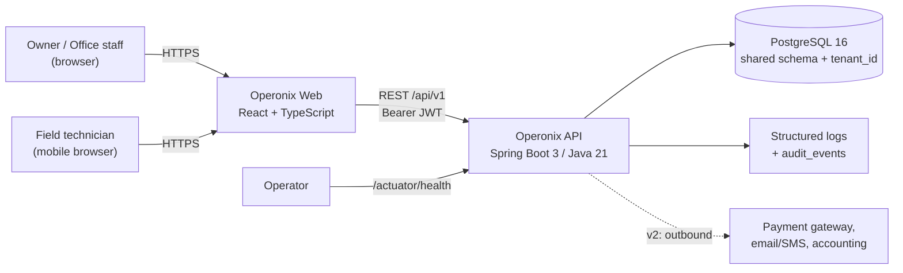
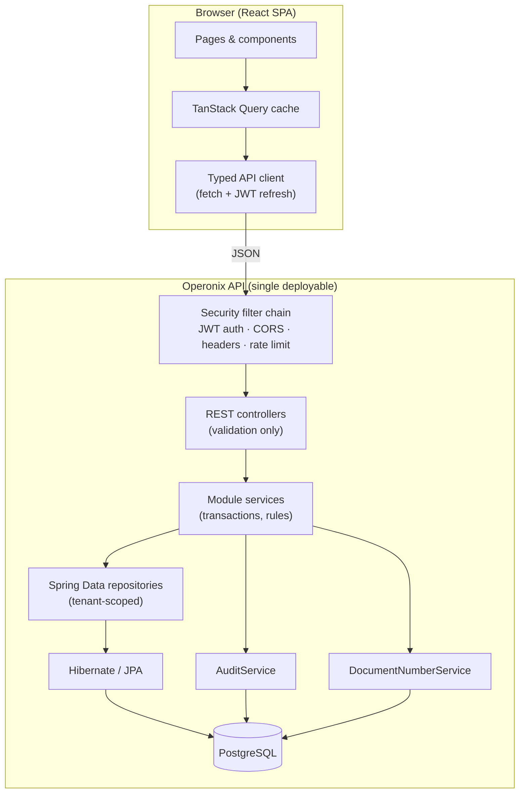
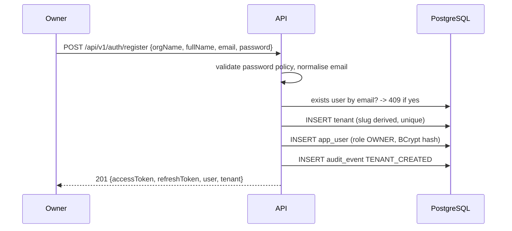
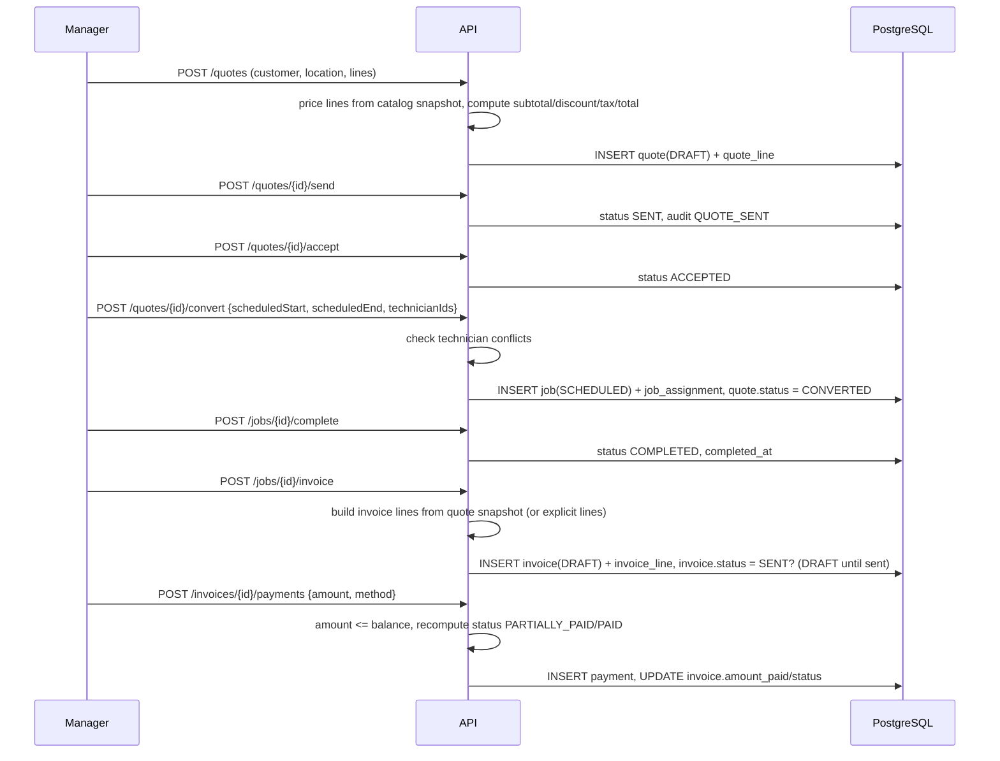
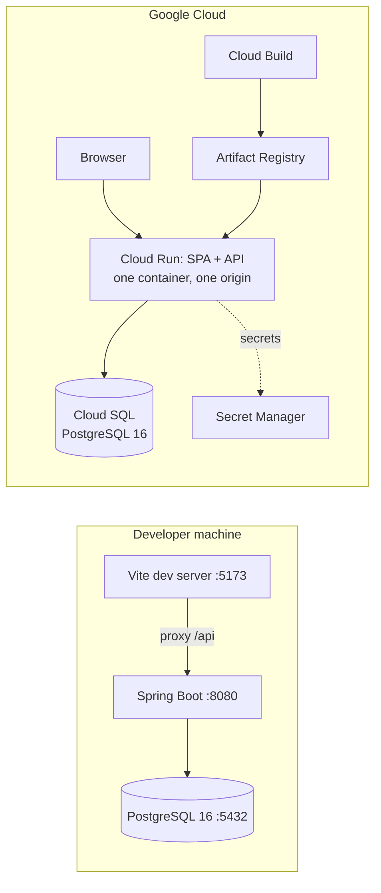

# Operonix — High-Level Design (HLD)

| Field | Value |
| --- | --- |
| Document status | Approved for v1 implementation |
| Version | 1.0 |
| Last updated | 2026-10-30 |
| Related documents | [LLD.md](LLD.md), [ERD.md](ERD.md), [../memory.md](../memory.md) |
| Initial vertical | Residential & commercial **cleaning services** |

---

## 1. Purpose and product scope

Operonix is a multi-tenant, vertical SaaS platform for small service businesses that still run on
spreadsheets, paper forms and phone calls. Version 1 targets **cleaning companies** (2–50 staff):
a single workspace that covers the lead-to-cash loop end to end.

### 1.1 Problem

Cleaning operators lose revenue in four places:

1. **Leads and customers** live in inboxes, notebooks and personal phones, so history and
   preferences are lost.
2. **Quotes** are hand-written, inconsistently priced and slow to send; follow-up is manual.
3. **Scheduling** is done on whiteboards, producing double-bookings, missed recurring visits and
   technicians arriving without scope or access notes.
4. **Invoicing** happens days later, from memory, and payment status is tracked in a spreadsheet.

### 1.2 v1 outcomes (product goals)

| ID | Outcome | Success signal |
| --- | --- | --- |
| G1 | One record per customer with locations, access notes and full job history | Customer 360 page shows every quote, job and invoice |
| G2 | Quote in under two minutes from the catalog, with correct tax and totals | Server-computed totals; quote PDF-ready data model |
| G3 | Dispatch without double-booking a technician | Conflict detection rejects overlapping assignments |
| G4 | Recurring cleaning visits created in one action | Weekly / bi-weekly / monthly series generation |
| G5 | Invoice and collect, including partial payments | Invoice balances always reconcile with payments |
| G6 | Owner sees the business at a glance | Dashboard KPIs: revenue, outstanding, jobs, conversion |
| G7 | Hard tenant isolation | Cross-tenant reads/writes are impossible via the API |

### 1.3 In scope (v1)

- Workspace (tenant) signup with owner account, team management and role-based access.
- Customer and service-location management with archive (not destructive delete).
- Service catalog with pricing, duration and per-line tax rate.
- Quotes with line items, discounts, tax, status lifecycle and conversion into jobs.
- Job scheduling with technician assignment, conflict detection, recurring series, status flow
  and completion notes.
- Invoices generated from jobs or ad hoc, with partial payments, void rules and balance tracking.
- Operational dashboard and a small set of revenue/job reports.
- Audit trail for security-relevant actions.
- Responsive web UI (desktop-first; usable on a phone in the field).

### 1.4 Explicitly out of scope (v1, see §11 for evolution)

Online card payments / payment-gateway capture, accounting sync (QuickBooks/Xero), SMS/email
delivery, customer self-service portal, native mobile apps, route optimisation, inventory/asset
maintenance, multi-currency conversion, per-tenant custom domains, SSO/SAML, file attachments,
billing of the SaaS itself (subscriptions for tenants).

> These are **not** silently assumed. Any v1 behaviour that depends on them (e.g. "send quote")
> records state locally and is documented as such.

### 1.5 Personas

| Persona | Role | Primary jobs to be done |
| --- | --- | --- |
| Owner | `OWNER` | See revenue and pipeline, manage team, configure workspace |
| Office manager | `ADMIN` / `MANAGER` | Intake customers, quote, schedule, invoice, chase payment |
| Field technician | `TECHNICIAN` | See today's assigned visits, scope, access notes; mark complete |

---

## 2. Architectural principles

1. **Modular monolith first.** One deployable backend with hard module boundaries
   (`identity`, `customer`, `catalog`, `quoting`, `scheduling`, `billing`, `reporting`, `audit`).
   Each module owns its tables and exposes a service interface; no cross-module repository access.
   This keeps transactions simple (quote → job → invoice is one ACID unit) and can be split into
   services later along the same seams.
2. **Tenant isolation is a first-class invariant**, not a UI concern. Every tenant-owned row carries
   `tenant_id`; every query is scoped by the authenticated principal's tenant; the tenant is never
   accepted from the client.
3. **Server is the source of truth for money and state.** Totals, tax, invoice status and balances
   are computed server-side; status transitions are validated by explicit state machines.
4. **Boring, proven technology.** Java 21 + Spring Boot 3, PostgreSQL, React + TypeScript.
5. **Small surface, sharp edges.** Validation at the boundary, RFC 7807 errors, deterministic
   business rules, optimistic locking on mutable aggregates.
6. **Observable by default.** Request IDs, structured logs with tenant/user context, audit events
   for security-relevant mutations, health endpoints.

---

## 3. System context



Everything is served over TLS. The SPA is static and holds only a short-lived access token in
memory plus a rotating refresh token in an `HttpOnly` cookie or secure storage (see LLD §9).

---

## 4. Container and component view



### 4.1 Module responsibilities

| Module | Owns | Key responsibilities | Depends on |
| --- | --- | --- | --- |
| `tenancy` | `tenant` | Workspace creation, settings, slug, timezone, currency | identity (owner creation), audit |
| `identity` | `app_user`, `refresh_token` | Signup, login, token rotation, team management, roles | tenancy, audit |
| `customer` | `customer`, `service_location` | Customer 360 data, archive, location management | audit |
| `catalog` | `service_item` | Priced services, duration, tax rate, activation | audit |
| `quoting` | `quote`, `quote_line` | Quote drafting, totals, lifecycle, conversion to job | customer, catalog, scheduling, audit |
| `scheduling` | `job`, `job_assignment` | Jobs, assignment, conflicts, recurrence, completion | customer, catalog, quoting, audit |
| `billing` | `invoice`, `invoice_line`, `payment` | Invoicing, payments, voiding, balances | customer, scheduling, audit |
| `reporting` | — (read models) | Dashboard KPIs and revenue/job reports | billing, scheduling, quoting |
| `audit` | `audit_event` | Append-only trail of security-relevant actions | — |
| `document` | `document_sequence` | Per-tenant, per-year document numbering | — |
| `common` | — | Errors, pagination, money, clocks, request context | — |

Allowed dependency direction: `web → service → repository`, and service-to-service only through
public service interfaces. Reporting may read repositories of other modules **read-only**; it must
never write.

---

## 5. Technology stack

| Layer | Choice | Version | Rationale |
| --- | --- | --- | --- |
| Language | Java | 21 (LTS) | Records, sealed types, pattern matching, virtual threads available |
| Backend | Spring Boot | 3.3.x | Mature security/JPA/validation integration |
| Web | Spring MVC | (Boot managed) | Blocking, simple to reason about; virtual threads optional |
| Security | Spring Security 6 + JJWT | 0.12.x | Stateless JWT, method-level authorization |
| Persistence | Spring Data JPA / Hibernate 6 | (Boot managed) | Aggregate modelling, optimistic locking |
| Migrations | Flyway | (Boot managed) | Versioned, reviewable schema; `ddl-auto=validate` |
| Database | PostgreSQL | 16 | ACID, partial indexes, JSONB-ready, mature ops |
| API docs | springdoc-openapi | 2.6.x | OpenAPI 3.1 + Swagger UI |
| Testing | JUnit 5, AssertJ, MockMvc | (Boot managed) | Fast slice + full-stack API tests |
| Test DB | Zonky embedded PostgreSQL | 2.2.x | Real PostgreSQL semantics without Docker |
| Frontend | React + TypeScript | 18.3 / 5.6 | Typed SPA, no SSR requirement for v1 |
| Build (FE) | Vite | 5.4 | Fast dev server and production build |
| Routing | React Router | 6.28 | Standard client routing |
| Server state | TanStack Query | 5.x | Caching, invalidation, retries without Redux |
| Styling | Tailwind CSS | 3.4 | Utility-first, consistent design tokens |
| Icons | lucide-react | 0.468 | Single icon set, tree-shakeable |
| Container | Docker + Compose | — | Local PostgreSQL (`compose.yaml`); no image built yet |
| CI | Not configured | — | Backend `mvn verify` + `npm run build` are run locally; wiring CI is a next step |

**Why not microservices?** At this scale a distributed quote→job→invoice flow would add sagas,
network failure modes and operational overhead with no user-visible benefit. Module boundaries and
module-owned tables keep the extraction path open.

**Why not a separate auth provider?** Tenant identity is core product data (team, roles, audit).
A provider can be added for SSO later; the token format is already standard JWT.

---

## 6. Multi-tenancy strategy

**Model: shared database, shared schema, mandatory tenant discriminator.**

- `tenant.id` (UUID) is stamped on every tenant-owned row; `app_user` additionally holds the
  tenant it belongs to.
- The tenant is derived **only** from the verified JWT (`tid` claim) → `TenantContext`. No endpoint
  accepts a tenant identifier from the client.
- Repository access goes through tenant-scoped finders that always include `tenant_id`; a service
  that loads an aggregate by id uses `findByIdAndTenantId`, so foreign IDs resolve to `404`, never
  to another tenant's data.
- Write paths stamp `tenant_id` from the context, never from the request body; DTOs do not expose it.
- Defense in depth: (a) integration tests assert cross-tenant 404/403 for every module; (b) later
  hardening — composite FKs `(id, tenant_id)` and PostgreSQL RLS — is documented in LLD §10.6.

**Isolation levels available later:** The tenant key is present on every table, so a move to
schema-per-tenant or database-per-tenant is mechanical for large accounts.

**Known v1 limitation:** one user identity belongs to exactly one workspace (global unique email).
Multi-workspace membership requires a `membership` join table and workspace switching; the token
already carries `tid`, so the change is additive. Recorded in memory.md.

---

## 7. Security architecture

| Concern | v1 control |
| --- | --- |
| Authentication | Email + password (BCrypt cost 12), JWT access token (15 min) + opaque refresh token (30 days, rotated, SHA-256 hashed at rest, reuse detection) |
| Authorization | Role hierarchy `OWNER > ADMIN > MANAGER > TECHNICIAN` enforced with `@PreAuthorize` and service-level checks; object-level checks on job ownership for technicians |
| Tenant isolation | See §6; tenant from token only |
| Transport | TLS terminated at the proxy; HSTS, `X-Content-Type-Options`, `Referrer-Policy`, frame denial, restrictive CSP on API responses |
| Input safety | Bean Validation on every request DTO, enum whitelists, pagination caps, sort-field whitelist, no dynamic SQL |
| Brute force | In-memory sliding-window limiter on `/auth/login` and `/auth/refresh` (per IP + email) returning `429` + `Retry-After` |
| Secrets | Environment variables only (`OPERONIX_JWT_SECRET`, `OPERONIX_DB_*`); startup fails outside `dev` if the secret is missing or the development default |
| Auditing | Append-only `audit_event` with actor, tenant, action, entity, IP, request id |
| Data at rest | PostgreSQL encryption/backups delegated to the hosting layer; passwords and refresh tokens are never stored in clear |
| Logging | No passwords, tokens or full request bodies; tenant/user/request id in MDC |

Full control detail, error catalogue and role matrix: LLD §6–§9.

---

## 8. Key workflows

### 8.1 Workspace signup (tenant provisioning)



Provisioning is one transaction: a workspace never exists without an owner.

### 8.2 Quote → job → invoice → payment



### 8.3 Scheduling and conflict detection

When a job is created, rescheduled or assigned, the service checks every technician for overlap
against non-cancelled jobs in the same tenant:

```
overlap = existing.start < new.end AND existing.end > new.start
```

Any overlap → `409 JOB_SCHEDULE_CONFLICT` listing the technician and conflicting job. Recurring
series creation is transactional: if any occurrence conflicts, no job is created.

### 8.4 Invoice status derivation

Stored status is derived from monetary state and lifecycle:

- `DRAFT` → `SENT` on send; sending requires a positive total and at least one line.
- `amount_paid = 0` → `SENT`; `0 < amount_paid < total` → `PARTIALLY_PAID`;
  `amount_paid >= total` → `PAID`.
- `overdue` is computed (`due_date < today` and not `PAID`/`VOID`/`DRAFT`) and never stored.
- Void is allowed only while `amount_paid = 0`.

### 8.5 Access flow (token lifecycle)

Access tokens are short-lived and stateless. The SPA keeps the access token in memory and the
refresh token in `localStorage` under a namespaced key (XSS risk mitigated by CSP and by keeping
the API free of HTML injection); on `401`, the client performs a single-flight refresh and replays
the request. Logout revokes the presented refresh token and clears client state.

---

## 9. Non-functional requirements

| Area | Target / decision |
| --- | --- |
| Latency | p95 < 300 ms for list/detail endpoints at 10k customers, 50k jobs per tenant |
| Throughput | Single instance sized for 100 concurrent users; horizontal replication is possible because the API is stateless |
| Data volume | PostgreSQL shared schema; every tenant-scoped table indexed by `tenant_id` first |
| Availability | Stateless API behind a proxy; managed PostgreSQL with PITR backups; target 99.5% monthly |
| Consistency | Strong within a request (single DB transaction); quote→job→invoice conversion is atomic |
| Recoverability | Flyway migrations are forward-only; restore = latest backup + replay (no destructive migration in v1) |
| Observability | JSON logs with `requestId`, `tenantId`, `userId`; `/actuator/health`, `/actuator/info`; audit table for business/security events |
| Accessibility | Keyboard-navigable forms, labelled inputs, visible focus, AA contrast |
| Browser support | Latest Chrome, Edge, Firefox, Safari; responsive from 360 px |
| Time zones | Stored UTC (`timestamptz`); tenant has an IANA timezone used for display and "today" KPIs |
| Money | `numeric(12,2)`, `BigDecimal`, `HALF_UP`; currency per tenant (single currency in v1) |

---

## 10. Deployment and environments



- **Local:** `compose.yaml` provides PostgreSQL 16; backend runs with the `dev` profile
  (`http://localhost:8080`), frontend via Vite (`http://localhost:5173`) proxying `/api`.
- **Production:** multi-stage `Dockerfile` (SPA build → Maven build → JRE 21 runtime) running as a
  non-root user. **One Cloud Run service serves the built SPA and `/api/v1` from the same origin**
  (`WebStaticConfig` + `SpaRootController`), so no CORS and no second service are needed; the SPA
  calls a relative `/api/v1`. Flyway migrates on startup and via a migrate-only Cloud Run job;
  config strictly from environment variables and Secret Manager.
- **CI:** backend `mvn verify` (unit + embedded-PostgreSQL integration tests, JaCoCo report),
  frontend `npm ci && npm run typecheck && npm run build`, and a container image build
  (`.github/workflows/ci.yml`). Deployment runs through Cloud Build with Workload Identity
  Federation (`.github/workflows/deploy.yml`).
- **API docs:** Swagger UI at `/swagger-ui.html`, OpenAPI JSON at `/v3/api-docs`, disabled in `prod`
  unless `OPERONIX_API_DOCS=true`.
- **Deployment detail:** [GOOGLE_CLOUD_DEPLOYMENT.md](GOOGLE_CLOUD_DEPLOYMENT.md); operations in
  [OPERATIONS_RUNBOOK.md](OPERATIONS_RUNBOOK.md) and [DISASTER_RECOVERY.md](DISASTER_RECOVERY.md).

---

## 11. Evolution path

| Horizon | Change | Why it fits the current design |
| --- | --- | --- |
| v1.1 | Email/SMS delivery of quotes and invoices, PDF rendering | Add `notification` module + outbox table; documents already have stable numbering |
| v1.1 | Stripe payment links and webhook-driven payments | `payment` already models method/reference; add `PaymentProvider` port |
| v1.2 | QuickBooks/Xero sync | Read-only projections from billing; outbox-driven |
| v1.2 | Technician mobile PWA, photo attachments | Object storage + job attachments table; assignment model exists |
| v2 | Multi-workspace membership, SSO | Add `membership`, keep `tid` claim; Spring Security OIDC client |
| v2 | Second vertical (pest control, equipment rental) | Catalog/job columns are vertical-neutral; add `vertical` attribute + module-specific extensions |
| v2 | Per-tenant isolation tiers | Tenant key is universal → schema/DB-per-tenant for enterprise accounts |
| v2 | Route optimisation, inventory | New modules calling existing job/customer APIs |

---

## 12. Risks and trade-offs

| Risk | Impact | Mitigation |
| --- | --- | --- |
| Missing tenant predicate in a new query leaks data | Severe | Standard `findByIdAndTenantId` pattern, code review checklist, cross-tenant integration tests per module, RLS as later hardening |
| JWT in browser storage is XSS-exposed | High | Short TTL, refresh rotation with reuse detection, CSP, no `dangerouslySetInnerHTML`, sanitised rendering |
| Single database becomes a bottleneck | Medium | Tenant-first indexes, pagination caps, read-only reporting queries, extraction path documented |
| Money rounding disputes | Medium | One documented rounding rule, shared calculator, unit tests with edge cases |
| Recurring series creates many rows | Low | Occurrence cap (26), explicit generation, cancel-series endpoint later |
| In-memory rate limiter is per-instance | Low | Acceptable for v1 single-region; replace with Redis when replicas > 1 and login abuse is observed |
| No payment gateway in v1 | Medium (product) | Manual payment recording keeps the ledger correct; gateway is additive |

---

## 13. Document governance

- HLD owns scope, architecture, stack and workflows.
- LLD owns module internals, API contracts, rules, validation, errors and security controls.
- ERD owns schema, constraints and indexes.
- Any implementation decision that deviates from these documents must be recorded in
  `memory.md` → "Deviations" **and** reflected back into the affected document in the same change.
- `memory.md` is the single source of truth for project state between sessions.
