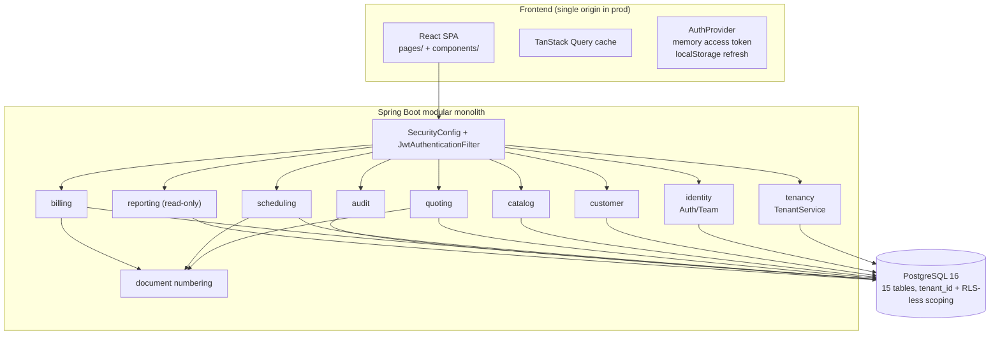
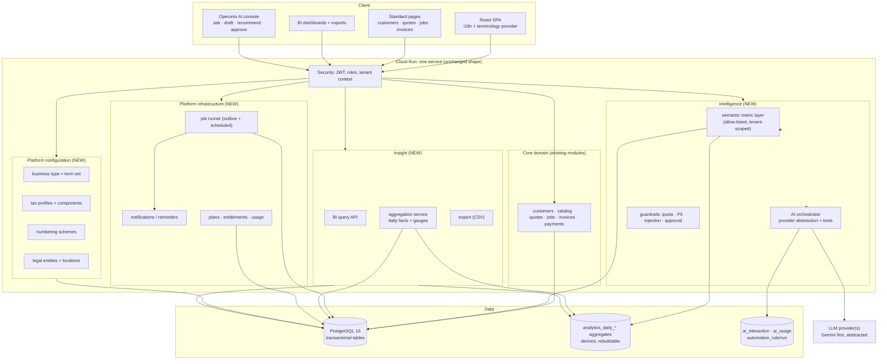

# Operonix — Architecture Impact Analysis

| Field | Value |
| --- | --- |
| Version | 1.0 (proposal — not approved) |
| Date | 2026-10-31 |
| Baseline | Commit state described in `memory.md` §4 (MVP verified, 30 backend tests, deployment-ready, **not deployed**) |
| Rule applied | Nothing is recommended for rewrite without a concrete defect in the current design |

---

## 1. Current architecture (as implemented)

```
React SPA (Vite, TanStack Query)  ──/api/v1──▶  Spring Boot 3.3 modular monolith
                                                 ├─ security: JWT + rotating refresh, Role enum
                                                 ├─ modules: tenancy, identity, customer, catalog,
                                                 │           quoting, scheduling, billing,
                                                 │           reporting, audit, document
                                                 ├─ money: MoneyCalculator (scale 2, HALF_UP)
                                                 ├─ tenancy: TenantEntity + JWT `tid` + scoped finders
                                                 └─ audit: append-only audit_event
                                                        │
                                                 PostgreSQL 16 (single schema, V1__schema.sql, 15 tables)
```



**Characteristics measured from the code**

| Property | Current reality |
| --- | --- |
| Endpoints | 55 REST operations under `/api/v1` across 12 controllers |
| Modules | 10 packages, enforced by convention only (no ArchUnit/module boundary test) |
| Tenancy | Shared schema; `tenant_id` on every tenant-owned table; finders are `findByIdAndTenantId`; `TenantEntity` blocks cross-tenant writes |
| Roles | 4 fixed roles (`OWNER, ADMIN, MANAGER, TECHNICIAN`), method-level `@PreAuthorize` + `AuthGuard` |
| Money | `BigDecimal` scale 2, single tax rate per line, proportional discount on the taxable base |
| Reporting | Live JPQL/derived queries per request; `ReportService` loads payment entities into memory for day/month buckets |
| Background work | **None** — no `@Scheduled`, no `@Async`, no events, no outbox, no queue |
| Localization | Server: `Locale.ENGLISH` formatters; client: `Intl` with hardcoded 2 decimals; copy is English-only |
| Configuration | `OperonixProperties` (JWT, CORS, rate limit, docs, defaults); tenant has only name/slug/currency/timezone |
| Extension seams | Module boundaries + `CustomerActivityPort`-style ports; no plugin/registry mechanism for industry config |
| Deployment | One Cloud Run container (SPA + API), Cloud SQL, Secret Manager, migrate-only job (prepared, not deployed) |

## 2. Proposed architecture (target)

Stay a **modular monolith**. Add three things it genuinely lacks: a **configuration layer**, a
**derived-analytics layer**, and an **intelligence layer**, plus a **background job runner** that all
three need.



### Why keep the monolith

| Consideration | Monolith (recommended) | Microservices (rejected for now) |
| --- | --- | --- |
| Quote → job → invoice → payment atomicity | One transaction, already correct and tested | Distributed transaction/saga for a 2–50 person tenant — pure cost |
| Tenant isolation | One `tenant_id` convention, one interceptor | N services × N data stores to police |
| BI consistency | Aggregates over one schema | Cross-service ETL before any metric exists |
| Operational load | One container, one DB, one migration train | Many deployables, service mesh, tracing — no team to run it |
| Growth path | Module extraction later is mechanical (ports already used) | Premature |

The one **justified** new runtime component is a **worker** (same image, different entrypoint, Cloud
Run job or a scheduler-triggered endpoint) because BI aggregation, reminders and AI evaluations are
time-driven and must not run inside request threads.

### Module boundary additions

```
config/      business type, term set, locale, numbering scheme, tax profile  (new module: `platform`)
analytics/   aggregation jobs, metrics, BI queries, exports                 (replaces `reporting`)
ai/          semantic layer, orchestrator, guardrails, usage, audit          (new)
automation/  rules, runs, approvals, notifications                           (new)
billing/     (existing invoices/payments)  + `subscription/` for SaaS plans  (new submodule)
```

Boundary rule to add (and enforce mechanically): **`analytics` and `ai` may not call another module's
repository** — they go through that module's service or through SQL ownership of their own aggregate
tables. This prevents the classic "reporting quietly became the second writer" failure.

## 3. Impact matrix

Severity: **S1** breaks the global promise · **S2** blocks a feature · **S3** cosmetic/deferred.
Complexity: **C1** small (≤3 files) · **C2** moderate (module-local) · **C3** large (cross-module or
schema-wide) · **C4** platform-programme.

| # | Area | Current | Gap | Action | Severity | Complexity | Depends on | Phase |
| --- | --- | --- | --- | --- | --- | --- | --- |
| 1 | DB: tenant config | `tenant(name,slug,currency,timezone)`; currency `CHECK` allows 6 codes | No country/locale/business type; JPY impossible | Add `country, locale, currency_scale, business_type, fiscal_year_start, status`; drop the currency `CHECK`, validate via ISO table | S1 | C3 | — | P0 |
| 2 | DB: money precision | `numeric(12,2)` everywhere; `MONEY_SCALE=2` | JPY 0dp / KWD 3dp break totals and display | Widen to `numeric(19,4)`; add `currency_scale` on tenant; `MoneyCalculator` per-currency rounding | S1 | C3 | #1 | P0 |
| 3 | DB: tax | `service_item.tax_rate`, `line.tax_rate` single value | No CGST/SGST/IGST split, no inclusive pricing, no jurisdiction | `tax_profile` + `tax_component` + `line_tax_component` snapshot | S1 | C3 | #2 | P0 |
| 4 | DB: legal entity/location | Customer locations only; no company address | Cannot issue a compliant invoice from a registered entity | `legal_entity`, `business_location`, doc references entity | S1 | C2 | #1 | P1 |
| 5 | DB: numbering | `document_sequence(tenant,doc_type,year)` + hardcoded format | Statutory patterns/series/reset impossible | `numbering_scheme` + `document_sequence.scheme_id` | S1 | C2 | #4 | P1 |
| 6 | Text/labels | Cleaning copy in 9 files + default job title in `JobService` | Product is single-industry | `term_set` configuration + `useTerms()` client hook; server default title from terms | S2 | C1 | #1 | P0 |
| 7 | Catalogue units | Enum `HOUR/VISIT/SQUARE_FOOT/ROOM/FLAT` + DB check | Blocks rental/weight/distance pricing | `unit_code` table (VARCHAR on line, seeded), keep enum values as seeds | S2 | C1 | — | P1 |
| 8 | Roles | Fixed 4-role enum | "Technician" label baked into auth; no accountant/viewer | Keep 4 *permission* roles; add display names via term set; add `VIEWER`/`ACCOUNTANT` in P2 | S3 | C1–C2 | #6 | P1/P2 |
| 9 | Customer address | `varchar(2) country`, flat 6 address columns | JK prefecture/IN state/UK postcode nuances | Keep flat core + add `region_code`, `country` FK to ISO, optional `address_json` for extras | S2 | C2 | #1 | P1 |
| 10 | Payments | Methods enum (5) | No UPI/SEPA/ACH/Konbini/COD | `payment_method` table with country applicability | S2 | C1 | #1 | P1 |
| 11 | Reporting | `ReportService` live queries, in-memory buckets | No trends by customer/service/location; O(n) memory; no history | `analytics` module: daily fact tables + gauges, refreshed by worker; BI API on facts | S2 | C3 | #1,#2,#4 | P1–P2 |
| 12 | Costs/profit | No cost data at all | Job profitability impossible | `job_cost` (labour/material/equipment/subcontractor) + `cost_category`; hourly cost on user | S2 | C2 | — | P2 |
| 13 | Time tracking | `job.scheduled_start/end`, `completed_at` only | Productivity must use scheduled time (misleading) | `job_time_entry` (user, start/end/approved) + job actual minutes | S2 | C2 | — | P2 |
| 14 | Background work | None | Aggregation, reminders, AI evaluations have nowhere to run | Outbox table + worker entrypoint + idempotent handlers | S2 | C3 | — | P0 (foundation) |
| 15 | AI | None | — | `ai` module: semantic layer over allow-listed metrics, orchestrator, usage, audit | S3 (new product) | C4 | #11,#14 | P2 |
| 16 | Automations | None | — | `automation_rule` + `automation_run` + approval states; reuses outbox/worker | S3 | C3 | #14, notifications | P2–P3 |
| 17 | SaaS billing | None | Cannot sell plans/quotas | `plan`, `subscription`, `usage_counter` + entitlement checks | S2 (monetization) | C3 | #14 | P2 |
| 18 | Auth/session | One user ↔ one workspace (`email` globally unique, `tenant_id NOT NULL`) | Users cannot belong to 2 businesses — common for accountants/owners | `membership` table; `app_user` becomes global identity; JWT gains `mid` | S2 | C3 | #1 | P2 |
| 19 | i18n | Server `Locale.ENGLISH`; client English literals | No translation readiness | Message bundles + `locale` per user/tenant; ICU messages; no string concat | S2 | C3 | #1 | P1 |
| 20 | Frontend nav | 16 pages, hardcoded labels/nav | Industry terms, BI, AI need new surfaces | Term provider, 3 new sections (Insights, Assistant, Automations), role-aware nav | S2 | C2 | #6,#11,#15 | P1–P2 |
| 21 | Deployment | One Cloud Run service + migrate job (prepared) | Worker, region routing, per-tenant data residency | Second Cloud Run job/service for worker; region-aware deployment | S2 | C3 | #14 | P1–P3 |
| 22 | Audit | `audit_event` append-only, 34 actions | AI/automation/admin actions uncaptured; no retention policy | Add action names; `ai_interaction`; retention/export policy | S2 | C1 | — | P1 |
| 23 | Exports | None | Accountant/business need CSV/PDF | CSV endpoints on BI module; PDF later (P3) | S3 | C1–C2 | #11 | P2 |
| 24 | Tests | 30 tests (money, auth, sales flow, SPA hosting) | No tenant-isolation property test across new modules; no BI correctness suite | Add ArchUnit boundary test, metric golden tests, tenant-scope tests per new repo | S2 | C2 | every phase | continuous |
## 4. Detailed change records (the ones that shape everything else)

### C-1 · Platform configuration module (`platform`)

| Aspect | Detail |
| --- | --- |
| Current implementation | Industry/country knowledge is in code: `ServiceUnit`, `DocumentType` prefixes, `WorkspaceService.CURRENCIES`, `TenantService.provision` (`USD`/`UTC`), English copy in TSX, default job title in `JobService:419` |
| Problem | Cannot onboard a new industry or country without a release; every new market touches many files |
| Why | This is the product promise: one configurable platform |
| Proposed | `platform` module with `business_type`, `term_set`/`term` (keys: `job.singular`, `worker.plural`, `catalog.unit.*`, `nav.*`), `numbering_scheme`, `tax_profile`/`tax_component`, `currency` (ISO 4217 with `minor_units`), `country` (ISO 3166 with defaults). Tenant references `business_type_id`, `country_code`, `locale`, `currency_code`, `fiscal_year_start_month` |
| Components affected | New `platform` module; `tenancy` (FKs + provisioning); `catalog` (unit FK); `document` (scheme); `billing`/`quoting` (tax profile); frontend `useTerms()` |
| DB impact | +6 tables (`business_type`, `term_set`, `term`, `numbering_scheme`, `tax_profile`, `tax_component`), +3 reference tables (`currency`, `country`, `payment_method`), tenant/customer/service/quote/invoice column additions |
| Backend impact | New read-mostly services; provisioning seeds a default business type; no change to existing business rules |
| Frontend impact | Terminology via context/provider; Settings gains region/tax/numbering sections; onboarding asks business type |
| Security | Admin-only mutation; platform tables are global (not tenant rows) but tenant-scoped overrides are |
| External deps | None (seed data ships in a migration) |
| Complexity | C3 |
| Testing | Repository tests per table; provisioning test (new tenant gets defaults); "no industry string in TSX" lint/grep test; snapshot test for term resolution |
| Risks | Over-configuration: a term set that changes *data semantics* rather than labels. Mitigation: term sets only affect display strings |
| Phase | P0 |

### C-2 · Currency precision and the money engine

| Aspect | Detail |
| --- | --- |
| Current implementation | `MoneyCalculator.MONEY_SCALE = 2`, `numeric(12,2)` columns, `Intl.NumberFormat` with `minimumFractionDigits: 2`, `tenant.currency` validated against a 6-code set (DB `CHECK` + `WorkspaceService`) |
| Problem | JPY (0 minor units) and KWD/BHD (3) produce wrong totals and wrong display; adding a currency requires a migration (the `CHECK`) and a code change |
| Why | Japan is a named target market; the DB constraint makes it literally impossible today |
| Proposed | Store money as `numeric(19,4)` (4 dp is enough for 3-dp currencies plus room for rate math), keep `BigDecimal`, and round via `MoneyContext(currency, scale)` derived from `currency.minor_units`. `MoneyCalculator` gains `calculate(lines, discount, MoneyContext)`. Tax-inclusive vs exclusive becomes a component property. Frontend derives fraction digits from `currency_scale` returned by the API (never hardcoded) |
| Components affected | `common/money`, `quoting`, `billing`, `reporting`, migrations, `format.ts` |
| DB impact | Alter all money columns to `numeric(19,4)`; document-level `currency` already exists on quote/invoice (good); add `tenant.currency_code` FK + `currency_scale` snapshot on documents |
| Backend impact | Single signature change in the calculator + call sites; existing 6 unit tests extended to JPY/KWD/INR incl. inclusive tax |
| Frontend impact | `formatMoney(value, currency, scale)`; remove `maximumFractionDigits = 2` defaults |
| Security | None |
| External deps | ISO 4217 list (seeded; no live API needed) |
| Complexity | C3 (schema-wide but mechanical) |
| Testing | Golden tests per currency (JPY totals end in .0, KWD 3dp, USD 2dp), rounding-boundary tests (0.005), property test: sum(lines) == subtotal |
| Risks | Historical rows: widening scale is lossless, so no backfill needed; **but** recomputing historical documents must be avoided — snapshots stay as issued |
| Phase | P0 |

### C-3 · Tax model (components, inclusive/exclusive, jurisdiction)

| Aspect | Detail |
| --- | --- |
| Current implementation | One `tax_rate numeric(5,4)` per `service_item`, copied to `quote_line`/`invoice_line`; tax = `lineSubtotal × rate`, discounted proportionally |
| Problem | India needs CGST+SGST or IGST; Canada needs GST+PST; UK needs inclusive pricing with VAT extracted; US needs jurisdiction-scoped sales tax with exemption; none fit one scalar |
| Why | Tax correctness is a legal requirement in every target market |
| Proposed | `tax_profile` (tenant, name, jurisdiction, `prices_include_tax` flag) → `tax_component` (code e.g. `CGST`, `rate`, `compound`, `order`). Lines reference `tax_profile_id`; the engine writes a **snapshot** into `document_tax_line` (`component_code`, `rate`, `taxable_base`, `amount`, `jurisdiction`) per document. Core engine computes component amounts deterministically and in order (compound components apply to base + prior components) |
| Components affected | `platform` (definitions), `quoting`, `billing`, `catalog` (default profile per item), reporting (tax breakdown), frontend (tax summary panel) |
| DB impact | +`tax_profile`, +`tax_component`, +`document_tax_line` (quote + invoice variants or a shared `document_tax_line` with `document_type`); `service_item.tax_profile_id` FK; keep `line.tax_rate` as the *effective* rate for backward compatibility during migration |
| Backend impact | `MoneyCalculator` produces `List<TaxComponentAmount>`; existing `tax_amount` remains the sum (compatibility) |
| Frontend impact | Per-component display ("CGST 9% ₹…, SGST 9% ₹…"); inclusive-mode hint on line items |
| Security | None; tax profiles are tenant data |
| External deps | None. **Compliance validation required per market** before activation (rates, place-of-supply rules, exemptions) |
| Complexity | C3 |
| Testing | Per-market scenario tests (intra/inter-state, inclusive extraction, compound tax, exempt customer); reconciliation test: components sum to `tax_amount` |
| Risks | Place-of-supply/nexus logic (US, India inter-state) is genuinely jurisdictional — do **not** attempt automatic determination in P0/P1; let the tenant pick a profile per line/location and validate what is computable |
| Phase | P0 (model) / P1 (per-market validation + activation) |

### C-4 · Legal entities, business locations, numbering

| Aspect | Detail |
| --- | --- |
| Current implementation | Documents are issued by the tenant implicitly; `DocumentNumberService` emits `Q-2026-0001` from `document_sequence(tenant, type, year)` |
| Problem | Statutory invoices must name the issuing **legal entity** (with tax registration) and often a specific **location/series**; some countries mandate fiscal-year series, gapless numbering, or a specific pattern |
| Why | Compliance + multi-location businesses are a stated target |
| Proposed | `legal_entity` (name, registration/tax ids, country, legal form) → `business_location` (address, registrations). Documents gain `legal_entity_id`, `location_id`, `numbering_series`, and `issued_at_instant`. `numbering_scheme` holds `pattern` (`{PREFIX}-{FY}-{SEQ:5}`), `reset` (`YEAR|FISCAL_YEAR|NEVER`), `gapless` flag; `document_sequence` gains `scheme_id` and keeps its row-lock allocation (already correct under concurrency) |
| Components affected | `platform`, `document`, `quoting`, `billing`, tenant settings UI |
| DB impact | +2 tables, +3 columns on quote/invoice/job sequences; migrate existing tenants to one auto-created entity/location and a `Q/J/INV` scheme that reproduces today's format exactly |
| Backend impact | `DocumentNumberService.next(schemeId)`; the renderer moves to `platform` |
| Frontend impact | Settings → Legal entities/Locations; document headers show entity + registration |
| Security | Entity/location mutations owner/admin only |
| External deps | None |
| Complexity | C2 |
| Testing | Pattern rendering tests; gapless under rollback; concurrent allocation (existing test pattern); migration test: numbers unchanged for existing tenants |
| Risks | Gapless numbering conflicts with "never burn a number" on rollback — the current `MANDATORY` propagation design already avoids burning, keep it |
| Phase | P1 |

### C-5 · Background work foundation (outbox + worker)

| Aspect | Detail |
| --- | --- |
| Current implementation | Nothing scheduled or async; all work is request-driven |
| Problem | BI aggregates need incremental refresh; reminders/follow-ups need time triggers; AI evaluations must run off-request; retries must be idempotent |
| Why | Three roadmap pillars depend on it; retrofitting later means rewriting each feature |
| Proposed | `outbox_event` (tenant, type, payload, `available_at`, `attempts`, `dedupe_key`, status) written **in the same transaction** as the domain change; a worker (same image, `worker` profile, Cloud Run job on Cloud Scheduler) claims batches with `SELECT … FOR UPDATE SKIP LOCKED` and dispatches idempotent handlers: aggregate refresh, reminder send, AI evaluation, usage rollup |
| Components affected | new `platform/jobs`; every module that emits events; deployment (second Cloud Run job + Scheduler) |
| DB impact | +`outbox_event`, +`job_run` (observability), +`analytics_daily_*` (written by handlers) |
| Backend impact | Event publishing helper; no existing module logic rewritten |
| Frontend impact | None directly; status surfaces through BI and automations |
| Security | Handlers set `TenantContext` from the event, never from a client payload; same scoping discipline as request threads |
| External deps | Cloud Scheduler (cheap); no queue product needed at this scale |
| Complexity | C3 |
| Testing | Idempotency (same `dedupe_key` twice), retry/backoff, partial failure, tenant isolation inside handlers |
| Risks | Duplicate side effects (e.g. reminder emails) — mitigate with `dedupe_key` + provider idempotency keys |
| Phase | P0 (foundation), P1 (first handlers) |

## 5. What can stay exactly as it is

| Component | Why it survives unchanged |
| --- | --- |
| Tenancy model (shared schema, `tenant_id`, scoped finders, `TenantEntity` guard) | Simple, tested, and the cheapest model for per-tenant aggregates at this scale |
| Auth (JWT access + rotating refresh, hashed at rest, reuse detection) | Sound; only claims gain fields (`mid`, `locale`) if membership is added |
| Role enforcement (`@PreAuthorize` + `AuthGuard` + office-only endpoints) | Semantics stay; only display labels become configurable |
| Quote → job → invoice lineage, state machines, numbering sequence row-lock | Reusable for every target industry |
| Audit log design (`audit_event`, append-only) | Extend the action enum; no redesign |
| Module boundaries, `/api/v1`, RFC 7807 errors, pagination shape | BI and AI are new modules on the same contract style |
| Same-origin Cloud Run packaging, Flyway, `ddl-auto=validate` | Unchanged; every evolution migration is additive |
| `MoneyCalculator` as the single money authority | Keep the concept; only its rounding *context* changes |

## 6. Scalability analysis

| Concern | Current behaviour | Where it breaks (estimate) | Planned mitigation |
| --- | --- | --- | --- |
| Revenue report queries | `ReportService` loads `Payment` entities per bucket into Java memory | ~100k payments/month/tenant, or many tenants per DB | Daily fact tables + indexed gauges (C-5, BI design §6) |
| Dashboard latency | Several aggregate queries per dashboard load | Slow when tables grow and instances cold-start | Pre-aggregated gauges, cached per tenant/day |
| BI history depth | Only current tables; no retention of derived data | Recomputing years of history on every request | Fact retention (e.g. 36 months daily, 5 years monthly) |
| Connection budget | pool 5 × 3 instances + migrate job | Raising instances hits Cloud SQL limits | Worker has its own tiny pool; formula documented in the runbook |
| Long AI calls | Would occupy request threads | A single slow model call under low concurrency | Evaluations run in the worker; interactive ask gets a hard timeout |
| Tenant skew | Shared tables; one large tenant | A very large tenant slows others | Fact tables keyed by tenant; partitioning only if measured (P3) |
| Schema rewrites | `ALTER … numeric(19,4)` rewrites tables | Large tables during live traffic | Maintenance window today (small tables); `pg_repack`/shadow later |
| Migration count | 1 migration today | Long startup with many migrations | `migrate-only` job already exists; keep migrations idempotent and short |

## 7. Explicitly deferred (and why)

| Deferred | Reason |
| --- | --- |
| Microservices / Kafka | No scale or team justification; outbox + worker covers the need |
| Separate warehouse (BigQuery) | Current volumes are far below the threshold; revisit at multi-TB or cross-tenant benchmarking |
| Read replicas | Only after measured contention; Cloud SQL replica is a later lever |
| Double-entry general ledger | Different product; tax breakdown + exports serve accountants first |
| Statutory e-invoicing (IRN, Peppol) | Per-country programme, gated by market demand |
| Vector DB / RAG over documents | No document corpus exists yet; `pgvector` would suffice later if approved |
| Per-tenant database isolation | Cost/complexity now; the shared-schema design keeps the door open (tenant-scoped FKs make sharding mechanical later) |
