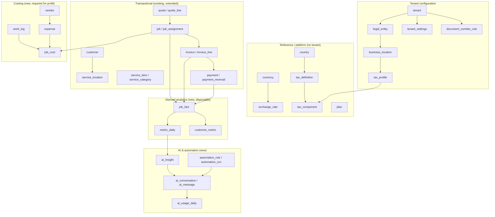

# Operonix — Data Model Impact Analysis

**Status:** Analysis only. No migration has been written or applied.
**Baseline:** `backend/src/main/resources/db/migration/V1__schema.sql` (the only migration), `docs/ERD.md`.
**Verification note:** every "current" statement below was read from the migration or the entity classes, not inferred.

---

## 1. Method

The current model was inventoried table-by-table from `V1__schema.sql`, then each proposed capability
(globalization, BI, AI, automation, subscription) was mapped onto it with one question: *can the
existing row shape carry this, or does a new row shape exist in the domain?* Anything that could be
satisfied by a new column or a lookup table was preferred over a new aggregate. Tables that only
anticipate hypothetical features are listed in §11 as explicitly **not** built.

---

## 2. Current baseline (verified)

15 tables, all tenant-owned except reference level:

| # | Table | Tenant column | Notes that matter for evolution |
| --- | --- | --- | --- |
| 1 | `tenant` | — (is the tenant) | `currency varchar(3)` with `CHECK IN ('USD','EUR','GBP','INR','AUD','CAD')`; `timezone varchar(64)`. No country, locale, legal entity, tax regime, or numbering policy. |
| 2 | `app_user` | `tenant_id` | `email` is **globally unique** (`uq_app_user_email`), not per tenant. Role is a single `varchar(20)` with a 4-value CHECK. |
| 3 | `refresh_token` | via `user_id` | Hashed, revocable, expiring. No device/session metadata. |
| 4 | `customer` | `tenant_id` | One flat address block, one contact name/email/phone, `status ACTIVE/ARCHIVED`. `billing_country varchar(2)`. No locale, tax id, or contact list. |
| 5 | `service_location` | `tenant_id` | Fixed `line1/line2/city/region/postal_code/country` columns; `postal_code varchar(16)`. |
| 6 | `service_item` | `tenant_id` | `unit` CHECK is `HOUR, VISIT, SQUARE_FOOT, ROOM, FLAT`; `tax_rate numeric(5,4)` stored **on the item**; no category, no cost, no taxable flag. |
| 7 | `quote` | `tenant_id` | `currency`, `subtotal/discount_amount/tax_amount/total`, `status` 6-value CHECK, `converted_job_id`. |
| 8 | `quote_line` | `tenant_id` | `tax_rate` and computed `line_subtotal/line_tax/line_total` snapshotted per line. |
| 9 | `job` | `tenant_id` | `scheduled_start/end` `timestamptz`, `status` 4-value, `recurrence NONE/WEEKLY/BIWEEKLY/MONTHLY`, `series_id` as a loose UUID with no definition table, `completed_at`. No duration actuals, no cost, no checklist. |
| 10 | `job_assignment` | `tenant_id` | `(job_id, user_id)` unique. |
| 11 | `invoice` | `tenant_id` | `currency`, money columns, `amount_paid`, `paid_at`, `void_reason`, status 5-value CHECK, derived `ck_invoice_paid amount_paid <= total`. |
| 12 | `invoice_line` | `tenant_id` | Same snapshot shape as `quote_line`. |
| 13 | `payment` | `tenant_id` | `amount`, `method` 5-value CHECK, `reference`, `paid_at`, `recorded_by`. **Append-only by convention**; no reversal link, no gateway id. |
| 14 | `audit_event` | `tenant_id` | `action`, `entity_type`, `entity_id`, `detail varchar(4000)`, `ip_address`, `request_id`. |
| 15 | `document_sequence` | `tenant_id` | PK `(tenant_id, doc_type, year)`, `doc_type IN ('QUOTE','JOB','INVOICE')`. Number format is hardcoded in `DocumentNumberService` as `PREFIX-YEAR-0000`. |

### Structural properties the current model gets right (keep)

- **Shared schema + mandatory tenant discriminator.** Every business table carries `tenant_id NOT NULL`
  with an FK to `tenant`. This is the cheapest correct model at current scale and should be preserved
  through P1; it is what the BI and AI layers can rely on for scoping.
- **Money snapshots on lines.** `quote_line` / `invoice_line` copy `unit_price`, `tax_rate` and computed
  amounts, so a later price or tax-rate edit never rewrites history. This is exactly the property the
  globalization work must extend, not replace.
- **Document sequences are per tenant/year with a locked row**, so numbering has no cross-tenant
  contention. Only the *format* needs to become configurable.
- **`audit_event` already exists** with actor, entity, IP and request id — the AI and automation work
  can reuse it rather than inventing a second audit trail.

### Structural gaps (the real cost drivers)

1. **A single currency per tenant, expressed as a CHECK constraint.** Multi-currency cannot be added by
   inserting rows; the constraint and every money column's meaning have to change (`§5.1`).
2. **Tax is a per-item percentage.** `service_item.tax_rate` and the per-line `tax_rate` cannot express
   components (CGST/SGST split), inclusive vs exclusive pricing, or a jurisdiction's rounding rule.
   `MoneyCalculator` also computes tax as `subtotal × rate` and pro-rates a header discount — a rule
   that is correct for simple exclusive tax and wrong for inclusive tax.
3. **No legal-entity / location structure.** `tenant` is simultaneously the workspace, the legal business
   and the currency owner. Multi-location and multi-entity reporting have no anchor row.
4. **No cost data anywhere.** There is no expense, no labour cost, no equipment cost. Job profitability
   is therefore *not computable today* — this is a data gap, not a query gap.
5. **No work-time records.** `job.scheduled_start/end` are planned times; `completed_at` is a single
   instant. Employee productivity and job labour cost cannot be derived from these.
6. **No analytics layer.** `ReportService` aggregates transactionally. Nothing is materialized.
7. **No AI or automation state.** No conversation, usage, quota, or rule tables.
8. **`job.series_id` is an unreferenced UUID** — recurring jobs exist as loose rows with no rule to
   regenerate them and no link to a definition.
9. **Fixed-width address and postal-code columns.** `postal_code varchar(16)` covers most countries but
   the flat `line1/line2/region` shape cannot represent district/prefecture structures without ambiguity,
   and there is no country-specific validation hook.
10. **`app_user.email` is globally unique** — a consultant working for two tenant workspaces is
    impossible. This is a real multi-tenant defect, flagged P0 in §6.
---

## 3. Proposed model at a glance

Three properties to read from that diagram:

1. **Reference data is global; configuration is per tenant; facts are per tenant.** `country`,
   `currency`, `tax_definition` and `plan` are platform-owned and cacheable. Everything a tenant can
   change lives in a tenant-scoped table.
2. **The `Derived` box is disposable.** Analytics tables can be dropped and rebuilt from
   `Txn` + `Cost` at any time. That is the test for whether a table belongs there.
3. **AI reads `Derived` or the semantic layer — never `Txn` directly, and never with generated SQL.**

---

## 4. New reference tables (no `tenant_id`)

| Table | Columns (key ones) | Why it exists | Phase |
| --- | --- | --- | --- |
| `country` | `code char(2) PK`, `name`, `default_currency char(3)`, `default_locale varchar(16)`, `postal_code_regex`, `phone_regex`, `address_format jsonb`, `date_format`, `active` | One row per country we activate. Drives address rendering/validation, defaults and locale without branching code on country names. | P0 |
| `currency` | `code char(3) PK`, `minor_units smallint`, `symbol`, `rounding_mode`, `active` | JPW/JPY has 0 minor units, KWD has 3. Money scale must be data, not a constant `2`. | P0 |
| `exchange_rate` | `id`, `base char(3)`, `quote char(3)`, `rate numeric(18,8)`, `as_of date`, `source varchar(32)`, `UNIQUE (base, quote, as_of)` | Historical FX for reporting and for the snapshot taken at invoice time. | P1 |
| `tax_definition` | `id`, `country_code`, `code` (e.g. `US-CA-SALES`, `GB-VAT-STD`, `IN-GST-18`), `name`, `mode` (`EXCLUSIVE`/`INCLUSIVE`), `rounding` (`LINE`/`DOCUMENT`), `effective_from`, `effective_to` | The jurisdictional container. Never referenced by business logic directly — always via `tax_profile`. | P1 |
| `tax_component` | `id`, `tax_definition_id`, `code` (`CGST`,`SGST`,`VAT`,`STATE`), `rate numeric(7,5)`, `compound boolean`, `position` | Enables component splitting (`9% + 9%` printed separately) without new columns. | P1 |
| `plan` | `id`, `code`, `name`, `limits jsonb`, `price_minor bigint`, `currency`, `active` | Subscription definitions for AI quotas and seat limits. | P2 |

`tax_definition` is deliberately **data, not code**. `MoneyCalculator` keeps its role as the single
arithmetic authority; the tax *rule* it applies is fetched from a definition row, so adding Japan's
consumption tax is an insert plus a profile, not a code branch.

---

## 5. Changes to existing tables

### 5.1 Money and currency (the highest-blast-radius change)

**Current:** `tenant.currency` with a 6-value CHECK; `quote.currency`, `invoice.currency` copied from
the tenant; every amount `numeric(12,2)`; `MoneyCalculator.MONEY_SCALE = 2` is a constant.

**Problem:** a tenant cannot invoice a foreign customer, and currency precision is hardcoded.

**Proposed:**

| Change | Detail |
| --- | --- |
| Drop `ck_tenant_currency` | Replace with FK to `currency(code)`. |
| `tenant.base_currency` | Rename/repurpose: the *reporting* currency of the workspace. |
| `invoice.currency` / `quote.currency` | Keep, now FK to `currency`. May differ from base currency. |
| `invoice.fx_rate numeric(18,8)` + `invoice.base_total`, `invoice.base_amount_paid` | Snapshot of the rate and the converted amount **at issue time**. Reporting never re-converts history. |
| `quote.fx_rate`, `quote.base_total` | Same, so a converted quote keeps its economics. |
| `tax_mode` on `tenant`/`entity` | `EXCLUSIVE` or `INCLUSIVE`; drives `MoneyCalculator` behaviour. |
| Precision | Amount columns stay `numeric(12,2)` for 2-dp currencies; a `currency.minor_units`-aware writer formats output. Storing 3-dp currencies needs `numeric(14,3)` on the four header money columns — decided per activated market, not now. |

This is an **expand/contract** migration: add columns and backfill `fx_rate = 1`, `base_total = total`,
drop the CHECK in a later release. No table rewrite, no downtime.

### 5.2 Tax

**Current:** `service_item.tax_rate numeric(5,4)`; `quote_line.tax_rate` / `invoice_line.tax_rate`
snapshot it; single rate per line.

**Proposed:**

- `service_item.tax_profile_id uuid NULL REFERENCES tax_profile(id)` — preferred path.
- `service_item.tax_rate` is **kept and deprecated**, not dropped: it is the fallback when no profile is
  assigned, which keeps every existing row and API response valid.
- New `line_tax_component` table: `(line_type, line_id, tax_component_id, base numeric, rate numeric, amount numeric)`
  — one row per printed component. Existing single-rate lines synthesize one component, so reports and
  PDFs can be uniform. `line_type` discriminates quote vs invoice lines to avoid two near-identical tables.
- `invoice.tax_mode`, `invoice.reverse_charge boolean`, `invoice.tax_number varchar(32)` — required for
  EU/US/JP documents; the tax number is a *snapshot* on the invoice, not read live from the customer.

### 5.3 Entities, locations, settings

| New table | Key columns | Notes |
| --- | --- | --- |
| `legal_entity` | `id`, `tenant_id`, `name`, `country_code`, `tax_number`, `base_currency`, `address jsonb`, `is_default` | The invoicing party — who is legally selling. `UNIQUE (tenant_id) WHERE is_default`. |
| `business_location` | `id`, `tenant_id`, `legal_entity_id`, `name`, `country_code`, `timezone`, `address jsonb`, `active` | Operational site. Jobs, catalog availability and reports can scope to it. |
| `tenant_settings` | `tenant_id PK`, `locale`, `week_start`, `fiscal_year_start_month`, `default_tax_profile_id`, `date_format`, `number_format`, `industry_template`, `feature_flags jsonb` | One row, 1:1 with tenant. Keeps `tenant` itself stable. |

`customer` and `service_location` gain `country_code char(2) REFERENCES country(code)` and an
`address jsonb` **alongside** the existing columns (not replacing them) so existing queries and DTOs keep
working while format-flexible rendering is introduced. `customer` also gains `tax_number`, `locale`,
`legal_entity_id` (which entity bills this customer), and `default_currency`.

### 5.4 Jobs, scheduling, recurring services

| Change | Reason |
| --- | --- |
| `recurring_series` (`id`, `tenant_id`, `customer_id`, `location_id`, `rrule`, `starts_on`, `ends_on`, `next_run_at`, `template jsonb`, `active`) | Replaces the loose `job.series_id` UUID with a real definition. `job.series_id` becomes an FK. |
| `job.actual_start`, `job.actual_end` | Duration actuals, needed for productivity and labour cost. |
| `job.status` CHECK extension | Add `ON_HOLD` and `NO_ACCESS` (real field-service outcomes) via `ALTER ... DROP/ADD CONSTRAINT`. |
| `job_checklist_item` | Deferred (§11) — only if a template system is funded. |

### 5.5 Costing — the prerequisite for profitability

These four tables are what turn "revenue" into "profit". Without them, job profitability is documented
as **unavailable**, never approximated.

| Table | Key columns | Source of truth for |
| --- | --- | --- |
| `work_log` | `id`, `tenant_id`, `job_id`, `user_id`, `started_at`, `ended_at`, `minutes`, `hourly_cost`, `billable` | Labour cost and productivity. `hourly_cost` is snapshotted from the user's rate at entry time. |
| `vendor` | `id`, `tenant_id`, `name`, `kind` (`SUBCONTRACTOR`,`SUPPLIER`,`OTHER`), `email`, `phone`, `active` | Who we owe. |
| `expense` | `id`, `tenant_id`, `job_id NULL`, `vendor_id NULL`, `category`, `amount`, `currency`, `fx_rate`, `base_amount`, `incurred_on`, `receipt_ref`, `created_by` | Materials, equipment, subcontractor, travel. Rows without a `job_id` are overhead. |
| `job_cost` | `id`, `tenant_id`, `job_id`, `cost_type` (`LABOR`,`MATERIAL`,`EQUIPMENT`,`SUBCONTRACTOR`,`OTHER`), `amount_base`, `source` (`WORK_LOG`,`EXPENSE`,`MANUAL`), `source_id` | Denormalized per-job roll-up. Recomputable; exists so profit queries do not scan two tables per request. |

`app_user.hourly_cost` is added so `work_log` has a rate to snapshot.

### 5.6 Payments, refunds, reconciliation

**Current:** payments are append-only by convention with no way to express a reversal, and
`ck_invoice_paid` forbids `amount_paid > total`. There is no gateway identity.

**Proposed (minimal, backwards-compatible):**

- `payment_reversal` (`id`, `tenant_id`, `payment_id`, `amount`, `reason`, `reversed_at`, `reversed_by`,
  `UNIQUE (payment_id)`) — a reversal never mutates or deletes the original payment, so the audit trail
  and gateway reconciliation stay intact. Partial reversal is supported by the `amount` column.
- `invoice.amount_refunded numeric(12,2) DEFAULT 0`; effective paid is `amount_paid - amount_refunded`.
- `payment.gateway varchar(32)`, `payment.gateway_ref varchar(120)`, `payment.status`
  (`PENDING`,`SETTLED`,`FAILED`,`REVERSED`) — all nullable, so manual payments keep working unchanged.
- `payment.currency` + `payment.fx_rate`, because a customer may settle in a different currency than the
  invoice was issued in; `invoice.amount_paid` is credited in the invoice currency using that rate.

### 5.7 Catalog

| Change | Reason |
| --- | --- |
| `service_category` (`id`, `tenant_id`, `name`, `position`, `active`) | Powers "revenue by service category" without string parsing. |
| `service_item.category_id`, `cost`, `taxable boolean` | Margin hints, gross profit per item, and tax-exempt items. |
| `service_item.unit` | CHECK replaced by FK to `unit_of_measure` (`code`, `label`, `tenant_id NULL` for platform units). A tenant can add `TRIP` without a migration. |

### 5.8 Identity and roles

**Verified defect:** `uq_app_user_email` is global, so one person cannot belong to two workspaces.

- `app_user` gains `locale`, `hourly_cost`, `last_active_at`.
- `UNIQUE (tenant_id, lower(email))` replaces the global unique index.
- `role` stays a discriminator on `app_user` for P1: `@PreAuthorize` already keys off role names
  throughout the codebase, and rewriting authorization is not justified by the global-expansion goal.
  A `member_invitation` table covers onboarding until a normalized RBAC model is funded (P3, deferred).

### 5.9 Numbering

**Current:** format hardcoded as `PREFIX-YEAR-0000` in `DocumentNumberService`; `doc_type` CHECK allows
three types.

**Proposed:** `document_number_rule` (`tenant_id`, `legal_entity_id`, `doc_type`, `prefix`,
`include_year`, `padding`, `reset_policy` (`YEARLY`/`NEVER`)) and `document_sequence` gains
`legal_entity_id`. The service reads the rule and formats; the existing locked-row allocation logic is
unchanged. Credit notes become a fourth `doc_type`.

---

## 6. New derived-analytics tables

All of these are **rebuildable**. A `ANALYTICS_REBUILD` admin job truncates and recomputes them from
`Txn` + `Cost`; that is recorded here so nobody mistakes them for system-of-record.

| Table | Grain | Key columns | Refreshed |
| --- | --- | --- | --- |
| `job_fact` | one row per job | `job_id PK`, `tenant_id`, `customer_id`, `location_id`, `completed_on date`, `service_category_id`, `invoiced_base numeric`, `paid_base numeric`, `cost_base numeric`, `gross_profit_base numeric`, `labor_minutes`, `status` | On job invoice/payment/cost change, plus nightly full pass |
| `invoice_aging_snapshot` | one row per open invoice per run | `run_date`, `invoice_id`, `tenant_id`, `days_overdue`, `bucket` (`CURRENT`,`1_30`,`31_60`,`61_90`,`90_PLUS`), `outstanding_base` | Nightly |
| `metric_daily` | tenant × date × metric | `tenant_id`, `metric_date`, `metric_code`, `value numeric`, `currency`, `dimension_key` nullable | Nightly + intraday for today |
| `customer_metric` | one row per customer | `customer_id PK`, `tenant_id`, `first_invoice_on`, `last_activity_on`, `lifetime_revenue_base`, `invoice_count`, `avg_days_to_pay`, `is_recurring` | Nightly |
| `ai_insight` | one row per generated insight | `id`, `tenant_id`, `kind`, `severity`, `fingerprint`, `facts jsonb`, `narrative`, `model`, `generated_at`, `acknowledged_by` | On demand / nightly |

`metric_daily.metric_code` values are a closed, documented set (`REVENUE_INVOICED`, `REVENUE_COLLECTED`,
`JOBS_COMPLETED`, `JOBS_CREATED`, `OUTSTANDING`, `OVERDUE`, `NEW_CUSTOMERS`, `ACTIVE_CUSTOMERS`).
Because it is a code column, no schema change is needed to add a metric — that is the point of the grain.

**Why aggregates instead of only materialized views:** a materialized view over `invoice` + `payment`
joined to `job` is fine at 10k rows and painful at 10M, and `REFRESH MATERIALIZED VIEW` locks or requires
`CONCURRENTLY` with a unique index. Delta-maintained rollup tables keep dashboard reads O(metrics) rather
than O(transactions), and can be corrected row-by-row when a late payment arrives. Postgres 16 also
supports `REFRESH ... CONCURRENTLY` only per view, so a chain of dependent views is worse than tables.

## 7. New AI and automation tables

| Table | Columns | Notes |
| --- | --- | --- |
| `ai_conversation` | `id`, `tenant_id`, `user_id`, `title`, `created_at`, `last_message_at`, `archived` | Scoped to tenant **and** user; never listed across tenants. |
| `ai_message` | `id`, `conversation_id`, `tenant_id`, `role` (`USER`,`ASSISTANT`,`TOOL`), `content`, `tool_name`, `tool_payload jsonb`, `tokens_in`, `tokens_out`, `model`, `latency_ms`, `created_at` | Retention-limited (default 90 days, configurable per tenant). |
| `ai_usage_daily` | `tenant_id`, `usage_date`, `tokens_in`, `tokens_out`, `requests`, `cost_micros bigint`, `PK (tenant_id, usage_date)` | Powers quotas and cost dashboards. `cost_micros` avoids float money. |
| `ai_query_audit` | `id`, `tenant_id`, `user_id`, `intent`, `metric_codes text[]`, `filters jsonb`, `row_count`, `rejected_reason`, `created_at` | Records the *resolved semantic query*, never raw model output, and never customer PII beyond ids. |
| `automation_rule` | `id`, `tenant_id`, `code`, `trigger_type`, `trigger_config jsonb`, `action_type`, `action_config jsonb`, `requires_approval boolean`, `enabled boolean`, `created_by` | Rules are declarative rows, not code paths, so they can be listed and disabled. |
| `automation_run` | `id`, `tenant_id`, `rule_id`, `subject_type`, `subject_id`, `status` (`PENDING_APPROVAL`,`APPROVED`,`EXECUTED`,`FAILED`,`SKIPPED`), `idempotency_key UNIQUE`, `payload jsonb`, `result jsonb`, `approved_by`, `attempts`, `created_at`, `executed_at` | The idempotency key is `(rule_id, subject_id, period)` so a retry cannot double-send a reminder. |

`automation_run.idempotency_key` being `UNIQUE` is the single most important constraint in this group: it
is what makes the reminder/follow-up jobs safe to retry under at-least-once scheduling.

---

## 8. Proposed ER diagram

Every relationship shown between `tenant` and the existing tables exists in `V1__schema.sql` today.
Everything else in this diagram is proposed. Nothing here has been written as a migration.

```mermaid
erDiagram
    COUNTRY ||--o{ TAX_DEFINITION : "defines"
    COUNTRY ||--o{ CURRENCY : "defaults to"
    CURRENCY ||--o{ EXCHANGE_RATE : "base"
    TAX_DEFINITION ||--o{ TAX_COMPONENT : "splits into"

    TENANT ||--o{ LEGAL_ENTITY : "owns"
    TENANT ||--|| TENANT_SETTINGS : "configured by"
    TENANT ||--o{ BUSINESS_LOCATION : "operates"
    TENANT ||--o{ DOCUMENT_NUMBER_RULE : "numbers with"
    TENANT ||--o{ APP_USER : "employs"
    TENANT ||--o{ CUSTOMER : "serves"
    TENANT ||--o{ SERVICE_CATEGORY : "groups"
    TENANT ||--o{ SERVICE_ITEM : "sells"
    TENANT ||--o{ QUOTE : "issues"
    TENANT ||--o{ JOB : "schedules"
    TENANT ||--o{ INVOICE : "bills"
    TENANT ||--o{ PAYMENT : "collects"
    TENANT ||--o{ EXPENSE : "spends"
    TENANT ||--o{ AUTOMATION_RULE : "automates"
    TENANT ||--o{ AI_CONVERSATION : "scopes"

    LEGAL_ENTITY ||--o{ BUSINESS_LOCATION : "contains"
    LEGAL_ENTITY ||--o{ TAX_PROFILE : "registers"
    TAX_PROFILE ||--o{ TAX_COMPONENT : "applies"
    BUSINESS_LOCATION ||--o{ JOB : "hosts"

    APP_USER ||--o{ REFRESH_TOKEN : "sessions"
    APP_USER ||--o{ JOB_ASSIGNMENT : "assigned"
    APP_USER ||--o{ WORK_LOG : "logs time"
    APP_USER ||--o{ AUDIT_EVENT : "acts"

    CUSTOMER ||--o{ SERVICE_LOCATION : "has"
    CUSTOMER ||--o{ QUOTE : "requests"
    CUSTOMER ||--o{ JOB : "receives"
    CUSTOMER ||--o{ INVOICE : "owes"

    SERVICE_CATEGORY ||--o{ SERVICE_ITEM : "contains"
    SERVICE_ITEM ||--o{ QUOTE_LINE : "referenced by"
    SERVICE_ITEM ||--o{ INVOICE_LINE : "referenced by"

    QUOTE ||--o{ QUOTE_LINE : "priced by"
    QUOTE |o--o| JOB : "converts to"
    JOB ||--o{ JOB_ASSIGNMENT : "staffed by"
    JOB ||--o{ WORK_LOG : "consumes"
    JOB ||--o{ JOB_COST : "accrues"
    JOB |o--o{ INVOICE : "billed by"
    JOB }o--|| RECURRING_SERIES : "instance of"
    JOB ||--o| JOB_FACT : "summarized by"

    INVOICE ||--o{ INVOICE_LINE : "priced by"
    INVOICE ||--o{ PAYMENT : "settled by"
    INVOICE ||--o{ LINE_TAX_COMPONENT : "taxed by"
    PAYMENT ||--o| PAYMENT_REVERSAL : "reversed by"

    VENDOR ||--o{ EXPENSE : "billed"
    EXPENSE }o--o| JOB_COST : "feeds"
    WORK_LOG }o--o{ JOB_COST : "feeds"

    CUSTOMER ||--o| CUSTOMER_METRIC : "aggregated as"
    METRIC_DAILY }o--|| TENANT : "reports on"
    AI_CONVERSATION ||--o{ AI_MESSAGE : "contains"
    AI_CONVERSATION ||--o{ AI_QUERY_AUDIT : "audited by"
    AI_INSIGHT }o--|| TENANT : "surfaces to"
    AUTOMATION_RULE ||--o{ AUTOMATION_RUN : "executes"
    AUTOMATION_RUN ||--o| AI_INSIGHT : "may create"
```

Relationship notation used above: `||--o{` one-to-many required, `|o--o{` optional-to-many,
`||--o|` one-to-zero-or-one, `}o--o{` many-to-many through a junction.

### Why a few deliberate shape choices

- **`job_cost` is not an FK from `expense`.** Costs arrive from three sources (`work_log`, `expense`,
  manual adjustment) and must roll up identically, so `job_cost` is the single read surface with
  `source`/`source_id` provenance.
- **`line_tax_component` uses a polymorphic `line_id` + `line_type`.** Two tables would duplicate the
  same columns; a check constraint plus an index on `(line_type, line_id)` keeps integrity acceptable
  because lines are never deleted independently of their header (only via cascade).
- **`job_fact` has `job_id` as its primary key.** It is a projection of `job`, so a surrogate id would add
  nothing and would allow orphan facts.

---

## 9. Tenant isolation in the proposed model

The existing invariant is: every business table has `tenant_id NOT NULL` and every repository query adds
`tenant_id = :tenantId` (verified: `CustomerRepository`, `QuoteRepository`, `PaymentRepository`,
`AuditEventRepository` all take the tenant as a parameter rather than deriving it in SQL).

Rules for every table proposed above:

| Rule | Applies to |
| --- | --- |
| `tenant_id uuid NOT NULL REFERENCES tenant(id)` as the **first** column of every composite index | all tenant tables |
| `UNIQUE` constraints are always tenant-prefixed (`UNIQUE (tenant_id, ...)`) — except intentionally global reference tables | all |
| FK targets carry the tenant too, or the service re-checks ownership before writing (defence against id-substitution) | `job_cost`, `work_log`, `expense`, `line_tax_component`, `automation_run` |
| No cross-tenant joins; BI queries always filter `metric_daily.tenant_id = :tenantId` | analytics |
| AI tools receive `tenantId` from the authenticated principal, never from the prompt or request body | AI |

**Row-level security:** not recommended now. The application already scopes in every repository and a
second enforcement layer would require threading a session GUC through the pooled DataSource — real work
with no behaviour change at current scale. It *is* the right defence-in-depth for a future
"analytics on a shared warehouse" step, so it is recorded as an option in
`ARCHITECTURAL_DECISIONS.md` (ADR-08) rather than silently skipped.

**The one isolation gap that exists today** is `app_user.email` being globally unique: it prevents one
person from joining two tenants, and it also lets a registration attempt reveal that an email exists in
another tenant. Fixing it is P0 because it blocks the multi-workspace product story, and it is a
constraint change plus an index, not a redesign.

## 10. Indexing plan

Current indexes are reasonable for the single-tenant-at-a-time query patterns. New indexes, justified by
the capability that needs them:

| Index | Query it serves |
| --- | --- |
| `invoice (tenant_id, status, due_date) WHERE status IN ('SENT','PARTIALLY_PAID')` | Overdue receivables and aging |
| `payment (tenant_id, paid_at)` — exists | Collection trend (already covered) |
| `job (tenant_id, scheduled_start)` — exists | Scheduling and completion counts |
| `job (tenant_id, status, completed_at)` | Job completion rate by period |
| `job_fact (tenant_id, completed_on, service_category_id)` | Revenue and profit by category |
| `expense (tenant_id, incurred_on)`, `expense (tenant_id, job_id)` | Cost roll-ups |
| `work_log (tenant_id, user_id, started_at)` | Productivity by employee |
| `metric_daily (tenant_id, metric_date, metric_code)` | Dashboard reads |
| `customer_metric (tenant_id, last_activity_on)` | Inactive-customer detection |
| `ai_message (conversation_id, created_at)` | Conversation replay |
| `automation_run (tenant_id, status, created_at)` | Approval queue |
| `exchange_rate (base, quote, as_of DESC)` | Rate lookup at issue time |

Partial indexes are preferred where the predicate is stable (`WHERE status IN (...)`), because they stay
small and the planner can use them directly. Every index above is `tenant_id`-leading so it is usable by
the tenant-scoped repositories without a separate tenant filter cost.

**What will become a bottleneck:** `AuditService` writes synchronously in the request transaction, and
`audit_event (tenant_id, created_at DESC)` will grow fastest of all tables. At current scale this is fine.
The documented trigger for change is >5M audit rows per tenant, at which point the write moves behind an
outbox table and the read side to `audit_event_archive`.

## 11. Migration strategy

Flyway with forward-only, numbered migrations; `V1__schema.sql` stays untouched as the baseline.

| Step | Content | Reversible? |
| --- | --- | --- |
| `V2__reference_data.sql` | `country`, `currency`, `unit_of_measure`, `tax_definition`, `tax_component`; seed rows for activated markets | Yes (drop) |
| `V3__tenant_configuration.sql` | `legal_entity`, `business_location`, `tenant_settings`, `tax_profile`, `document_number_rule`; backfill one default entity + settings row per existing tenant | Data backfill is idempotent |
| `V4__money_and_tax.sql` | `fx_rate`/`base_total` on quote & invoice with `DEFAULT 1`/backfill; drop `ck_tenant_currency`; `line_tax_component`; `service_item.tax_profile_id` | Expand-only for one release |
| `V5__catalog_and_identity.sql` | `service_category`, `service_item.category_id/cost/taxable`, `unit_of_measure` FK, `app_user` new columns, swap global email unique for tenant-scoped | Index swap needs care |
| `V6__costing.sql` | `work_log`, `vendor`, `expense`, `job_cost`, `job.actual_start/actual_end` | Yes |
| `V7__payments.sql` | `payment_reversal`, `invoice.amount_refunded`, `payment.gateway*`, `payment.status`, `payment.currency/fx_rate` | Yes |
| `V8__analytics.sql` | `job_fact`, `metric_daily`, `customer_metric`, `invoice_aging_snapshot` + indexes | Yes (drop and rebuild) |
| `V9__ai_and_automation.sql` | AI and automation tables | Yes |

**Rules applied to every migration:**

1. **Add nullable or defaulted, backfill, then tighten** — never add a `NOT NULL` column without a default
   in the same transaction as the backfill.
2. **No destructive statement in the same release that stops writing the column.** Deprecated columns
   (`service_item.tax_rate`) live at least one release.
3. **No long lock:** backfills run in batches with a documented statement timeout; on Cloud SQL the
   migration runs from the deployment job, not from application startup, once the schema outgrows a
   single-request window.
4. **Every migration must be tested against an empty database and against a database seeded with the
   current MVP shape** — the second case is the one that catches backfill mistakes.

---

## 12. Explicitly deferred (not built)

Listed so that a future agent does not add them "for completeness". Each has a stated trigger.

| Not building | Why | Trigger to reconsider |
| --- | --- | --- |
| Normalized `role` / `permission` / `role_permission` | Four roles cover every current screen; a permission matrix would touch every `@PreAuthorize` with no user-visible gain | A customer needs a custom role, or per-object permissions (e.g. "own customers only") |
| Separate `quote_tax_component` / `invoice_tax_component` tables | One polymorphic table with a discriminator is smaller and always queried the same way | A component needs type-specific columns |
| `job_checklist_item` / template library | No UI or business requirement yet; templates are a product decision | Field-service customers ask for repeatable checklists |
| `product` / `inventory` / stock movements | Operonix bills services, not stock. Adding inventory is a different product | A customer needs parts consumed per job with stock levels |
| Data warehouse (BigQuery export) | At MVP volumes, Postgres aggregates answer every documented metric in milliseconds | >50M transaction rows per tenant, or cross-tenant benchmarking |
| Row-level security policies | See §9 | Multi-tenant sharing of one connection pool with untrusted query construction (e.g. a future BI SQL console) |
| Per-tenant database or schema | Operationally heavy for zero current benefit | A contract requires physical data separation |
| `exchange_rate` auto-sync service | Historical snapshots matter more than live rates; a daily manual/cron import is enough | A market requires daily multi-currency invoicing |
| Customer portal tables (`portal_user`, `portal_session`) | Distinct product surface, not needed to be industry-independent | Customer self-service is funded |
| Soft-delete columns everywhere | Current model uses status columns where it matters (`customer.status`, `invoice.status`) | A compliance requirement for recoverable deletion |

## 13. Verification notes for this document

- **Verified from the repository:** the 15 tables and every constraint quoted in §2 (read from
  `V1__schema.sql`); the hardcoded number format (`DocumentNumberService.next`); tax arithmetic
  (`MoneyCalculator.calculate`, including proportional discount and 2-dp rounding); tenant-scoped
  repository signatures; `tenant.currency` CHECK values; `app_user` global email unique.
- **Inferred, not verified:** the exact row counts at which the indexing advice matters, and the
  Cloud SQL instance sizes. Both are marked as estimates wherever they appear.
- **Cannot be verified from the repository:** whether any current tenant actually operates in more than
  one country, and whether customers require inclusive tax. These are business facts that change
  sequencing in `IMPLEMENTATION_ROADMAP.md`, and are listed there under "decisions requiring validation".
- This document proposes no code change. The proposed ER diagram is a target state; the only artefact
  that may be implemented before approval is further documentation.
