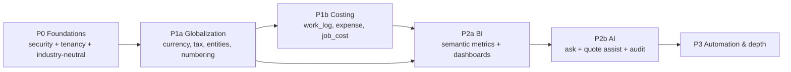

# Operonix — Implementation Roadmap

**Status:** proposal awaiting approval. Nothing in this roadmap has been started.
**Estimates:** given in *engineer-days for one experienced full-stack engineer already fluent in this
codebase*. They are planning aids, not commitments; every P0 item is a small change to code that exists.

---

## 1. Sequencing principle

Three rules decided the order, and they explain why the roadmap is not organised by feature:

1. **Nothing that changes money can ship before the money model is correct.** Currency precision,
   inclusive tax and component tax change what `MoneyCalculator` produces. Building BI or AI on top of a
   soon-to-change calculation means rebuilding both.
2. **Nothing that reports on cost can ship before cost exists.** Job profitability needs `work_log` and
   `expense` rows. Shipping a "profit" dashboard over missing cost data would produce confident, wrong
   numbers — the single worst outcome for this product.
3. **AI is last on purpose.** It is the most expensive to build and the easiest to add once metrics,
   tenants scoping, quotas and audit exist. Building it first would mean building the semantic layer
   twice.

The only hard dependency chain is `P0 → P1a → P1b → P2a → P2b`. P3 items are independent of each other and
can be reordered by customer demand.

---

## 2. Phase P0 — Foundations (must ship first)

Goal: make the product safe to sell to a *second kind* of business and a *second* workspace member,
without touching the financial model.

| # | Item | Type | Complexity | Effort | Depends on |
| --- | --- | --- | --- | --- | --- |
| P0-1 | Remove cleaning-specific copy, demo data, seed templates and UI labels; introduce `industry_template` seed profiles (generic field-service default) | Mandatory | S | 3 | — |
| P0-2 | Industry-neutral terminology pass: "cleaner"→"technician"→role-neutral label, service catalogue wording, onboarding copy | Mandatory | S | 2 | P0-1 |
| P0-3 | Tenant-scoped unique email (`UNIQUE (tenant_id, lower(email))`) + registration/invite flow unaffected | Mandatory | S | 1.5 | — |
| P0-4 | Shared rate limiter (login + all authenticated endpoints), replacing the in-process limiter | Mandatory | S | 2 | infra: Memorystore or DB counter |
| P0-5 | Refresh-token rotation with reuse detection (revoke family) | Mandatory | S | 1.5 | — |
| P0-6 | Structured logging with redaction list + no-secret-in-log test | Mandatory | S | 1 | — |
| P0-7 | `tenant.home_region` column (single region active) and `country`/`currency` reference tables with seed data | Recommended | S | 2 | — |
| P0-8 | Configurable document number format (`document_number_rule`) with a default that reproduces today's format exactly | Mandatory | M | 3 | P0-7 |
| P0-9 | Frontend i18n scaffolding (message catalogue + `Intl` formatting already partly present in `format.ts`) | Recommended | M | 3 | — |
| P0-10 | Regression tests for every P0 item, incl. a tenant-isolation sweep over existing endpoints | Mandatory | M | 3 | all above |

**P0 exit gate:** existing test suite green; new isolation and refresh-reuse tests green; a new tenant can
be created for a non-cleaning industry with no cleaning vocabulary anywhere in the UI; document numbers
are unchanged for existing tenants.

**Deliberately not in P0:** multi-currency, multi-tax, cost tracking, BI, AI. Each would double P0's size.

---

## 3. Phase P1a — Globalization and financial correctness

Goal: a tenant in any of the four target markets can be configured, and its documents are legally
plausible (subject to the legal validation items in §8).

| # | Item | Type | Complexity | Effort | Depends on |
| --- | --- | --- | --- | --- | --- |
| P1a-1 | `legal_entity`, `business_location`, `tenant_settings` + backfill one default entity per tenant | Mandatory | M | 4 | P0-7 |
| P1a-2 | Currency: `currency.minor_units`, drop the `tenant.currency` CHECK, per-document currency | Mandatory | L | 6 | P1a-1 |
| P1a-3 | FX snapshot on quote/invoice (`fx_rate`, `base_total`) with backfill `= 1` | Mandatory | M | 3 | P1a-2 |
| P1a-4 | `MoneyCalculator` precision + inclusive/exclusive mode; **deterministic tests first** | Mandatory | L | 8 | P1a-2 |
| P1a-5 | `tax_definition`/`tax_component`/`tax_profile` + `line_tax_component`; existing single-rate rows synthesize one component | Mandatory | L | 10 | P1a-4 |
| P1a-6 | Invoice legal fields: `tax_number`, `reverse_charge`, `tax_mode`, component breakdown in the PDF/print view | Mandatory | M | 5 | P1a-5 |
| P1a-7 | Country-aware address model (`address_format` + regex validation) while keeping existing columns | Recommended | M | 4 | P0-7 |
| P1a-8 | Locale-aware date/number/currency rendering in the frontend; fiscal-year setting | Recommended | M | 4 | P0-9 |
| P1a-9 | Payment reversals (`payment_reversal`), `amount_refunded`, corrected balance/status recomputation | Mandatory | M | 5 | P1a-4 |
| P1a-10 | Payment gateway abstraction (interface + one provider or a no-op manual provider) | Optional | M | 5 | P1a-9 |

**P1a exit gate:** inclusive-tax totals equal the entered gross; JPY invoices round to 0 dp and render
without decimals; a USD invoice for an INR tenant stores a durable FX snapshot that never changes when
rates move; reversing a payment restores the exact prior balance; all existing tenants keep their
current numbers and totals (verified by a data-equality test on a seeded MVP database).

**Highest risk in the whole roadmap:** P1a-4 and P1a-5 touch every financial number. Mitigation is
specified: characterization tests capture today's outputs for a matrix of lines (quantities with 3 dp,
zero-rate lines, header discount, 100% discount) *before* the calculator changes, so any behavioural
difference is visible in the diff of expected values.
---

## 4. Phase P1b — Costing (the prerequisite for profit)

Goal: the platform knows what a job cost, not just what it billed.

| # | Item | Type | Complexity | Effort | Depends on |
| --- | --- | --- | --- | --- | --- |
| P1b-1 | `work_log` + `app_user.hourly_cost` + technician time entry (start/stop and manual) | Mandatory for profit | M | 6 | — |
| P1b-2 | `vendor` + `expense` (job-linked and overhead) with receipt reference | Mandatory for profit | M | 6 | — |
| P1b-3 | `job_cost` roll-up (`LABOR`/`MATERIAL`/`EQUIPMENT`/`SUBCONTRACTOR`/`OTHER`) recomputed on change | Mandatory | M | 4 | P1b-1, P1b-2 |
| P1b-4 | Job cost UI: cost panel on job detail, expense list, labour hours | Mandatory | M | 5 | P1b-3 |
| P1b-5 | `service_category` + `service_item.cost`, giving a *planned* margin for quotes | Recommended | S | 3 | — |
| P1b-6 | `job.actual_start/actual_end`; derive duration without a work log when only these exist | Recommended | S | 2 | — |
| P1b-7 | `recurring_series` table + FK from `job.series_id`, with the existing recurrence behaviour preserved | Recommended | M | 5 | — |

**P1b exit gate:** a completed job shows revenue, cost by type, and gross profit; a job with no cost rows
renders **"cost not recorded"** rather than a 100%-margin number. That distinction is the acceptance
criterion, not a nicety.

---

## 5. Phase P2a — Business Intelligence

Goal: dashboards that answer the owner's questions, built only on metrics whose inputs exist.

| # | Item | Type | Complexity | Effort | Depends on |
| --- | --- | --- | --- | --- | --- |
| P2a-1 | Metric catalogue as code (codes, formulas, required inputs, availability rules) | Mandatory | M | 4 | — |
| P2a-2 | Query service: tenant-scoped aggregation with date range, timezone, currency conversion | Mandatory | L | 8 | P1a-3, P1a-8 |
| P2a-3 | `metric_daily` + `customer_metric` + `job_fact` maintenance job (nightly + on-demand for today) | Mandatory | L | 8 | P2a-1 |
| P2a-4 | Receivables aging (`invoice_aging_snapshot`) + overdue API | Mandatory | M | 4 | — |
| P2a-5 | Dashboard UI: revenue (invoiced vs collected), outstanding, pipeline, jobs completed | Mandatory | L | 8 | P2a-2 |
| P2a-6 | Customer intelligence UI (new vs recurring, LTV, inactive) | Recommended | M | 5 | P2a-3 |
| P2a-7 | Employee productivity UI (jobs assigned/completed, hours, completion rate) with explicit "time not tracked" states | Recommended | M | 5 | P1b-1 |
| P2a-8 | Profitability UI (job/customer/category) gated on cost-data completeness | Recommended | M | 5 | P1b-3 |
| P2a-9 | CSV export per report | Optional | S | 2 | P2a-2 |

**P2a exit gate:** every dashboard number can be traced to a metric definition; a tenant with no cost data
sees profitability as unavailable, not zero; period-over-period comparisons respect tenant timezone and
DST; a 100k-invoice seeded tenant returns the dashboard in under 500 ms locally.

**Cost note:** this phase is pure engineering; no third-party spend beyond existing database capacity.
The nightly job can run as a Cloud Run Job on a schedule, which is near-zero cost at this volume.

---

## 6. Phase P2b — Operonix AI

Goal: natural-language answers over the P2a metric layer, quote drafting, and auditability — with no
generated SQL and no autonomous financial action.

| # | Item | Type | Complexity | Effort | Depends on |
| --- | --- | --- | --- | --- | --- |
| P2b-1 | `LlmProvider` interface + Gemini adapter + a deterministic fake provider for tests | Mandatory | M | 4 | — |
| P2b-2 | Intent schema + validator (metrics, filters, dimensions whitelist) with typed rejection | Mandatory | L | 8 | P2a-1 |
| P2b-3 | Ask endpoint: intent → metric service → facts → narration; facts-only fallback when the model fails | Mandatory | L | 8 | P2b-2 |
| P2b-4 | `ai_conversation`/`ai_message`/`ai_query_audit` persistence + retention job | Mandatory | M | 4 | — |
| P2b-5 | Quotas and usage metering (`ai_usage_daily`), enforced before the provider call | Mandatory | M | 4 | P0-4 |
| P2b-6 | AI chat UI with citations to the underlying report and a clear "AI-generated" label | Mandatory | M | 6 | P2b-3 |
| P2b-7 | Quote assistance: service suggestions + description drafting, returns a draft the user accepts | Recommended | L | 8 | P2b-1, P1b-5 |
| P2b-8 | Insight cards (revenue drop, inactive customers, overdue pattern) written from computed facts | Recommended | M | 6 | P2a-3 |
| P2b-9 | Cost dashboard for AI spend (tokens, requests, cost per tenant) | Recommended | S | 2 | P2b-5 |

**P2b exit gate:** cross-tenant prompt attempts return only caller data; unknown metrics are rejected
before any query runs; quota exhaustion returns a typed error with zero provider calls; every AI answer's
numbers match the equivalent BI report exactly (automated comparison test).

**Cost note:** the dominant new cost is model tokens. Budgeting guidance is in
`OPERONIX_AI_DESIGN.md` §10; the plan must include a hard per-tenant daily cap from day one, because a
runaway loop is the realistic financial risk, not normal usage.

---

## 7. Phase P3 — Automation and depth

| # | Item | Type | Complexity | Effort | Notes |
| --- | --- | --- | --- | --- | --- |
| P3-1 | `automation_rule`/`automation_run` + scheduler + approval queue + idempotency | Recommended | L | 12 | Requires an outbound channel (email) first |
| P3-2 | Email delivery for quotes/invoices/reminders (provider + templates + unsubscribe) | Mandatory for P3-1 | L | 8 | New third-party service |
| P3-3 | Portal for customers (view/accept quote, pay invoice) | Optional | XL | 20+ | Separate product surface |
| P3-4 | Multi-region activation (L2 residency) | Optional | XL | 15+ | Only for a market that requires it |
| P3-5 | Normalized RBAC (`role`/`permission`) | Optional | L | 10 | Only when a customer needs custom roles |
| P3-6 | E-invoicing integrations (India IRN, others) | Blocked on legal | XL | 20+ | Not before a market demands it |
| P3-7 | MFA, session management, data export/erasure endpoints | Recommended | M | 8 | Security backlog H7/H8/H10 |

---

## 8. Decisions requiring the owner's approval

These are not engineering choices; the architecture differs depending on the answer.

| # | Decision | Why it changes the plan | Default if unanswered |
| --- | --- | --- | --- |
| D1 | Which markets launch first, in which order? | Determines which tax definitions and gateways are built in P1a | India first (existing region), then UK/US |
| D2 | Inclusive or exclusive pricing as the default for new tenants? | Changes `MoneyCalculator` default and every UI label | Exclusive default, inclusive per tax profile |
| D3 | Is job profitability in scope for MVP-2, or is revenue-only BI acceptable first? | If revenue-only, P1b can follow P2a and the roadmap compresses by ~15 days | Profitability included, because it is the differentiator |
| D4 | Who may see cost and margin data? | Drives the scope layer; owner-only is cheapest | OWNER + ADMIN |
| D5 | Is a per-tenant AI quota a paid add-on? | Determines whether `plan`/subscription tables land in P2b or P3 | Quota included with a conservative cap |
| D6 | Do we accept Google Gemini as the sole initial provider, with its data terms? | Provider choice is a contract decision, not just technical | Gemini via an abstraction; no data used for training |
| D7 | Is physical data residency required for the first market? | L1 (column + later routing) vs L2 (multi-region now) is a large cost difference | L1 now, L2 on demand |
| D8 | Do we need MFA before the first external customer? | Security backlog ordering | Recommended before launch |

---

## 9. Effort, critical path and calendar shape

| Phase | Mandatory effort | Recommended included | Calendar at 1 engineer | At 2 engineers |
| --- | --- | --- | --- | --- |
| P0 | ~19 d | ~24 d | 5 weeks | 3 weeks (only partly parallel) |
| P1a | ~55 d | ~65 d | 13 weeks | 8 weeks (P1a-4/5 stay serial) |
| P1b | ~21 d | ~31 d | 6 weeks | 4 weeks |
| P2a | ~32 d | ~46 d | 9 weeks | 5 weeks |
| P2b | ~34 d | ~52 d | 10 weeks | 6 weeks |
| P3 | — | ~40 d | — | — |

Total to the end of P2b with recommended scope: roughly **43 engineer-weeks**, i.e. ~10 months solo or
~6 months with two engineers. The mandatory-only path is ~31 weeks.

**Critical path:** `P0-8 → P1a-2 → P1a-4 → P1a-5 → P1a-6 → P1b-3 → P2a-3 → P2b-2 → P2b-3`.
Everything on that path touches money or metrics. Parallelisable off the critical path: frontend i18n,
address model, receivables aging, expense UI, AI provider adapter, quota plumbing.

**What can be cut without breaking the story:** P2a-6/7/8, P2b-7/8/9 and all of P3. Cutting P1b removes
profitability, which is the main differentiator versus a generic invoicing tool — so if schedule pressure
appears, cut P2a depth before P1b.

---

## 10. Risk register

| # | Risk | Likelihood | Impact | Mitigation | Owner |
| --- | --- | --- | --- | --- | --- |
| R1 | Money/tax refactor changes existing totals | Medium | **Severe** (wrong invoices) | Characterization tests before the change; data-equality test on a seeded MVP DB; feature flag per tenant for inclusive mode | Eng |
| R2 | Scope creep turns P1a into a tax engine project | High | High (schedule) | Tax definitions are data with 4 activated markets, not a rules engine; e-invoicing explicitly out of scope | Product |
| R3 | Profitability ships over incomplete cost data | Medium | **Severe** (misleading owners) | Availability rules in the metric catalogue; UI must show "cost not recorded"; acceptance gate in P1b | Product + Eng |
| R4 | AI cost overrun | Medium | Medium | Hard per-tenant daily cap, usage metering before the call, cost dashboard, kill switch | Eng |
| R5 | AI produces plausible but wrong narratives | Medium | High (trust) | Numbers always come from the server; model only narrates; "AI-generated" labelling; facts-only fallback | Eng |
| R6 | Cross-tenant leak via a new endpoint | Low | **Severe** | Tenant-isolation test sweep per phase; scope derived from principal, never request | Eng |
| R7 | Legal/compliance claims outrun reality | Medium | High (contractual) | §8 of the security doc enforced in marketing and docs; no "compliant" claim without sign-off | Business |
| R8 | Migration locks on a large production table | Low now, rising | Medium | Batched backfills, deploy-time migrations, `CONCURRENTLY` index creation | Eng |
| R9 | Provider API deprecation/model change | Medium over 12 months | Medium | `LlmProvider` abstraction + fake provider in tests; model name is configuration | Eng |
| R10 | Two engineers, one codebase, financial refactor | Medium | Medium | Critical path held by one owner; P1a-4/5 not parallelised across people | Eng lead |

---

## 11. Testing requirements per phase

The existing suite is the baseline; each phase adds the tests listed in the respective design document.
Non-negotiable per phase:

| Phase | Must add |
| --- | --- |
| P0 | Tenant-isolation sweep; refresh-reuse; log redaction; industry-neutral seed regression (no cleaning vocabulary in default seeds) |
| P1a | Tax matrix (exclusive/inclusive × component × discount × zero-rate); currency precision (JPY/USD/INR); FX snapshot immutability; payment reversal; document-number back-compat |
| P1b | Cost roll-up idempotency (editing an expense updates `job_cost` once); unavailable-cost rendering; work-log overlap validation |
| P2a | Metric definition tests (each formula against hand-computed fixtures); timezone/DST boundary; aggregate-vs-transactional equality (materialized numbers must match a live query) |
| P2b | Intent validation rejections; cross-tenant prompt; quota before provider call; AI-number equals BI-number; provider failure fallback; prompt-injection corpus |
| P3 | Automation idempotency under concurrency; approval permission checks; unsubscribe compliance |

Performance gates: migrations on a 100k-invoice seeded DB under 60 s; dashboard p95 under 500 ms locally;
AI ask p95 under 6 s including narration.

---

## 12. Milestones and demo checkpoints

| Milestone | Demonstrates | Phase gate |
| --- | --- | --- |
| M0 — Industry-neutral | A pest-control tenant signs up and never sees cleaning wording | P0 exit |
| M1 — Global documents | The same job is invoiced in INR (GST split, inclusive) and USD (exclusive sales tax) with correct totals and numbering | P1a exit |
| M2 — Cost truth | A completed job shows revenue, cost and gross profit, and an un-costed job says so | P1b exit |
| M3 — Owner dashboard | Revenue invoiced vs collected, receivables aging, customer intelligence for a seeded 100k-invoice tenant | P2a exit |
| M4 — Ask Operonix | "Which customers are overdue and by how much?" returns the same figures as the aging report, with an audit row | P2b exit |
| M5 — Automation | An approved reminder run sends exactly once, and a retry sends nothing | P3 gate |

---

## 13. Comparison: keep the current architecture vs evolve it

Neither option is "rewrite". The question is scope of change on a *working* modular monolith.

| Dimension | Option A — keep MVP as-is (cleaning-focused, single currency) | Option B — this proposal (P0→P2b) | Option C — full rebuild (rejected) |
| --- | --- | --- | --- |
| Time to first non-cleaning customer | Never (product blocks it) | ~5 weeks (P0) | 6–9 months |
| Multi-currency | Not possible (CHECK constraint) | Per-document currency + FX snapshot | n/a |
| Inclusive tax (UK/JP) | Wrong totals | Configurable per tax profile | n/a |
| Cost/profit insight | Not possible (no cost data) | P1b, ~6 weeks | n/a |
| Owner dashboards | Transactional reports only | Aggregated BI, sub-second | n/a |
| AI assistant | Not possible (no metric layer) | Grounded, audited, quota-bound | n/a |
| Risk | Product stalls; no second market | Money refactor risk (mitigated by tests) | Throws away a tested, verified MVP |
| Code churn | None | Additive: 9 migrations, no table dropped, existing APIs preserved | Total |
| Existing tests | Keep passing | Must keep passing + expanded | Discarded |
| Team cost to end state | 0 | ~43 engineer-weeks | ~80+ engineer-weeks |

**Recommendation: Option B.** The MVP's core (tenant-scoped modular monolith, snapshot money lines,
locked document sequences, audit table) is the right foundation; every phase adds tables and columns
rather than replacing them. Option C is only defensible if the tenancy model were wrong, and it is not.

### What would change the recommendation

- If a target market requires **physical per-tenant data separation** as a contract condition, the
  tenancy model moves to per-tenant databases, which is a genuine re-architecture — Option C territory
  for the data layer only.
- If **e-invoicing mandates** land in the first market before P1a, the tax model must be designed with the
  mandate's schema from the start rather than retrofitted.

---

## 14. Cost considerations (order of magnitude, not a quote)

All figures are directional and must be confirmed against current GCP and provider pricing before any
budget commitment. They are included because the AI feature changes the cost *shape* from fixed to
variable.

| Item | Driver | MVP today | After P2b | Notes |
| --- | --- | --- | --- | --- |
| Cloud Run | requests + min instances | ~$0–20/mo at low traffic | ~$20–60/mo | Keep `min-instances=0` outside business hours; set a minimum of 1 only if cold starts hurt |
| Cloud SQL (PostgreSQL 16) | instance size + storage | ~$25–70/mo (`db-custom-1-3840` class) | ~$50–120/mo | The dominant fixed cost. BI aggregates add rows, not instances, until tens of millions of transactions |
| Cloud Storage | documents/backups | ~$1–5/mo | ~$5–20/mo | Lifecycle rules to coldline after 90 days |
| Artifact Registry | images | ~$1–3/mo | ~$3–8/mo | Keep 10 recent images, delete older |
| Secret Manager | versions | <$1/mo | <$2/mo | Negligible |
| Cloud Logging/Monitoring | log volume | ~$0–10/mo | ~$10–30/mo | **Set exclusion filters**; AI prompts/responses must not be logged, which also controls cost |
| Memorystore (Redis) for shared rate limiting/quotas | smallest tier | ~$35–45/mo (optional) | included | Alternative: a Postgres-backed counter table for $0 at low volume; recommended initially |
| **LLM tokens (Gemini)** | requests × tokens | $0 | **Variable: the only cost that scales with usage** | Hard per-tenant cap; see `OPERONIX_AI_DESIGN.md` §10 |
| Email delivery (P3) | emails sent | $0 | ~$0–20/mo | Free tiers cover early volume |
| Payment gateway (P1a-10/P3) | % of volume | $0 | % of GMV | Pass-through; never a platform cost |

**The two cost risks that matter:** (1) a Cloud SQL instance sized for peak rather than measured load —
mitigate by starting small and monitoring connection saturation; (2) unmetered AI usage — mitigate with
the per-tenant daily cap enforced *before* the provider call, which is specified in P2b-5 and is not
optional.

**Recommended alerting:** budget alerts at 50/80/100% of a monthly target, a billing alert on any single
day exceeding 3× the trailing average, and a Cloud Monitoring alert on Cloud Run 5xx rate and on Cloud SQL
connection count above 70% of max.

---

## 15. If nothing is approved

The product remains a good single-market, single-currency field-service tool. The specific things that
will *not* be possible, stated so the trade-off is explicit: a second industry profile without editing
copy and seeds; a customer invoice in a currency other than the tenant's; correct inclusive-tax totals for
UK/Japan; any statement about job profit; any dashboard beyond the existing transactional reports; and any
AI assistant that is both useful and defensible.

**Next step after approval:** start P0-1 through P0-3 (industry neutrality + tenant-scoped email), because
they are small, reversible, and unblock every later phase. Do not start P1a until D1 (market order) and D2
(inclusive default) are answered.
