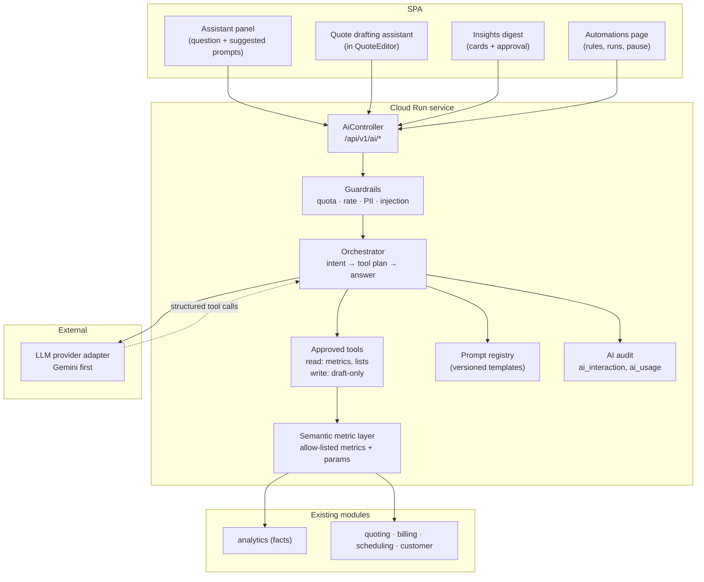

# Operonix — Operonix AI Design

| Field | Value |
| --- | --- |
| Version | 1.0 (proposal — not approved) |
| Date | 2026-10-31 |
| Product surface | "Operonix AI — Your Intelligent Business Assistant" |
| Hard rule | AI never computes approved money, never executes unrestricted SQL, never sends to a customer without human approval |

---

## 1. Principles and non-goals

| Principle | Consequence |
| --- | --- |
| **Deterministic money** | Totals, tax and discounts come from `MoneyCalculator`/tax engine. The model may propose inputs; the engine produces the number |
| **No free-form SQL** | Questions map onto an **allow-listed semantic metric layer** with typed parameters. There is no code path from a prompt to an arbitrary query |
| **Tenant is implicit** | `tenantId` comes from the authenticated session, never from the model, the prompt, or a tool argument |
| **Facts vs interpretation** | Every answer separates *observed data* (from tools) from *model commentary* (clearly labelled) |
| **Human approval for writes** | Anything that reaches a customer or changes price/status requires an explicit user action, and is audited |
| **No training on tenant data** | Provider configuration must disable data use for model improvement; this is a contractual/config requirement per provider |
| **Graceful degradation** | If the model is unavailable, timed out, or over quota, the UI falls back to the deterministic report — the product keeps working |

**Non-goals (this design):** autonomous agents that email customers, model-authored prices written
directly to accepted quotes, chat over arbitrary uploaded documents (RAG deferred), voice, and any
cross-tenant benchmarking ("compare me to other businesses") — the last one is a business/privacy
decision, not a technical one.

## 2. Architecture



### Request lifecycle (interactive "ask")

```
1. Auth: JWT → tenant, user, role            (existing filters)
2. Guard: role allowed? quota left? rate ok? (ai_usage)
3. Intent: classify question → candidate metrics + filters (model, constrained schema)
4. Validate: every metric/param must exist in the registry; tenant-scoped defaults applied
5. Execute: AnalyticsService/metric tools run deterministic, parameterized queries
6. Compose: model narrates *only* the returned numbers (facts block injected verbatim)
7. Verify: numbers in the answer must appear in the facts block (post-check); otherwise replace with the facts table
8. Audit: prompt hash, tool calls, model, tokens, latency, outcome (ai_interaction)
9. Respond: {answer, facts[], citations[], followups[], freshness}
```

## 3. Semantic metric layer (the security boundary)

The layer is a **registry**, not a query builder. Each metric declares its SQL/JPQL, dimensions,
required role, and allowed parameters. The model can only reference registry entries.

| Registry entry (example) | Type | Params | Returns |
| --- | --- | --- | --- |
| `revenue.collected` | metric | `from`, `to`, `groupBy?` | amount, currency, series |
| `revenue.invoiced` | metric | `from`, `to`, `groupBy?` | amount |
| `revenue.by_customer` | metric | `from`, `to`, `limit?` | rows(customer, amount) |
| `receivables.total` | metric | `asOf` | amount |
| `receivables.aging` | metric | `asOf`, `bucketDays` | buckets |
| `invoices.overdue` | list | `asOf`, `limit?` | invoices(id, number, customer, dueDate, balance) |
| `jobs.completed_by_user` | metric | `from`, `to` | rows(user, completed, scheduledHours) |
| `customers.inactive` | list | `days`, `limit?` | customers(id, name, lastActivity) |
| `services.top_profit` | metric | `from`, `to`, `limit?` | rows(service, revenue, cost, margin) *P2, needs cost data* |
| `quotes.expiring` | list | `days` | quotes(id, number, customer, validUntil, total) |

Parameter handling:

* `from`/`to` parsed as `LocalDate`, bounded (max span per metric, e.g. 3 years).
* `limit` capped (default 10, max 50).
* Dimensions are enum-validated (`day|week|month|service|customer|location`).
* **No raw SQL is ever accepted**, so SQL injection through the model is structurally impossible.
* Tenant identity is injected server-side; a model-supplied `tenantId` is ignored.

### Tool schema exposed to the model

```json
{
  "name": "query_metric",
  "parameters": {
    "metric": {"enum": ["revenue.collected", "revenue.invoiced", "receivables.total", "..."]},
    "from": {"type": "string", "format": "date"},
    "to": {"type": "string", "format": "date"},
    "groupBy": {"enum": ["day", "week", "month", "service", "customer", "location"]},
    "limit": {"type": "integer", "minimum": 1, "maximum": 50}
  }
}
```

Provider tool-calling (Gemini function calling) is used for step 3–5; if a provider lacks reliable
tool calling, the orchestrator falls back to strict JSON output validated against the same schema —
the metric layer never trusts the model's phrasing, only its selected metric + parameters.
## 4. Model provider abstraction

| Concern | Design |
| --- | --- |
| Interface | `LlmClient.complete(LlmRequest): LlmResponse` + `supportsToolCalling()`; providers are adapters (`GeminiClient`, `OpenAiCompatibleClient`, `NullClient`) |
| Initial provider | Google Gemini (Vertex AI or AI Studio key), chosen for Cloud adjacency and cost; **not** assumed available — configured per environment |
| Selection | `operonix.ai.provider` + per-task model tier (`fast`, `quality`); tasks declare a tier, not a model name |
| Fallback | On 429/5xx/timeout → retry once with backoff, then `NullClient` (deterministic report, no narration); never surface a raw provider error |
| Timeouts | Interactive: 8 s hard timeout; background evaluations: 60 s |
| Streaming | Not in first release; the response is small enough to wait for |
| Cost controls | Token caps per task, output length caps, prompt caching for static instructions |
| Privacy | Provider account configured for no-training/no-retention-manifest; only the facts block + question are sent, never raw table dumps or PII beyond what the question needs |

The adapter is deliberately thin: swapping providers is a config change plus one class, and the
semantic layer, prompts, guardrails and audit stay identical.

## 5. Use case A — Natural-language reporting

**Example interactions**

| Owner asks | Orchestrator does | Answer shape |
| --- | --- | --- |
| "How much revenue did I make this month?" | `revenue.collected` (this month) + `revenue.invoiced` | "You collected ₹4,12,500 this month and invoiced ₹4,55,000. (as of 09:12)" + facts table |
| "Which customers generate the most revenue?" | `revenue.by_customer` (fiscal YTD, limit 10) | ranked table + narration |
| "Which invoices are overdue?" | `invoices.overdue` (asOf today) | list with days past due + total |
| "Who completed the most jobs this month?" | `jobs.completed_by_user` | table + note that hours are *scheduled* |
| "Which services make the highest profit?" | `services.top_profit` **or** refusal with reason when cost data is missing | explicit "cost data is not captured for X% of jobs" |
| "Compare this month with last month" | two `revenue.collected` calls | delta + direction, with both periods stated |
| "Which customers haven't booked recently?" | `customers.inactive` (90 d) | list + suggested next action (draft only) |
| "What are my bottlenecks?" | `receivables.aging`, `jobs` completion/on-time, `quotes.expiring` | facts, then a clearly separated "interpretation" section |

**Contract:** every response carries `facts[]` (machine-verifiable numbers) and `answer` (prose that
may only cite those numbers). A post-check compares numeric tokens in `answer` against `facts`; on
mismatch the prose is replaced by the facts table and the interaction is flagged for evaluation.

## 6. Use case B — Quotation assistance

| Capability | Mechanic | Guardrail |
| --- | --- | --- |
| Draft from requirements ("weekly clean, 3 floors, 2 bathrooms, Oakland") | Model maps to **existing catalogue items** + quantities; proposes `Line[]` | Suggest-only; user must accept each line |
| Suggest quantities/prices | Historical medians from `invoice_line` for similar services/customers fed as facts | Price must come from catalogue or user input; model cannot invent a price |
| Discount within rules | Business rules config (`max_discount_pct` per role/plan); model proposes ≤ cap | Engine clamps and shows the cap; exceeding requires owner action |
| Write descriptions | Professional wording from service + site facts | Text only; no numbers |
| Improve a quote | Analyzes margin/coverage vs similar accepted quotes | Advisory labels, no auto-edit |
| Speed | Saves to a **draft** only | `QuoteStatus.DRAFT`; `send` remains a human action |

API:

```
POST /api/v1/ai/quote-draft
{ "customerId": "...", "requirementText": "weekly clean ...", "locationId": "..." }
→ 200 {
    "lines":[{"serviceItemId":"...","description":"...","quantity":"1.000","unitPrice":"180.00",
              "taxProfileId":"...","confidence":"high","reason":"matches 'Standard office clean'"}],
    "assumptions":["3 floors, weekly cadence"],
    "warnings":[],
    "requiresReview": true
  }
```

The response contains **proposed inputs**, never computed totals. The editor then calls the existing
pricing endpoint, so the number the customer sees is produced by `MoneyCalculator` exactly as today.

## 7. Use case C — Operational intelligence

| Signal | Source | Detection (deterministic first, model second) |
| --- | --- | --- |
| Revenue fluctuation | `analytics_daily_revenue` | WoW/MoM delta beyond configured band (e.g. ±20%) |
| Declining customer activity | `customers.inactive`, `at_risk` | no invoice in 60/90 days |
| Overdue pattern | `receivables.aging` | overdue share above threshold, or one customer above X |
| Under-utilised worker | `productivity` | scheduled hours below team median by > 30% |
| Frequently delayed jobs | `job.completed_at` vs `scheduled_end` | on-time rate below threshold |
| Bottleneck | quote→job→invoice latency | median days per stage above threshold |
| Recurring opportunity | job recurrence + customer history | recurring pattern without an invoice plan |
| Unusual performance | any metric | z-score/percentile against the tenant's own history |

**Output contract** (this is what keeps it honest):

```json
{
  "insightId": "...", "type": "receivables_overdue",
  "observed": {"overdueAmount": "42000.00", "invoiceCount": 7, "asOf": "2026-10-31"},
  "interpretation": "Overdue invoices have grown for 3 weeks; two customers account for 68%.",
  "recommendation": "Send reminders to Acme and Bolt; consider a deposit policy for Acme.",
  "confidence": "medium",
  "sources": ["receivables.aging", "invoices.overdue"]
}
```

`observed` is computed by deterministic queries. `interpretation`/`recommendation` are model output and
must render in a visually distinct block labelled "AI interpretation". Detections run in the worker on
a schedule (daily) so insight cards are ready before the owner opens the app.

## 8. Use case D — Workflow automation

| Automation | Trigger | Action | Approval |
| --- | --- | --- | --- |
| Payment reminder | invoice overdue by `N` days, no reminder in `M` days | draft email; send on approval (or auto-send if tenant opts in) | approval or explicit opt-in |
| Quote follow-up | quote SENT, no response in `N` days | draft follow-up message | approval |
| Recurring job reminder | upcoming recurring job | notify assigned crew + customer | auto (internal) / approval (customer) |
| Inactive customer win-back | no activity in 90 days | draft message + optional call task | approval |
| Overdue work alert | job past scheduled end, still IN_PROGRESS | notify manager | auto (internal) |
| Suggested action | new insight of high confidence | create task card | approval |
| Scheduling assistance | conflict/overlap detected | suggest alternative slot (deterministic solver), no auto-move | approval |

**Rule model**

```
automation_rule(tenant_id, kind, enabled, trigger_json, action_json, approval_required,
                limits_json, created_by, updated_by)
automation_run(tenant_id, rule_id, subject_type, subject_id, status[PENDING_APPROVAL|APPROVED|
                EXECUTING|SENT|FAILED|SKIPPED], dedupe_key, attempts, error, approved_by,
                scheduled_at, executed_at)
```

Non-negotiables:

1. **Idempotency:** `dedupe_key = rule_id + subject_id + period` — one reminder per invoice per window.
2. **Permission checks:** the approving user must hold the role that permits the action; the runner
   uses a service identity with the *rule owner's* permissions recorded.
3. **Execution history:** every attempt in `automation_run`, every state change in `audit_event`.
4. **Kill switch:** per-rule `enabled`, per-tenant global pause, and a platform-level provider flag.
5. **No self-modifying rules:** AI may *propose* a rule; a human creates/enables it.
6. **Bounded blast radius:** `limits_json` caps sends per day per rule (default 20).

## 9. Security

| Risk | Control |
| --- | --- |
| Prompt injection ("ignore instructions, drop table") | No SQL path exists; tools are enum+typed; system prompt states facts are untrusted data; the model output is never executed |
| Injection via customer data (customer name contains instructions) | All tenant text is passed in a fenced `data` block, truncated, and the model is instructed to treat it as data; numeric facts are injected as structured JSON, not prose |
| Cross-tenant leakage | Tenant id injected server-side; every metric query filters by it; golden test asserts that a prompt naming another tenant returns the caller's own data or a refusal |
| PII exposure | Redaction layer: emails/phones/addresses omitted unless the question requires them; `ai_interaction` stores hashed prompt + redacted excerpt, not raw PII |
| Provider retention/training | Contractual/config toggle; documented in SECURITY_AND_COMPLIANCE_IMPACT.md; tenant-facing disclosure that data is processed by a subprocessor |
| Quota abuse | Per-plan token/tool-call budgets in `ai_usage`; 429 with a clear message; no silent overspend |
| Model hallucinated numbers | Post-check against facts block; prose replaced on mismatch; interaction flagged |
| Audit | `ai_interaction` (user, task, tool calls, tokens, model, latency, outcome, flags) — append-only |
| Secrets | Provider key in Secret Manager; never in the bundle, the repo, or logs |
| Denial of service | Per-user rate limit (e.g. 20 asks/hour), max input length, worker concurrency cap |

## 10. Cost, quotas and observability

| Item | Approach |
| --- | --- |
| Metering | `ai_usage(tenant_id, date, provider, model, task, prompt_tokens, output_tokens, cost_micros, latency_ms, outcome)` |
| Pricing table | Versioned config mapping model → price per 1k tokens (never hardcoded in business logic) |
| Plan quotas | `plan.ai_monthly_tokens`, `plan.ai_features[]`; enforced before the call and reconciled after |
| Caching | Static instructions cached; identical (metric, params) results reused within a TTL; no cache for tenant-specific prose unless keyed by facts hash |
| Model tiering | `fast` for classification/extraction, `quality` for narration and quote drafting |
| Budget alerts | Platform-level daily spend metric in Cloud Monitoring; hard cap in config |
| Dashboards | Requests, p95 latency, failure rate, tokens, cost per tenant, tool-call mix, refusal rate |

## 11. Data model (AI-specific)

| Table | Purpose | Notes |
| --- | --- | --- |
| `ai_interaction` | one row per ask/draft/evaluation | user, task, prompt hash, redacted prompt excerpt, tool calls JSON, model, tokens, latency, outcome, flags |
| `ai_usage` | daily rollup per tenant/provider/model/task | drives quotas and billing |
| `ai_feedback` | user thumbs/up-down + optional comment | evaluation loop |
| `automation_rule` / `automation_run` | automation definitions and history | see §8 |
| `insight` (optional) | persisted daily insight cards | type, observed JSON, interpretation, confidence, dismissed_at |

All rows are tenant-scoped with `tenant_id` as the leading key.

## 12. Failure handling

| Failure | Behaviour |
| --- | --- |
| Provider timeout / 5xx | One retry, then deterministic answer without narration + "AI commentary unavailable" |
| Quota exhausted | 429 `AI_QUOTA_EXCEEDED`; UI offers "view report" (deterministic) |
| Invalid tool call from model | Reject, send one corrective turn with the schema; after 2 failures, fall back |
| Facts/narration mismatch | Prose discarded, facts table shown, interaction flagged |
| Automation send fails | Retry with backoff in worker; after N attempts `FAILED` + manager notification |
| Provider outage (long) | `NullClient` mode; automations pause; `/actuator/health` stays UP (AI is not core) |

## 13. Evaluation and testing

| Test | Type |
| --- | --- |
| Metric registry completeness (every metric has SQL, role, params) | Unit |
| Tool-call validation rejects unknown metric/param | Unit |
| Prompt injection corpus (20+ attempts) must not reach data outside scope | Integration |
| Cross-tenant prompt ("show Acme in tenant B") returns caller data or refusal | Integration |
| Numbers-in-answer post-check | Unit |
| Quota enforcement + metering accuracy | Integration |
| Fallback path (provider disabled) still returns reports | Integration |
| Automation idempotency (same rule/subject/period twice) | Integration |
| Golden prompt/response snapshots for narration tone (non-blocking) | Eval harness |

## 14. Phasing

| Phase | AI scope |
| --- | --- |
| **P2** | Semantic layer over the P1 metrics; "ask" with facts-only fallback; quote-draft suggestions in the editor; audit + usage + quotas; Gemini adapter behind a kill switch |
| **P3** | Scheduled insight cards, automations with approvals, provider comparison, streaming, expanded evaluation harness |
